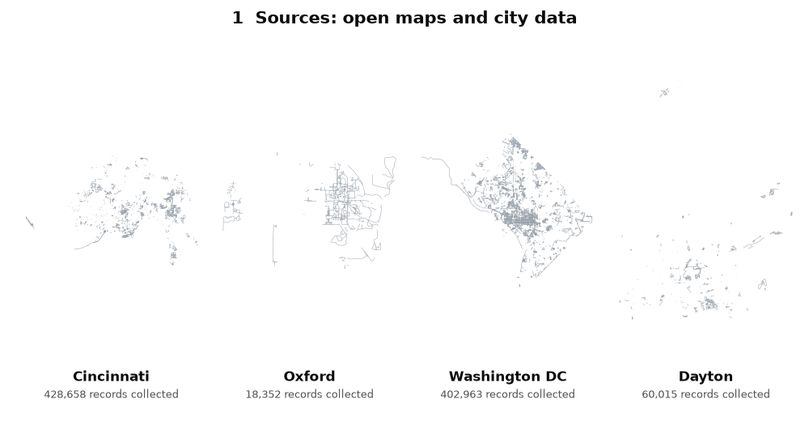
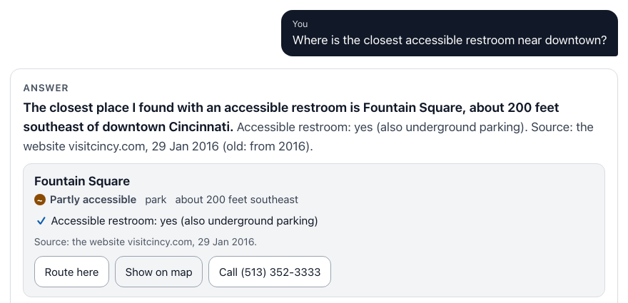
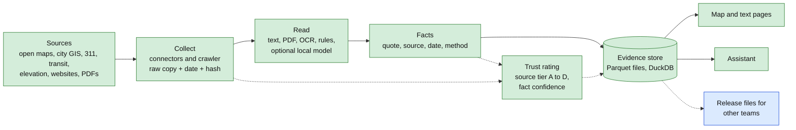
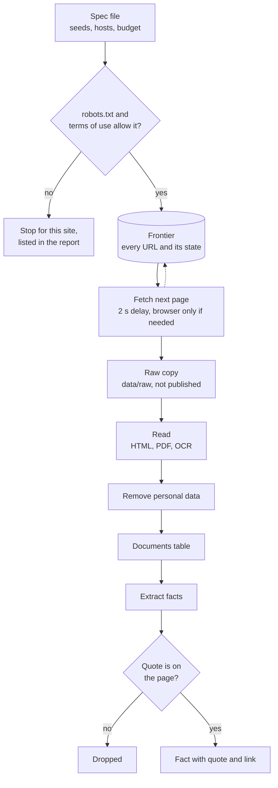
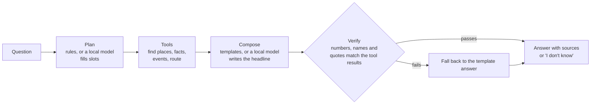

# Accessibility Map

**Collects wheelchair and low-vision access information about places, rates how far each fact can be trusted, shows it on a map, and answers questions from it, with a source for every claim.** A Miami University research project.

> **Try it now: [Open the Oxford map](https://zenaism.github.io/accessibility-map/data/map/oxford.html)** (works on phone and desktop, no install).

<p align="center">

</p>

**Live maps:** [Cincinnati](https://zenaism.github.io/accessibility-map/data/map/cincinnati.html) · [Oxford](https://zenaism.github.io/accessibility-map/data/map/oxford.html) · [Assistant](https://zenaism.github.io/accessibility-map/data/map/ask.html) · [Text-only place lists](https://zenaism.github.io/accessibility-map/data/map/places/cincinnati/index.html) (screen-reader friendly)

The assistant answers from the same facts, with the source in the answer (guided mode, no model; Cincinnati and Oxford only):

<p align="center">

</p>

## What it does

- Collects open data (OpenStreetMap, city GIS, 311, transit, elevation) and venue websites for several regions.
- Turns web pages into **facts**, each with a word-for-word quote, a link and a date. A fact whose quote is not on the page is dropped.
- Rates every source automatically (tiers A to D). Missing information is shown as "unknown", never as "inaccessible".
- Shows places and step-free walking directions on a map and in plain-text lists.
- Answers questions in a chat assistant that uses only these facts and says "I don't know" when it has none.

## Status

Counts are the collected-source totals in [`data/cards/index.csv`](data/cards/index.csv) (rows, not places).

| Region | Records collected | Live today | Not yet |
|---|--:|---|---|
| Cincinnati | 428,658 (25 sources) | map, text pages, assistant (guided mode) | Reddit, regional slope source, walking network (not collected) |
| Oxford | 18,352 (21 sources) | map, text pages, assistant, step-free directions | Reddit, walking network card |
| Washington DC | 402,963 (9 sources) | data only (curb ramps, barriers, bus stops, OSM) | no map page, not in the assistant |
| Dayton | 60,015 (4 sources) | data only (OSM, Overture, city web pages) | no map page, not in the assistant |
| Baltimore / Maryland | 0 | nothing | 57 sources *discovered* ([`source_candidates.csv`](data/candidates/source_candidates.csv)), none collected |

Also true today:
- The assistant is merged into `main` on GitHub (PR #1) and covers Cincinnati and Oxford only. Its question understanding is rule-based; the optional local model needs [Ollama](https://ollama.com).
- "Report a problem" (with photo) is built, but `supabase/problem_reports.sql` is **not confirmed as run** on the real project, so reports may not be stored. See [`docs/problem_reports.md`](docs/problem_reports.md).
- No raw crawled pages or visitor reports are in this repo (see the crawler table below).
- Nothing has been tested with real screen-reader users yet.

## Architecture

Checked against `src/atlas/` on 2026-11-23. Green = built, blue = planned.



Details and the reasons behind each choice: [`docs/system_overview.md`](docs/system_overview.md), [`docs/architecture.md`](docs/architecture.md).

### Crawler



### Assistant



Guided mode (default) uses only the rules and templates and needs no model. "Local model" mode adds Ollama in the plan and compose steps; the verifier runs in both.

## Try it in 5 minutes

Run from a clone. The maps are committed, so you can open them with no setup.

```bash
open data/map/oxford.html           # the Oxford map; no install (map tiles need network)
make setup                          # Python venv, packages, headless browser (network, a few minutes)
make kb                             # build the assistant's DuckDB file from the map data (2 seconds)
scripts/serve_assistant.sh          # chat page at http://localhost:8002 (PORT=8010 to change)
make test                           # test suite (very slow; not verified, see note)
```

- `make kb` and `scripts/serve_assistant.sh` were run from a fresh checkout on 2026-11-23 and worked. `make setup` and the full `make test` were **not verified** for this README (the test run was stopped after more than 20 minutes).
- Needs network: `make setup`, `make data` (downloads all open sources), the map background tiles, any crawl.
- Needs Ollama (optional): "Local model" mode in the assistant and `atlas extract --llm`. Everything else works without it.
- Crawling needs hours and raw data that is not in the repo; see [`docs/crawler_guide.md`](docs/crawler_guide.md).

## How the crawler respects sites and privacy

| Rule | How |
|---|---|
| robots.txt | obeyed on every request, agent name `accessibility-map` |
| Terms of use | usual terms pages are read first; if they forbid bots the crawl of that site stops (limit: only finds terms at the usual addresses) |
| Slow | 2 s between requests to one site, `Crawl-delay` honoured, back off on errors |
| Public pages only | no logins, no CAPTCHAs, private network addresses blocked |
| Personal data | personal-looking emails and phones marked cell or home are replaced before storage; role addresses like `info@` are kept |
| Raw pages | stay on the researcher's computer, git-ignored, never published |
| Opt-out | [about-crawler.html](https://zenaism.github.io/accessibility-map/about-crawler.html); site owners can open an issue and be removed |
| Reddit | only through the official API, never by scraping |

Open items, from [`docs/compliance.md`](docs/compliance.md): no named person yet answers site-owner complaints; no role email on the opt-out page; counsel or library review of releasing page-derived data is not done; the 24-month report retention is a proposal; sites crawled before the terms check existed were checked against robots.txt only. This is a developer policy, not legal advice.

## Ideas for accessibility features

Where a reviewer could help. "Partly" = a first version or only some inputs; "Idea" = written down only. Nothing in the list is finished.

| Idea | Why | What exists | State |
|---|---|---|---|
| Read signs and entrances from photos | door width, steps and signs are rarely in text | a vision step for posters; the assistant can describe a photo with a local model and is told never to certify access | Partly |
| Cross-slope from the wheelchair IMU | elevation data cannot measure cross slope; a moving chair can | slope from USGS elevation; lab recordings exist but are not joined to the map | Idea ([RQ2](docs/research_questions.md)) |
| Harm-weighted evaluation | a false "accessible" costs more than a false "unknown" | question bank, trap and golden cases in [`eval/`](eval) | Partly (no harm weights yet) |
| Screen reader and user testing | the interface is designed for it but untested | text-only pages, 44 px targets, labelled controls | Idea (self-check with VoiceOver planned) |
| Audio route guidance | blind users need crossings and spoken steps | Directions has read-aloud, a "blind" profile that prefers signalised crossings, and voice input | Partly |
| User profiles (chair size, slope limit) | "passable" depends on the person | routing profiles `wheelchair` and `blind`; ADA limit fixed at 8.33% | Idea for personal limits ([`data_needs.md`](docs/data_needs.md)) |
| More regions | the goal is the whole US | region resolver, automatic source discovery; DC and Dayton collected; Baltimore discovered | Partly |
| Fix known interface barriers | small targets, errors not tied to fields | audit in [`docs/ux_brief.md`](docs/ux_brief.md), order of fixes in [`improvement_plan.md`](docs/improvement_plan.md) | Partly |
| Predict outages, fill missing attributes | most places have no tag | history archives (weather, alerts) run hourly | Idea |

## Where things are

```
config/          regions, sources, trust settings, crawl specs
src/atlas/       connectors/, crawler/, extract/, assistant/, trust.py, routing.py, export_map.py
scripts/         figures, extraction, serving the assistant
data/map/        published maps, GeoJSON, text pages
data/cards/      dataset card and trust rating per source
data/extracted/  facts with quotes
eval/            assistant question bank and results
docs/            everything written down
```

[`docs/README.md`](docs/README.md) is the index; start with [`docs/system_overview.md`](docs/system_overview.md). Why choices were made: [`docs/decisions.md`](docs/decisions.md). What was done and when: [`docs/progress_log.md`](docs/progress_log.md). Every source and its status: [`SOURCES.md`](SOURCES.md).

## Data and licences

Saved Google Places details are not published (decision D-41). Data comes from OpenStreetMap (ODbL), Overture Maps, city and state open data, USGS, and quoted facts from public web pages. Each source's licence is on its dataset card in `data/cards/`; the list is in [`SOURCES.md`](SOURCES.md). **The crawled raw pages are not included**, only short quotes with links. The code is MIT-licensed ([`LICENSE`](LICENSE)); the data keeps each source's licence, and the third-party voice files in `data/map/tts/` are described in [`data/map/tts/NOTICE.md`](data/map/tts/NOTICE.md) (one of them, `kokoro-worker.js`, is GPL-3.0 because it contains eSpeak NG).
