# System architecture (diagrams)

Mermaid diagrams, so they render in Obsidian and on GitHub and stay diffable as text. Colour key used in every diagram: **green = exists today** (Cincinnati and Oxford pipeline), **blue = planned** in [`national_data_plan.md`](national_data_plan.md), **grey = external**. Reasons behind the choices are in [`decisions.md`](decisions.md).

## 1. The big picture: four layers

Data flows left to right through four layers. Each layer has one job, and the layer below only trusts what the layer above passes down.

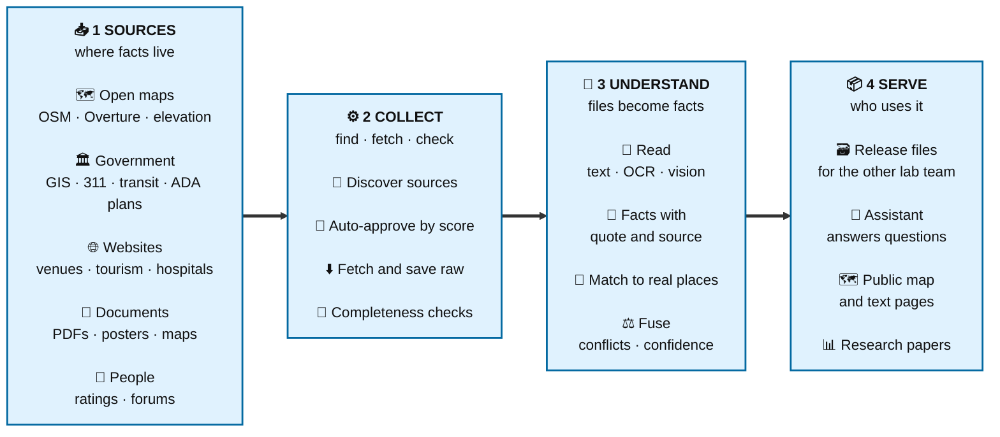

Each box is one layer: the list inside is what it holds or does. Cincinnati and Oxford already run most of layers 1 to 3 plus the map and the assistant tools; discovery, review, completeness checks, matching and fusion, and the release files are planned. See the detailed diagrams below for each part.

## 1b. One fact's journey (a concrete example)

This is what happens to a single sentence on a zoo's website, from the web page to an answer.

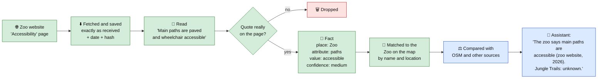

## 2. Discovery: how new sources are found without hand-picking

Four routes feed one candidate table. Nothing reaches the release without passing review.

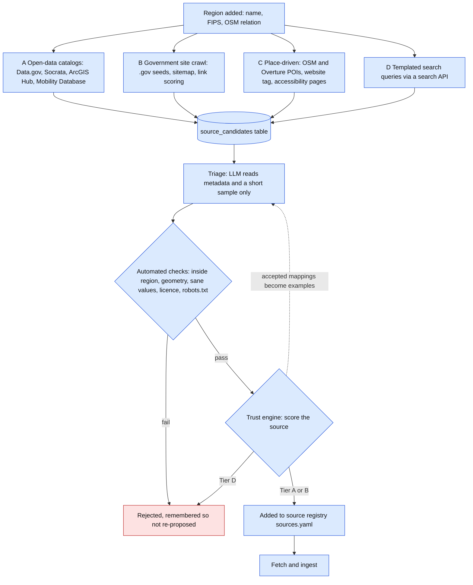

## 3. Multimodal extraction: from raw file to checked claims

Every input type ends as the same thing: claims with a quote or image region, so anyone, or any later check, can verify the original.

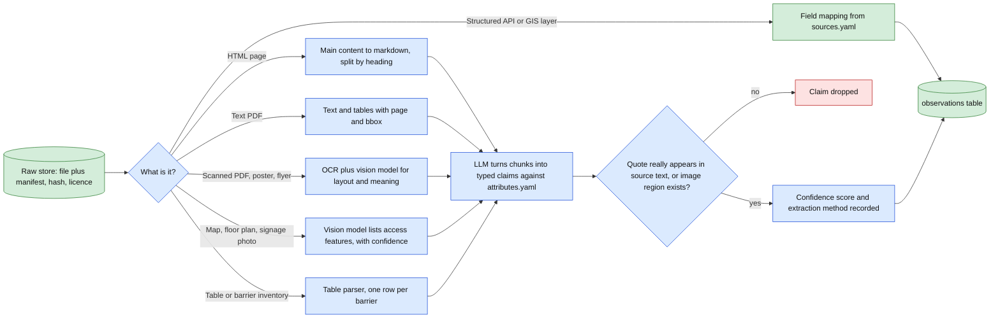

## 4. Data model: what the tables are and how they connect

Every fact is an observation tied to an entity and a source. We keep all observations, including ones that disagree.

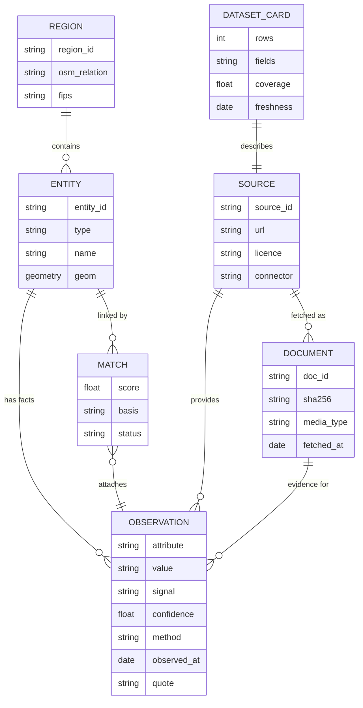

## 5. Storage and release: what the other team receives

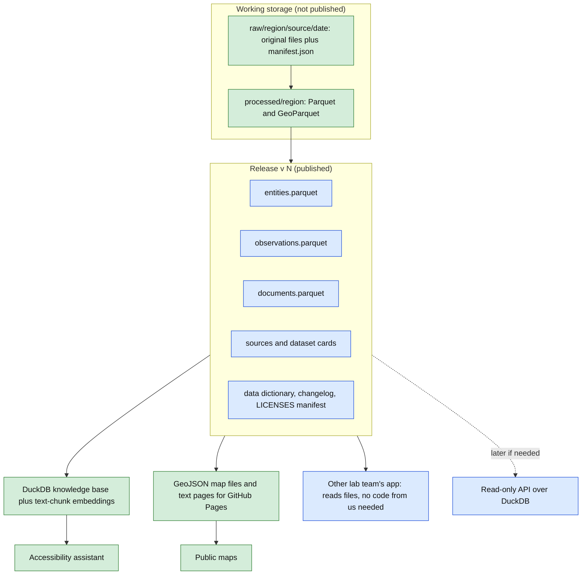

## 6. Assistant at question time

The model never answers from memory. It calls tools; the tools return records with sources; the answer is written only from those records.

_Update 2026-11-20: with no funding for a hosted model, the assistant is built as a fixed pipeline (plan, run tools, compose, verify) with a rules version and a small-local-model version; see section 12 and [`assistant_build_spec.md`](assistant_build_spec.md). The diagram below shows the principle (tools first, sources on every claim), not the final design._

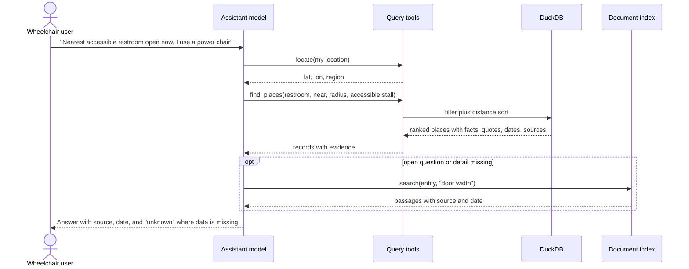

## 7. Adding a new region (what "region in a box" means)

One command per place; the same steps for Maryland, DC, Dayton and later every state.

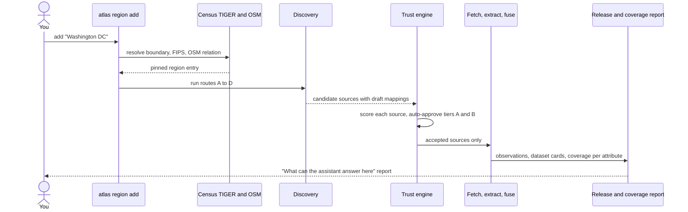

## 8. Review states for a source

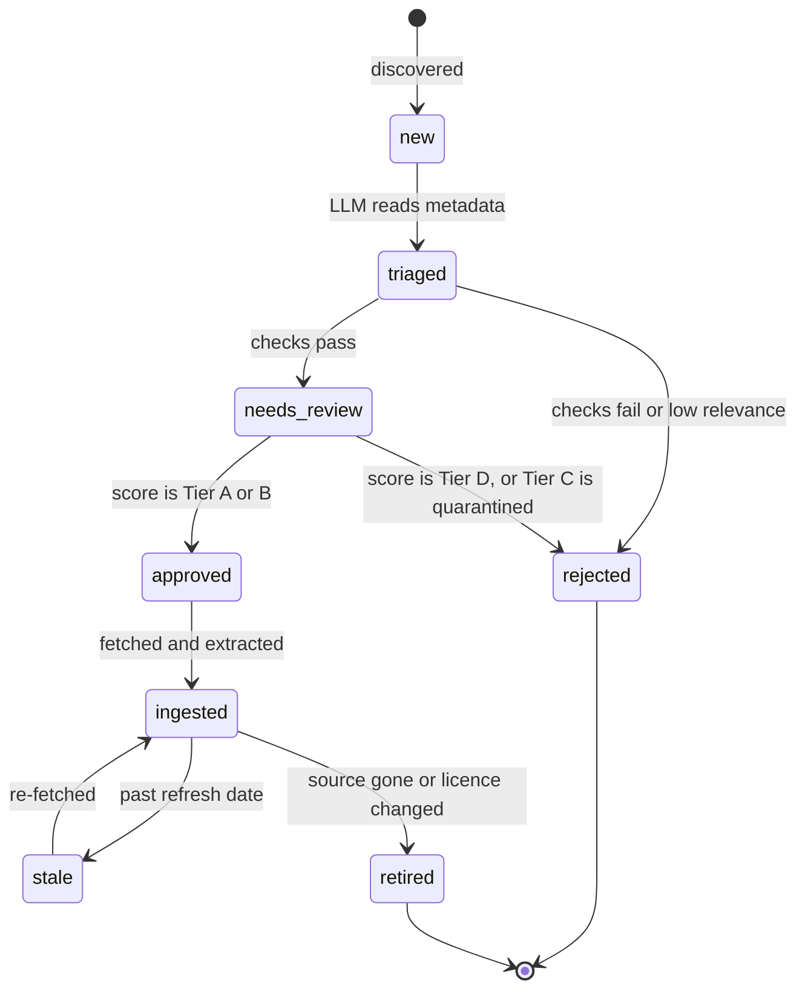

## 9. Fetching everything: the crawl and its completeness gates

The goal is that nothing we might need is silently missed. Every URL we learn about gets a final status, and a source is not "done" until the gates pass.

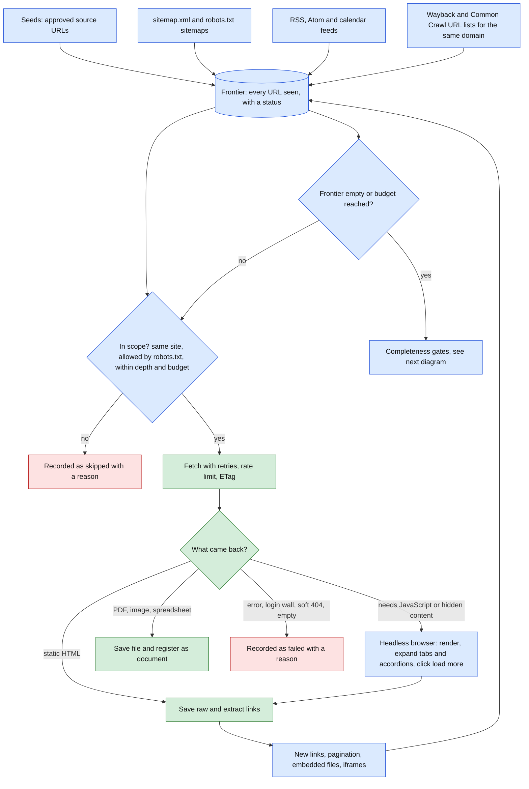

## 10. Completeness gates: how we know we got everything

Each gate compares what we fetched with an independent measure of what exists. Anything that does not match goes to the gap queue instead of being ignored.

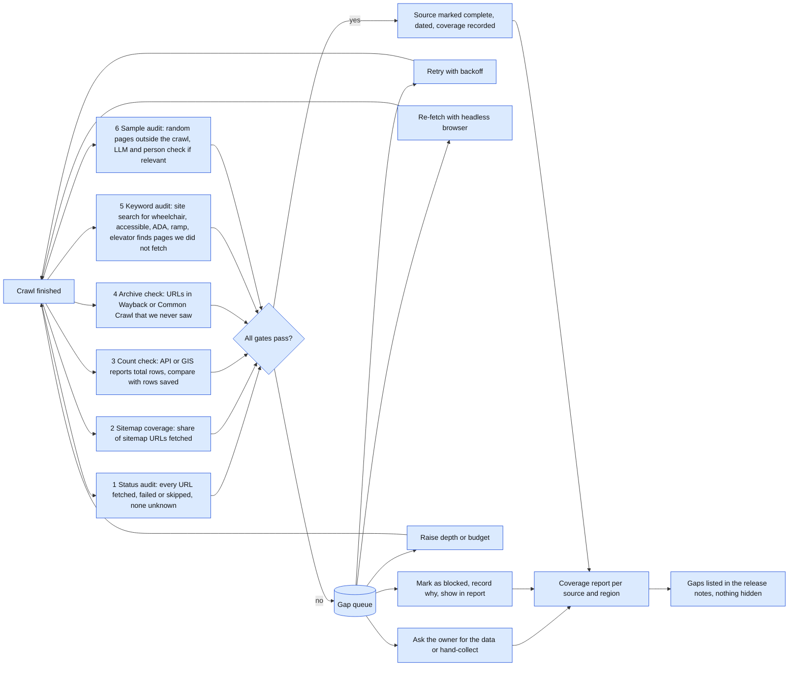

## 11. The zero-budget stack: which free tool does each step

Spend compute only where it pays: cheap rules first, small local models only on pages that pass, cache everything.

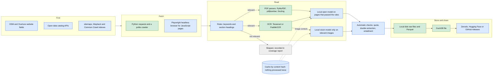

## 12. Delivery: from build to what people use (Openway Assistant and routing)

How the pieces fit from collecting data to the screen. **Green = exists today, blue = planned** (see [`routing_in_browser_plan.md`](routing_in_browser_plan.md), [`assistant_plan.md`](assistant_plan.md) and [`assistant_build_spec.md`](assistant_build_spec.md)). First scope: **Cincinnati and Oxford**; nothing is Ohio-specific in the code, regions come from `config/regions.yaml`, so more regions can be added later.

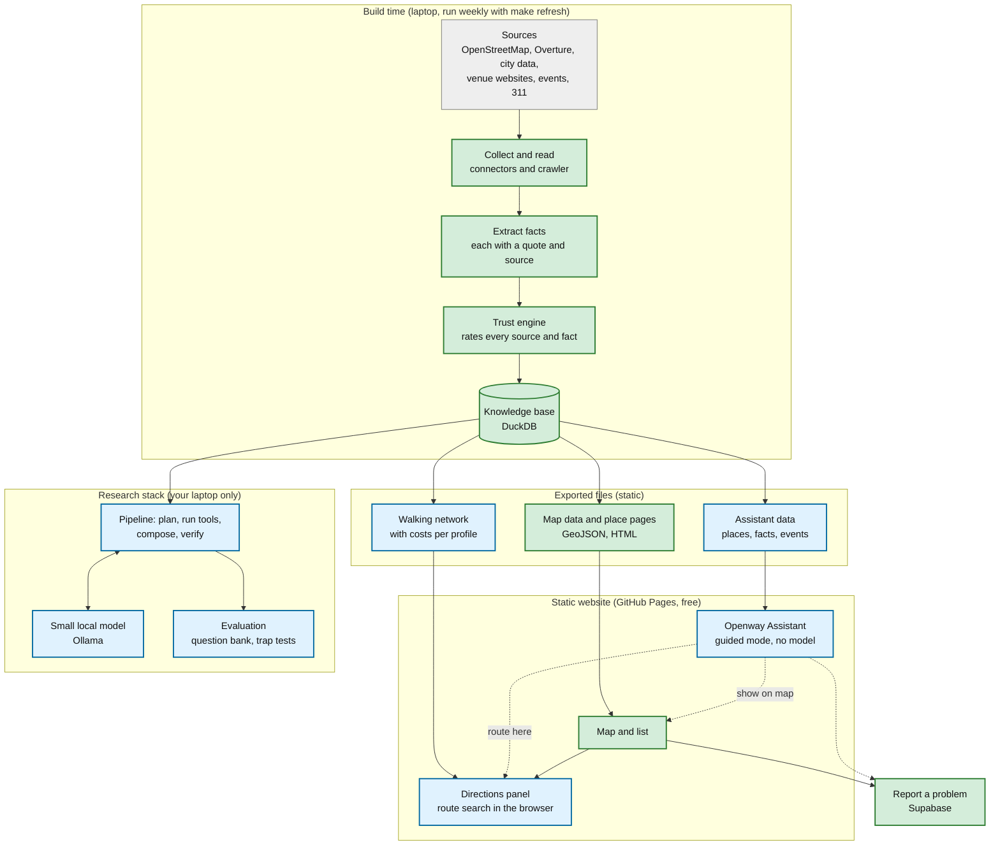

Reading it:

- **One build, three outputs.** The knowledge base feeds the map files, the walking network and the assistant data in the same build, so they never disagree.
- **The public site needs no server and no paid model.** Routing and the assistant's guided mode run in the visitor's browser from the exported files, and questions never leave the device.
- **The research stack is separate.** The same four-step pipeline runs on the laptop with a small local model, so we can measure what a model adds over rules alone.
- **Answers lead to actions.** The assistant can show places on the map, open the Directions panel for a place, or open the report form.
- **Freshness.** The site shows the snapshot date. Events and other fast-changing data are only as fresh as the last `make refresh`; a scheduled refresh is a pending decision.

## 13. UX flows (owner's 8 changes, 2026-11-23)

Full reasoning in [`ux_brief.md`](ux_brief.md). **Green = exists today, blue = planned.**

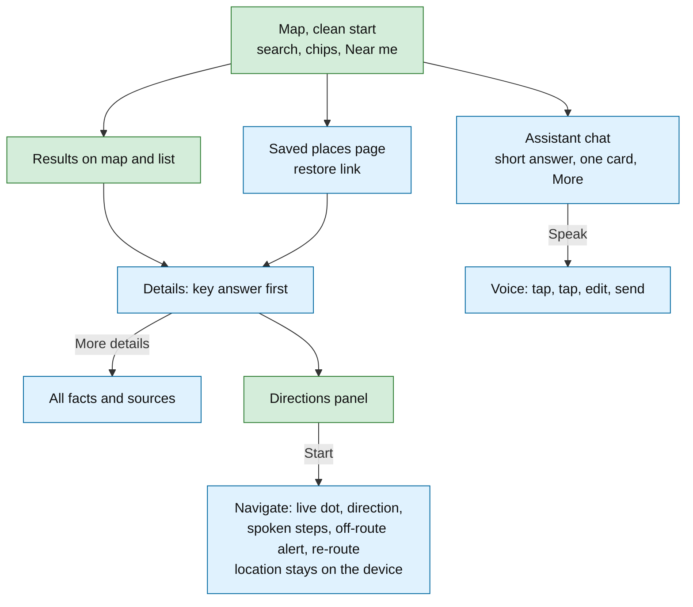

