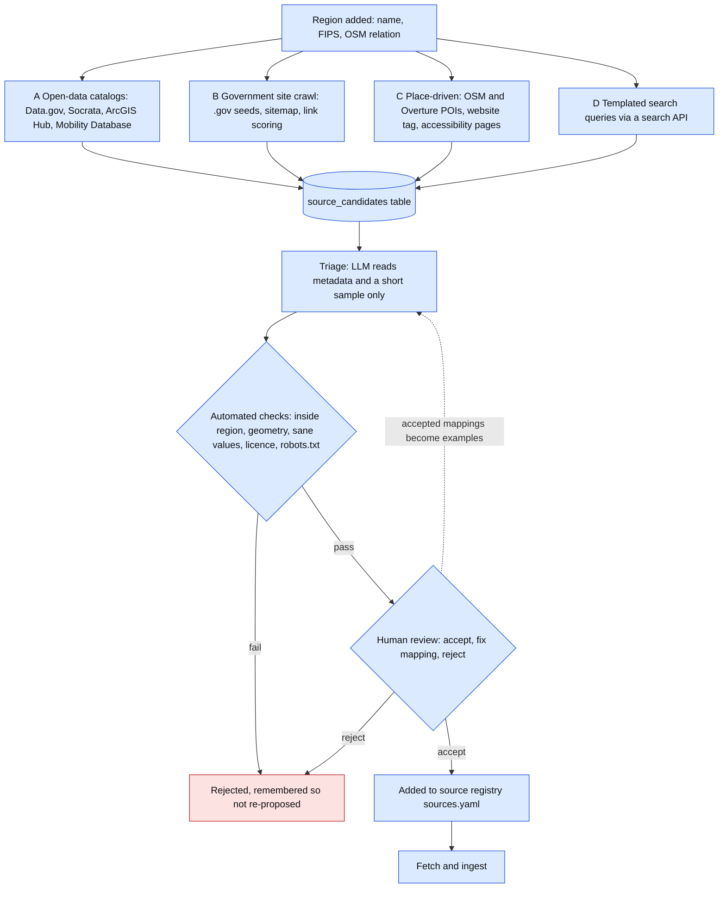
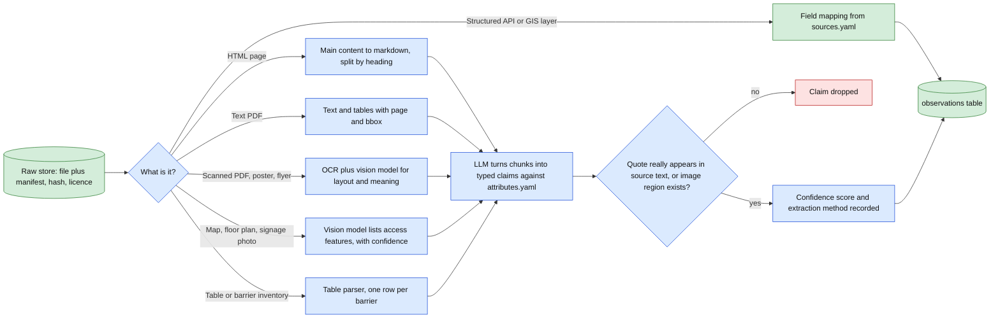
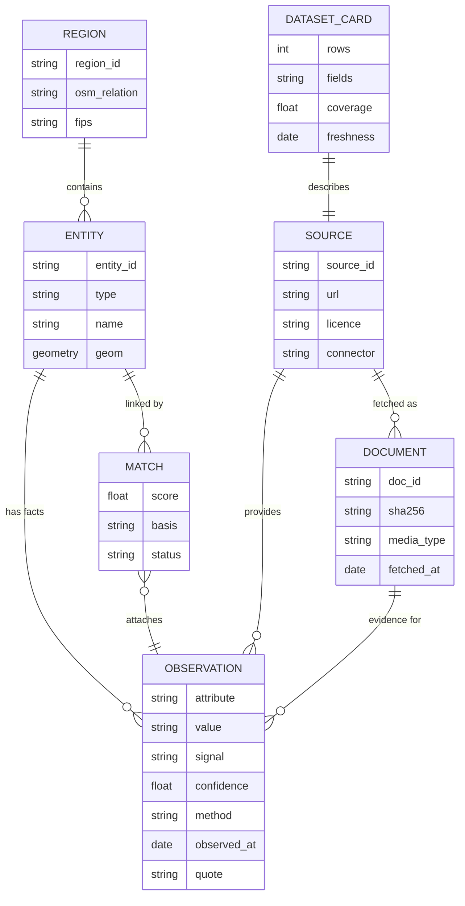
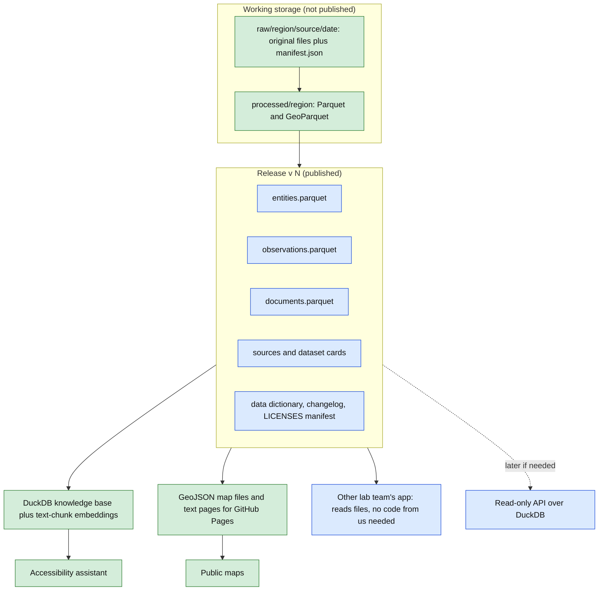
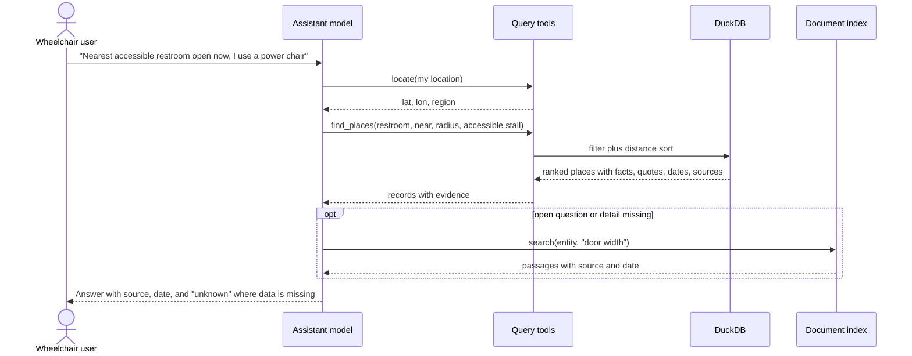
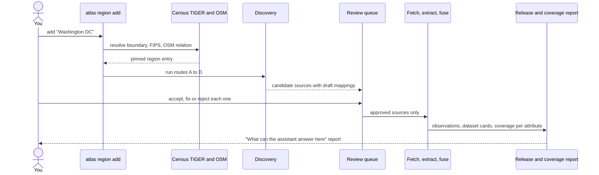
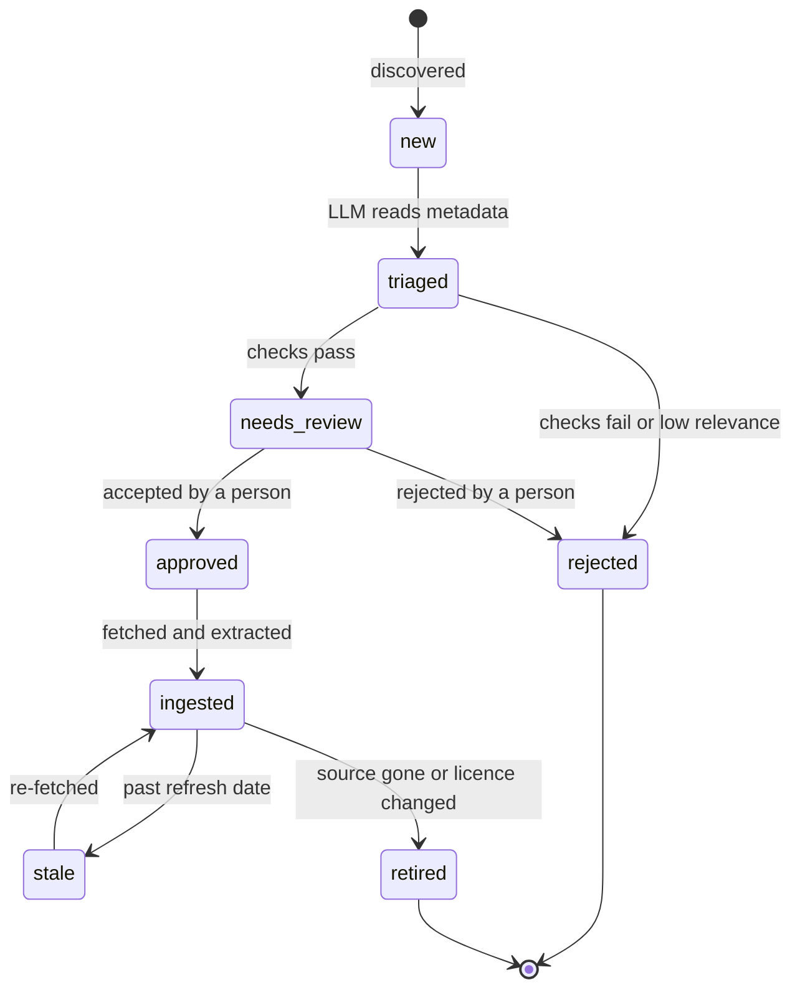

# System architecture (diagrams)

Mermaid diagrams, so they render in Obsidian and on GitHub and stay diffable as text. Colour key used in every diagram: **green = exists today** (Cincinnati and Oxford pipeline), **blue = planned** in [`national_data_plan.md`](national_data_plan.md), **grey = external**. Reasons behind the choices are in [`decisions.md`](decisions.md).

## 1. The whole system in one picture

Read left to right: where data comes from, what we do to it, what comes out, who uses it.

```mermaid
flowchart LR
  subgraph SRC["Sources"]
    direction TB
    S1["Open geodata: OSM, Overture, elevation, Census"]
    S2["Government: city and state GIS, 311, ADA plans, transit GTFS"]
    S3["Venue and tourism websites, hospitals, universities, nonprofits"]
    S4["Documents: PDFs, posters, maps, floor plans"]
    S5["Community: crowd maps, forums, our own ratings"]
  end
  subgraph PIPE["Pipeline"]
    direction TB
    P1["1 Discover sources"]
    P2["2 Review and approve"]
    P3["3 Fetch to raw store"]
    P4["4 Extract: text, tables, OCR, vision"]
    P5["5 Normalize to entities and observations"]
    P6["6 Fuse: dedupe, conflicts, confidence"]
    P1 --> P2 --> P3 --> P4 --> P5 --> P6
  end
  subgraph OUT["Outputs"]
    direction TB
    O1["Versioned release: GeoParquet plus dataset cards"]
    O2["DuckDB knowledge base"]
    O3["Map and text pages"]
  end
  subgraph USE["Users of the data"]
    direction TB
    U1["Accessibility assistant"]
    U2["Other lab team's app"]
    U3["Researchers and papers"]
  end
  SRC --> P1
  P6 --> O1
  O1 --> O2
  O1 --> O3
  O2 --> U1
  O1 --> U2
  O1 --> U3
  O3 --> U3

  classDef built fill:#d4edda,stroke:#2e7d32,color:#111
  classDef planned fill:#dbeafe,stroke:#1d4ed8,color:#111
  classDef ext fill:#eeeeee,stroke:#777,color:#111
  class S1,S2,S4,P3,P4,P5,O2,O3 built
  class P1,P2,P6,O1,S3,S5,U1,U2 planned
  class U3 ext
```

## 2. Discovery: how new sources are found without hand-picking

Four routes feed one candidate table. Nothing reaches the release without passing review.

## 3. Multimodal extraction: from raw file to checked claims

Every input type ends as the same thing: claims with a quote or image region, so a person can verify the original.

## 4. Data model: what the tables are and how they connect

Every fact is an observation tied to an entity and a source. We keep all observations, including ones that disagree.

## 5. Storage and release: what the other team receives

## 6. Assistant at question time

The model never answers from memory. It calls tools; the tools return records with sources; the answer is written only from those records.

## 7. Adding a new region (what "region in a box" means)

One command per place; the same steps for Maryland, DC, Dayton and later every state.

## 8. Review states for a source

