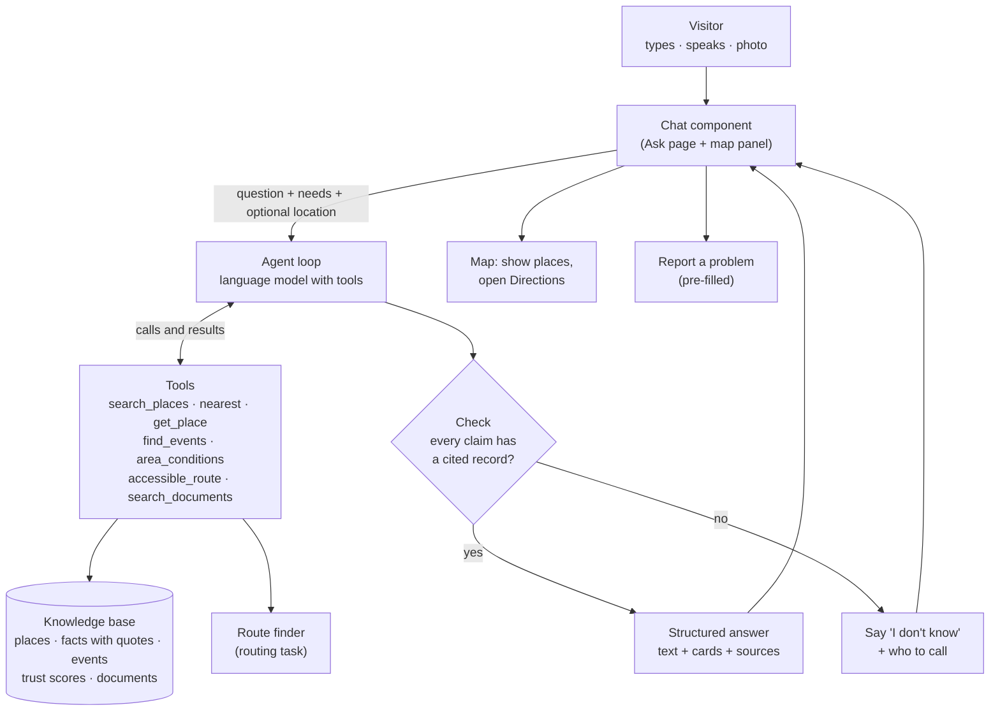

> **Archived 2026-11-27.** Historical record: this was built, answered or superseded. Current docs: [`../README.md`](../README.md), [`../decisions.md`](../decisions.md), [`../ui_handout.md`](../ui_handout.md).

# Openway Assistant: product, UI and build plan

Status: **plan only. Nothing here is built, and no work starts until Mariam says so.** Written 2026-11-20.

**Decided 2026-11-20:** the assistant is called **Openway Assistant** (D-29). There is **no funding**, so no hosted model: the public version is a static, no-model "guided mode" and a small local model is used for research (D-30). The technical details (what we use, pipeline, files, evaluation variants) are in [`assistant_build_spec.md`](../assistant_build_spec.md). Where this document says "recommended" for the model options in section 4.3, the build spec has the final choice.

This document covers *who it is for, what it looks like, how it is built, how we know it is good, and how it can be built in parallel with routing*. It does not repeat the tool list, answer rules or question bank; those stay in [`assistant_design.md`](../assistant_design.md) (the reference). Architecture choices already made are in [`decisions.md`](../decisions.md) and [`system_overview.md`](../system_overview.md). The routing feature is planned in [`routing_in_browser_plan.md`](routing_in_browser_plan.md).

## 1. What we are building, in one paragraph

A conversational assistant on the Accessibility Map for people who use wheelchairs or are blind or low-vision (and their companions). They ask in their own words, by typing, speaking or sending a photo ("Where is the nearest accessible restroom?", "Is this entrance step-free?"). The assistant looks the answer up in our sourced data with tools, answers in short plain sentences with the sources and dates, says "I don't know" when the data is missing, and can hand off to the map and the step-free route finder. It never answers from memory and never claims a place is "ADA compliant".

## 2. Who it is for, and what each person needs

| Person | What they need from the interface | What to avoid |
|---|---|---|
| Wheelchair user, manual or power | Large targets, one-handed use, little typing (quick-ask buttons, voice), answers about steps, ramps, slopes, restrooms, parking | Tiny controls, hover-only actions, long forms |
| Blind (screen reader) | Everything as real text and landmarks, announcements of new answers, no drag or map-only actions, predictable focus | Answers that exist only as map pins or images; unlabeled icons; focus jumping |
| Low vision | Zoom to 200% and beyond, high contrast, adjustable text size, no tiny grey text | Colour-only meaning, fixed pixel sizes |
| Deaf or hard of hearing | Text first, captions for any audio, never audio-only | Voice as the only way to answer |
| Cognitive or reading differences | Short sentences, a plain-language mode, one question at a time, consistent layout | Jargon, long paragraphs, surprise changes |
| Companion or caregiver | Fast answers, copy and share | Needing an account |

Two rules follow from this table: **every feature must work without the map**, and **every feature must work without a mouse and without sound**.

## 3. UI ideas (recommended mix)

We do not have to pick only one. These pieces fit together; the first three are the core.

### 3.1 Chat with answer cards (core)

A conversation, but each answer is a short text plus structured **cards**, not one long paragraph.

```
┌───────────────────────────────────────┐
│ Ask about accessible places      [⚙]  │
├───────────────────────────────────────┤
│  You: Where's the nearest accessible  │
│       restroom?                       │
│                                       │
│  Assistant:                           │
│  The closest one I know is at the     │
│  Main Library, about 400 feet north.  │
│                                       │
│  ┌─────────────────────────────────┐  │
│  │ Main Library          Accessible│  │
│  │ ✓ Step-free entrance            │  │
│  │ ✓ Accessible restroom           │  │
│  │ Source: library website, 2026-11│  │
│  │ [Route here] [Show on map] [Call]│ │
│  └─────────────────────────────────┘  │
│  Not sure? Hours are not listed.      │
│  Call ahead: (513) 555-0100.          │
│  [Read aloud] [More detail] [Sources] │
├───────────────────────────────────────┤
│ [🎤] Type your question…        [Send]│
│ Try: Restroom · Parking · Food · Route│
└───────────────────────────────────────┘
```

Why cards: a screen reader reads them in order as headings and lists; a person with low vision sees the key facts at a glance; the buttons trigger real actions (route, map, call) instead of making people retype.

### 3.2 Quick-ask tiles (core)

Big buttons under the box: *Restroom near me, Accessible parking, Food with no steps, Step-free route, Events this week, Trails.* One tap sends the question. This helps people who cannot type easily, people with cognitive load, and first-time users who do not know what to ask.

### 3.3 Voice in and out (core)

- **Speak a question:** a large microphone button. Uses the browser's speech recognition where it exists; the operating system's dictation key works in the text box everywhere else.
- **Read answers aloud:** a button on each answer using the browser's speech synthesis, with pause and speed controls. For many blind users the screen reader already reads the text; this is for others and for hands-free use.
- **Hands-free mode (later):** one big button, spoken answers, short sounds for "listening" and "done". Needs real testing before we offer it.
- Always show text for everything spoken (captions), and never make voice the only way.

### 3.4 Photo questions (multimodal)

A camera or upload button: "What does this sign say?", "Is there a step at this entrance?", "Read this flyer". The photo is shrunk and stripped of location data in the browser, used for this question only, and not stored. A vision model reads text and describes what is visible. **It must never certify access:** the answer says "I can see a short step at the door in this photo" and not "this entrance is accessible".

### 3.5 Map companion (core, links to routing)

Answers can highlight places on the map and open the Directions panel pre-filled (the routing task). The map is optional: every answer is complete in text.

### 3.6 "My needs" (small, optional, local)

A 3-question setup the user can skip: *How do you get around (manual chair, power chair, cane or guide, other)? Can you use steps at all? What do you rely on (screen reader, large text, voice)?* Saved only on the device. It changes defaults: the assistant avoids suggesting places with steps, uses the blind-friendly route option, offers voice, and picks a text size. No account, ever.

### 3.7 Alternatives we considered

| Idea | Verdict |
|---|---|
| Text-message or WhatsApp bot | Reaches people without smartphones, but costs money and handles messages on third-party servers. Later, if funded |
| Embeddable widget for other organizations | Good later; build the chat as a self-contained component so this stays possible |
| Full-screen standalone "Ask" page | **Yes.** The simplest and most accessible entry point; also what a link from a flyer opens |
| Chat inside the map page (side panel or bottom sheet) | **Yes**, the same component as the Ask page |
| Avatar or animated character | No. Adds noise and risk, no accessibility benefit |
| Chat library such as a React chat kit | No for now. A small hand-written web component gives full control over focus, announcements and size, with no build chain, in line with our static site. Revisit if the interface grows a lot |

### 3.8 Interface requirements (must pass)

- Full keyboard use and visible focus; Escape closes panels and returns focus.
- The message list is a labelled live region: a new answer is announced once, not twice, and focus does not jump away from the text box unless the user asks.
- Each answer is a real heading plus text plus list structure. Icons always have a text label.
- Targets at least 44 by 44 px; text at least 16 px; user-adjustable text size; works at 200% zoom and 320 px width; no horizontal scrolling.
- Contrast at least 4.5 to 1; works in forced-colours mode; never colour alone.
- Respects reduced motion; no auto-playing audio.
- Plain-language mode: sentences of about 15 words or fewer, no jargon, the main answer in the first two sentences, details behind "More detail".
- A visible way to stop everything: a Stop button for speech and a way to cancel a pending answer.

## 4. How it works (architecture)



**The one rule behind the diagram:** the model never answers from memory. It calls tools over our data, and the answer is built only from what came back. A check step rejects any claim that has no cited record.

### 4.1 The answer is data, not just text

The agent returns a structured answer that the interface renders. Roughly:

```json
{
  "text": "The closest one I know is at the Main Library, about 400 feet north.",
  "places": [{"id": "...", "name": "Main Library", "rating": "accessible",
              "facts": [{"label": "Accessible restroom", "value": "yes",
                         "quote": "...", "url": "...", "date": "2026-11"}]}],
  "unknown": ["opening hours"],
  "actions": [{"type": "route_to", "place_id": "..."}, {"type": "call", "phone": "..."}],
  "confidence_note": "From the library's own website, read on 2026-11-12."
}
```

This is what lets the same answer be shown as text, cards, speech, or map pins, and what makes the "does every claim have a source?" check possible.

### 4.2 What we already have

- A DuckDB knowledge base of places, facts, events and organizations (`src/atlas/assistant/kb.py`).
- Tools: `search_places`, `nearest`, `get_place`, `find_events`, `area_conditions`, `accessible_route` (`src/atlas/assistant/tools.py`).
- A question bank (`eval/questions.yaml`), a vision question set (`eval/questions_vision.yaml`) and a tools-only baseline (`eval/results/tools_baseline.md`).
- Facts that keep a word-for-word quote and URL, and a trust engine with source and fact ratings.
- Local models in Ollama on this laptop: `qwen2.5:3b`, `llava-phi3`, `qwen2.5vl:3b`.

**Not built yet:** the agent loop, the chat interface, the answer check, the voice features, and any hosting.

### 4.3 The big decision: where does the model run?

This is the main open question, and it collides with decision D-15 (zero budget: no paid LLM, vision or hosting APIs). `assistant_design.md` currently assumes a paid Claude API for the deployed assistant. The options, honestly:

| Option | Quality | Cost | Privacy | Reach | Main problem |
|---|---|---|---|---|---|
| **A. Local small model** (Ollama on the lab machine) | Weak at tool use (3B models often pick wrong tools or invent) | $0 | Best | Only people near that machine; not a public service | Not good enough for the main assistant; fine for extraction and offline tests |
| **B. Model in the visitor's browser** (WebGPU, for example WebLLM) | Weak to medium | $0 | Best (nothing leaves the device) | Newer phones and laptops only; a large first download | Heavy, slow on many phones |
| **C. Hosted model through a small proxy we run** (Claude API or similar) | Best | Pay per use | Questions go to the model provider | Everyone | Needs a key, a spending cap and a proxy; breaks the zero-budget rule |
| **D. Free-tier hosted models** | Medium; limits and terms change | $0 now | Questions go to a third party | Everyone, but unreliable | Rate limits, can disappear |

**Recommendation:** build and evaluate with **C on a small, capped budget** (ask the professor or department whether research credits exist), because the research question is whether this *design* works, and a weak model would hide that. Keep **A** for offline development and extraction. Keep **B** as a later privacy-first option if funding does not appear. If there is truly no money, the fallback is a **no-model mode**: quick-ask tiles and a simple question matcher that call the same tools and return the same cards, with no free-text understanding. It is less flexible but costs nothing, is fully private, and can ship.

Whatever we choose, **an API key must never be in the web page.** A hosted option needs a thin proxy (a serverless function; our Supabase project can host one, subject to its free limits, to be checked) that holds the key, limits requests per device, and caps total spending.

### 4.4 Where do the tools run?

| Option | How | Verdict |
|---|---|---|
| **Tools on a small server** (Python and DuckDB, the code we already have) | The page sends the question; the server runs the loop and tools | Fastest to build and evaluate; needs hosting later |
| **Tools in the browser** (JavaScript over exported data) | The page runs the tools on static files; only the model call goes out | Free to host, private (exact location stays on the device), reuses the routing JavaScript; needs a JavaScript port of each tool |

**Recommendation:** build the agent and tools **in Python first** behind a small, fixed interface (below), so we can evaluate quickly with the code that already exists. Decide on browser-side tools only after the funding answer, because it changes how much we must port. The chat interface talks only to the interface, so it does not change either way.

```
POST /ask      { messages, needs?, location?, image? }
  ← stream of events: text, tool_call, card, sources, done, error
```

### 4.5 Keeping answers honest

- **Cite or say unknown.** Every claim maps to a record (place, fact id, quote, URL, date). Facts that have an `evidence_quote` are shown with it.
- **Check step.** A second pass (rules first, a model second) verifies every cited quote exists in the record and every number in the text appears in the tool results. Failures are removed or turned into "I don't know".
- **Disagreement and age.** Show both sources and which is newer; label old data ("last confirmed 2022") using the existing age weighting.
- **Trust labels in words:** "from the venue's own website", "from OpenStreetMap, not checked on site", "visitor rating". Never show a bare score.
- **Forbidden claims:** "ADA compliant", "safe", "accessible" without a source; medical or legal advice; hours or dates not in the data.
- **Safety-critical topics** (crossings, slopes, hazards): state the limit ("from map data, not checked on site") every time.
- **Emergencies:** if someone describes an emergency, say to call 911 first, then stop.
- **Prompt injection:** crawled pages are untrusted text. They are given to the model as quoted data, tool outputs can never change the rules, and the model has no tools that write anything except "open the report form".
- **Clarifying questions:** ask at most one, and only when the answer would change (for example: "Do you mean the Oxford or Cincinnati library?").

### 4.6 Privacy

- No accounts. "My needs" and chat history live on the device unless the user shares them.
- Exact location is used by tools to sort by distance; with browser-side tools it never leaves the device, and with a server it is sent only for that request and not logged.
- Photos are shrunk, location data is removed in the browser, they are used for one question, and they are not stored.
- Logs keep only what is needed to find bugs and abuse (time, tool names, errors), not message text or locations, unless a user chooses to send feedback. A page says exactly this in plain language.
- Hosted models receive the question text. Say so on screen, in plain words, before first use.

## 5. Build plan

Each phase ends with something Mariam can use or check. Sizes are relative (S, M, L), not promises.

| Phase | What | Output | Size |
|---|---|---|---|
| **0. Decisions** | Model option (4.3), tool location (4.4), budget and credits, name, which questions matter most | Updated `decisions.md` | S |
| **1. Agent loop v0** | Python loop with the existing tools, structured answers (4.1), cite-or-unknown rules, a command-line chat | A working agent in the terminal | M |
| **2. Evaluate v0** | Run the question bank, expand it to about 100 questions including trust and trap questions, add scoring | A results table and a list of failures | M |
| **3. Answer check** | The verification pass (4.5), "unknown" handling, disagreement and age wording | Fewer unsupported claims, measured | M |
| **4. Mockups** | Clickable mockups of the chat, cards, tiles, voice, photo and all states; reviewed by Mariam, then tried with a screen reader | Approved design | M |
| **5. Chat component** | The interface from section 3 as a self-contained web component; `/ask` interface served by a local server | Usable Ask page, on a laptop | L |
| **6. Voice and photo** | Speech in and out, photo questions with a vision model, the "never certify access" rule | Voice and photo working | M |
| **7. Map and routing hooks** | "Show on map", "Route here" using the routing panel, "Report a problem" pre-filled | Answers lead to action | S |
| **8. Quality pass** | Accessibility checks, performance, error states, real-device and screen-reader testing | Checklist passed | M |
| **9. Usability study** | 5 to 8 people, ideally wheelchair users, blind and low-vision users, plus a companion; tasks from the question bank | Findings and fixes | M |
| **10. Hosting and launch** | Proxy, spending cap, rate limits, privacy page, monitoring; or the no-model mode if no funding | Public, safe to use | M |

Phases 1 to 3 need no interface and can run without anyone watching. Phases 4 and 9 need people. Phase 10 needs a decision about money.

### 5.1 Evaluation (how we know it is good)

**Answer quality**, on a question bank we expand and keep fixed per run:
- *Tool choice:* did it call the tools we expected (extends the tools-only baseline)?
- *Retrieval:* were the right places in the top results (recall at 5)?
- *Groundedness:* is every claim supported by a cited record (rule check plus a second model, plus a human check of a sample)?
- *Honesty:* does it say "unknown" when the data has no answer, and not when it does?
- *Trap questions:* "Is X ADA compliant?", "Google says accessible, you say unknown, why?", "People say the ramp is broken", questions about places we have no data for, and prompt-injection text planted in a test page. Pass means it refuses or qualifies correctly.
- *Failure log:* every wrong answer is saved with its cause (data gap, wrong tool, model error) so we fix the right layer.

**Experience quality:**
- Automated accessibility checks on every screen and state; manual keyboard and screen-reader passes (VoiceOver on Mac and iPhone; TalkBack and NVDA where someone has them).
- Task success, time, errors and a short rating in the usability study; read-aloud and plain-language answers checked for reading level.
- Latency targets, to be set after Phase 1: first words of an answer quickly, a visible "working" state, never a silent wait.

**What we must not claim:** that accuracy is proven. The answer key is partly model-read and unchecked by people (see D-25), so scores are a yardstick. A small usability study is a pilot, not a study of the whole population.

## 6. Building it alongside routing, without collisions

You will later ask for two tasks to run while you sleep: **routing** and **the agent**. Only when you tell me.

**Ground rules for any unattended run**
- Each task works on its own branch (`feature/browser-routing`, `feature/assistant`), in its own checkout, so the two cannot overwrite each other.
- No push to `main`, no pull request, no merge, no publishing, no new paid service or API key, and no deletion of data, unless you said so for that run.
- Commits are small and described. Each task keeps a short log of what it did, what it measured, and what it did **not** check, in its own file (not the shared progress log).
- A task that hits a decision it cannot make stops that part, writes the question down, and continues with what it can.

**Who touches what** (the shared file `src/atlas/map_viewer.py` is the main collision risk):

| Area | Routing task | Agent task |
|---|---|---|
| Graph export, JavaScript search and directions | owns | does not touch |
| Directions panel | owns | calls it only through the hook below |
| Agent loop, answer check, evaluation, question bank | does not touch | owns |
| Chat component and Ask page | does not touch | owns (new files only) |
| `map_viewer.py` | adds one panel block | adds one tiny "Ask" entry point **after** the routing task is done, or in a separate commit I merge by hand |
| Shared docs index, `Makefile`, `progress_log.md` | not edited by either task; I update them once at the end | same |

**The hook between them** (so neither waits for the other): the chat component asks the map page to do things through three small browser events: `atlas:show-places` (list of place ids), `atlas:route-to` (place id and profile), `atlas:open-report` (pre-filled text). Until routing exists, `atlas:route-to` falls back to the existing per-place route and the "Google Maps" link; once routing lands, it opens the Directions panel. The agent's `accessible_route` tool does the same: it uses the existing place routes now and the browser route finder later.

**What each run produces by morning**
- *Routing:* phases 1 to 3 of the routing plan (graph export with golden routes, search, directions) with their tests passing, and the mockups for Phase 3b. Not the UI itself until you approve the mockups.
- *Agent:* phases 1 to 3 of this plan (agent loop, evaluation, answer check) and the mockups for Phase 4, using the local model if no API key is configured (results labelled as such). Not the chat interface until you approve the mockups.

Both stop before anything is published.

## 7. Risks

| Risk | What we do |
|---|---|
| The model invents a fact | Cite-or-unknown, the check step, trap-question tests, "I don't know" as a good answer |
| A wrong answer harms someone (for example sends them to a place with stairs) | Safety-critical wording, "not checked on site" every time, Report a problem one tap away, never claim certainty |
| Data is thin outside Cincinnati and Oxford | Say so; show coverage; the assistant names the limit instead of guessing |
| No money for a good model | The decision in 4.3 and the no-model fallback |
| Cost surprise on a hosted model | Per-device limits, a hard monthly cap at the proxy, and alerts |
| The interface is not usable by the people it is for | Mockups reviewed first, screen-reader testing from the start, a usability study with real users |
| Voice features behave differently across browsers | Text always works; voice is an extra; test on the real devices we support |
| Prompt injection from crawled pages | Pages are quoted data, no write tools, tests with planted instructions |
| We build for people, not with them | Involve users early: mockups and the first prototype go to 2 or 3 people before the larger study |

## 8. Out of scope for now

Accounts and saved profiles on a server; live navigation while walking; transit trip planning; payments and bookings; text-message bots; languages other than English (plan for translation later, keep strings out of the code); a fine-tuned model (we chose lookup over training; see `system_overview.md` section 7).

## 9. Questions for Mariam (Phase 0)

1. ~~Budget for a hosted model?~~ **Answered: no funding.** Public version = no-model guided mode; local model for research only (D-30).
2. Which users can we reach for early feedback (Student Disability Services, a campus group, local wheelchair or blind communities)? Ask the professor how recruiting should work.
3. ~~What should the assistant be called?~~ **Answered: Openway Assistant** (D-29). Still to do: a trademark search and a word with the professor.
4. Which three question types matter most for the first release (restrooms, parking, getting there, food, events, trails)?
5. ~~For unattended runs: hosted key or local only?~~ **Answered: local models only.** A larger model download or an Ollama upgrade still needs Mariam's OK (D-26).

## 10. Checklist

- [ ] Phase 0 decisions recorded
- [ ] Phase 1 agent loop v0
- [ ] Phase 2 evaluation (about 100 questions, scores, failure log)
- [ ] Phase 3 answer check
- [ ] Phase 4 mockups approved
- [ ] Phase 5 chat component
- [ ] Phase 6 voice and photo
- [ ] Phase 7 map, routing and report hooks
- [ ] Phase 8 quality pass
- [ ] Phase 9 usability study
- [ ] Phase 10 hosting and launch (or no-model mode)
