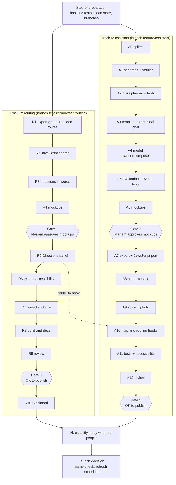

> **Archived 2026-11-27.** Historical record: this was built, answered or superseded. Current docs: [`../README.md`](../README.md), [`../decisions.md`](../decisions.md), [`../ui_handout.md`](../ui_handout.md).

# Implementation plan: routing and Openway Assistant (Cincinnati and Oxford)

Status: **plan only. No work starts until Mariam says so.** Written 2026-11-20.

This is the **work order**: the exact steps, their order, what each produces, how each is checked, and where Mariam must approve. Reasons and designs live in the other documents and are not repeated here:

| Topic | Document |
|---|---|
| Routing design and UX | [`routing_in_browser_plan.md`](routing_in_browser_plan.md) |
| Assistant product, UI, evaluation | [`assistant_plan.md`](assistant_plan.md) |
| Assistant technical design | [`assistant_build_spec.md`](../assistant_build_spec.md) |
| How the pieces fit | [`architecture.md`](../architecture.md) section 12 |
| Decisions | [`decisions.md`](../decisions.md) (D-29, D-30) |

**Scope:** Cincinnati and Oxford only. Routing starts with Oxford. Nothing in the code is Ohio-specific. More regions come after both tracks work and are tested.

## 1. Overview

Two tracks that share one foundation and are built in parallel on separate branches. Diamonds are **gates**: nothing past a gate starts until Mariam approves.

Overnight runs (only when Mariam asks): **Run 1** = Step 0, R1 to R4, A0 to A6 (everything up to the two mockup gates). **Run 2** (after the gates) = R5 to R9, A7 to A12. Humans-only items are in section 6.

## 2. Working agreements (apply to every task)

**Branches and checkouts**
- Two git worktrees so the tracks cannot overwrite each other:
  `git worktree add ../accessibility-map-routing -b feature/browser-routing`
  `git worktree add ../accessibility-map-assistant -b feature/assistant`
- Never push to `main`, never open a pull request, never merge, never publish. Pushing a feature branch only when Mariam allows it for that run.
- Small commits with plain messages saying what and why.

**Environment gotchas to handle in Step 0** (found by reading the repo, to be verified)
- `data/processed/` and `data/kb/` are git-ignored, so a worktree does not contain them. Point worktrees at the main checkout's data with `ATLAS_PROCESSED_DIR` and `ATLAS_RAW_DIR` (supported in `src/atlas/core.py`). The knowledge base path is fixed relative to the checkout, so run `make kb` in the assistant worktree (it builds from the tracked `data/map` files).
- The Python package is installed in editable mode from the main checkout. In a worktree, run with `PYTHONPATH=src` and confirm with `python -c "import atlas; print(atlas.__file__)"` that the worktree's code is the one imported. Use the main checkout's `.venv`.
- The repository's git history is about 17 MB today. A graph file of several MB must **not** be committed on every experiment. During development write it to an untracked folder; commit the final file once, at publish time.

**Checks every task must pass before it is called done**
1. `ruff check` and `ruff format --check` (line length 110, from `pyproject.toml`).
2. `make test` (`pytest -q`) passes; new code has tests; the baseline count recorded in Step 0 has not dropped.
3. JavaScript tests pass with `node --test` (Node 22 is installed).
4. The task's own acceptance check in this plan.
5. The track's work log updated: what was done, what was measured, what was **not** checked.

**Honesty rules:** measured numbers are labelled with what they were measured on; anything not tested says so; a failing test is reported, not hidden; no claim that an access feature is "ADA compliant".

**Work logs and reports:** each track writes to its own file (`docs/work_logs/routing.md`, `docs/work_logs/assistant.md`) so the shared `progress_log.md`, `docs/README.md` and `Makefile` are edited once, by me, at the end. After each run I write `docs/work_logs/RUN-<n>.md`: done, tests, not checked, decisions needed.

**Stop conditions for unattended runs:** stop that part and write the question down if a task needs a paid service, a model download or upgrade, a change to `main`, deleting data, or a decision not covered here.

## 3. Step 0: preparation (before either track)

| # | Task | Output |
|---|---|---|
| S-0.1 | On a clean checkout of `main`, run `make test` and `ruff check`; record the number of tests passing and any failures | Baseline in the work logs. (Not measured yet. The last full suite run I know of was before the Phase 0 fixes.) |
| S-0.2 | Review what is uncommitted on `main` (Mariam decides): the Blink URL fix in `config/sources.yaml`; new docs; `config/crawl/oxford_city.json`; 60 regenerated `data/cards/*.json` files that differ only in `age_days`; stray files (`Untitled*.base/.canvas`, `2026-11-15.md`, `finish_cleanup.sh`, `logs/`, `data/ledger/`) | A clean tree to branch from. I do not commit or delete anything without an OK |
| S-0.3 | Create the two worktrees, set the data paths, verify the right code is imported, run the baseline tests inside each worktree | Both worktrees pass the baseline |
| S-0.4 | Create the work-log files and a one-page "how to run each track" note | Ready to log |

## 4. Track R: routing

Design and UX details: `routing_in_browser_plan.md` (sections 3 to 5). Here are the steps.

| # | Task | Files | Acceptance check |
|---|---|---|---|
| R1 | Export the walking network with costs per profile, Oxford first; generate 20 golden routes from Python | `src/atlas/export_routing.py`, `tests/test_export_routing.py`, `tests/golden_routes_oxford.json`, an `atlas.cli` entry | Deterministic output, no NaN, all edge endpoints exist, stair edges kept with no cost; **size printed** (raw and gzipped); golden file has 20 pairs covering stairs avoided, crossings, too-far, stairs-only |
| R2 | Route search in JavaScript: load graph, snap to nearest node (150 m limit), A* for both profiles, shortest-with-stairs for the comparison | `src/atlas/web/routing.js`, `tests/js/routing.test.js` | `node --test` reproduces the node path of every golden route |
| R3 | Directions in words: line-for-line port of `_legs`, `_turn`, `_feet`, `_crossing_words`, `_describe`, `_summary`, crossing counts, comparison sentence | `src/atlas/web/directions.js`, `tests/js/directions.test.js` | Exact string equality with the golden `directions`, `length_feet`, `compared_with_shortest`, `crossings_text` for all 20 pairs, both profiles |
| R4 | Clickable mockups of the panel: desktop and phone, every state in the plan (section 4.5), using the map's real colours | `docs/mockups/routing/*.html` (not shipped) | Opens locally; covers all 11 states |
| **Gate 1** | Mariam approves or changes the mockups. **Nothing below starts before this.** | | |
| R5 | Directions panel: fields with combobox, "my location", pick on map, swap, profile choice, summary, steps list, map line with icons, Web Worker, load-on-demand, error states, copy link | `map_viewer.py` (one block), `src/atlas/web/panel.js`, CSS | Works in a real browser on the Oxford map; all three ways to pick a start |
| R6 | Tests: Playwright browser tests (route found, errors, keyboard only, phone size), axe-core on every state, focus order, 320 px and 200% zoom | `tests/test_directions_ui.py` | All pass; no accessibility violations on any state |
| R7 | Measure graph size, parse time, search time (short and long route, laptop and CPU-throttled) against the plan's targets | numbers in the work log | Targets met, or the gap stated |
| R8 | Add the export to `make map`; update README, `data/map/README.md`, architecture, Help text | docs | Fresh clone builds and tests pass |
| R9 | Review: `ruff`, `/code-review`, ten real Oxford routes compared by hand with Python output and with the streets Mariam knows | review notes | Findings fixed or listed |
| **Gate 3** | Mariam says OK to publish (commit the final graph, push the branch) | | |
| R10 | Cincinnati: measure size and speed; contract the graph or tile it if needed; keep the old per-place routes as fallback if limits are not met | work log | Meets the plan's limits (about 8 MB gzipped, route in under 2 s on a mid-range phone) or the fallback is documented |

## 5. Track A: Openway Assistant

Technical design: `assistant_build_spec.md`. Product and interface: `assistant_plan.md`.

| # | Task | Files | Acceptance check |
|---|---|---|---|
| A0 | **Spikes** (decide what is worth building): does `qwen2.5:3b` return valid JSON plans through Ollama's schema option; speed and memory on this 8 GB machine; does DuckDB full-text search work here | `docs/work_logs/assistant.md` | Each question answered with numbers, including failures |
| A1 | Schemas and the verifier first (they define "correct") | `schema.py`, `verify.py`, `tests/test_assistant_verify.py` | Verifier rejects: unknown record ids, quotes not in the record, numbers not in results, banned phrases, invented hours or dates |
| A2 | Rules planner and executor: intent, needs vocabulary from `config/categories.yaml`, fuzzy place names, dates in words, region from context | `planner.py`, `executor.py`, `needs.py`, tests | For every answerable question in `eval/questions.yaml` the planner picks the expected tool and arguments |
| A3 | Template composer and a terminal chat | `composer.py`, `engine.py`, `chat_cli.py` | Answers for the question bank are short, sourced, and say "unknown" where the data has no answer |
| A4 | Model planner and composer behind the same interfaces, constrained output, fallback to rules | `llm.py`, additions to `planner.py`, `composer.py` | Every model output passes the verifier or is replaced; timeouts handled |
| A5 | Evaluation harness with variants A to D (rules or model for plan and compose); grow the bank to about 100 questions including events with a fixed "today", relative dates, empty results, past events, categories with no data, trust and trap questions, planted-instruction tests | `eval/run_agent.py`, `eval/traps.yaml`, `eval/results/` | Results table for all four variants: tool choice, retrieval, groundedness, honesty, trap pass rate, seconds per answer |
| A6 | Clickable mockups: chat with answer cards, quick-ask tiles, voice, photo, "My needs", unknown and error states, phone and desktop | `docs/mockups/assistant/*.html` | Opens locally; covers every state in the plan |
| **Gate 2** | Mariam approves or changes the mockups. **Nothing below starts before this.** | | |
| A7 | Export assistant data; JavaScript port of planner, tools, templates and verifier for the public guided mode; golden tests generated from Python | `export_assistant_data.py`, `src/atlas/web/assistant/*.js`, `tests/js/` | JavaScript reproduces the Python plans and answers exactly on the golden set |
| A8 | Chat interface as a web component: Ask page and map panel, answer cards, live-region announcements, focus handling, plain-language mode, text size, "My needs" | `src/atlas/web/assistant/chat.js`, `cards.js`, CSS | Works with keyboard only; matches the approved mockups |
| A9 | Voice in and out, photo questions (local vision model on the local version; on-device text reading in the public version) | `voice.js`, `photo.js` | Text always works; photos are shrunk and stripped of location in the browser; "never certify access" wording checked |
| A10 | Hooks to the map and routing: `atlas:show-places`, `atlas:route-to`, `atlas:open-report`; until routing is merged, `route-to` uses the existing per-place route | small additions to `map_viewer.py`, done in a separate commit after Track R | Each hook works from an answer card |
| A11 | Tests: Playwright, axe-core on every state, 320 px and 200% zoom, forced colours, reading level of answers | `tests/test_assistant_ui.py` | All pass |
| A12 | Review: `ruff`, `/code-review`, evaluation re-run, ten real questions tried by hand | review notes | Findings fixed or listed |
| **Gate 3** | Mariam says OK to publish | | |

## 6. Things only people can do

| What | Who | When |
|---|---|---|
| Approve both sets of mockups | Mariam | Gates 1 and 2 |
| Decide what to do with uncommitted files on `main` | Mariam | Step 0 |
| Trademark search for "Openway" and a word with the professor | Mariam | Before any public use of the name |
| Find testers (ideally wheelchair users, blind and low-vision users); ask the professor how recruiting works | Mariam | Before the usability study |
| Try the interface with a real screen reader and on real phones | Mariam or testers | After R6 and A11 |
| Write test questions without looking at our data, check expected answers | Mariam or people who know the places | During A5 |
| Decide on a scheduled data refresh (for events and other fast-changing information) | Mariam | Before launch |
| Usability study (5 to 8 people, five tasks, record problems) | Mariam, with me preparing the tasks and notes | After Gate 3 |
| Check routes against streets you know | Mariam | R9 |

## 7. What the first overnight run would produce

Only when Mariam asks. Two parallel workers, one per track, each on its own branch and worktree.

- **Track R:** Step 0 setup, R1 (graph export and golden routes for Oxford), R2, R3, R4 (mockups). Tests passing, sizes and timings in the log.
- **Track A:** A0 to A6: spikes, verifier, rules planner, templates, terminal chat, model variants, evaluation results, mockups. Local models only (D-30).
- **Morning report** `docs/work_logs/RUN-1.md` with: what is done, test results, what was not checked, open decisions.
- **Nothing pushed, nothing merged, no interface built.** Both tracks stop at their mockup gate.

Mariam's morning checklist: read the report, open both mockup folders, run `make test` in each worktree, answer the decisions listed.

## 8. How long it takes

Not estimated in days, because the spikes (A0) and the first size measurement (R1) decide the real effort. Rough relative sizes: R1 to R3 and A1 to A3 are medium; mockups are small to medium; R5, A7, A8 are the largest; the review and testing tasks are medium. After Run 1 I will replace this section with measured effort.

## 9. Main risks to the plan

| Risk | Handling |
|---|---|
| Worktrees import the wrong code or miss ignored data | Step 0 checks the import path and sets the data variables; a test fails loudly if data is missing |
| The two tracks collide in `map_viewer.py` | Routing owns its block; the assistant's hook is a separate commit after routing; shared docs are edited once by me at the end |
| The small local model is too weak | Variant A (rules and templates) still ships; the result is reported as a finding |
| Large graph file bloats git | Untracked during development; committed once at publish time |
| Mockups approved but real interface differs | The interface is built from the mockups and checked against them in R5 and A8 |
| Estimates are wrong | Replaced with measured effort after Run 1 |
