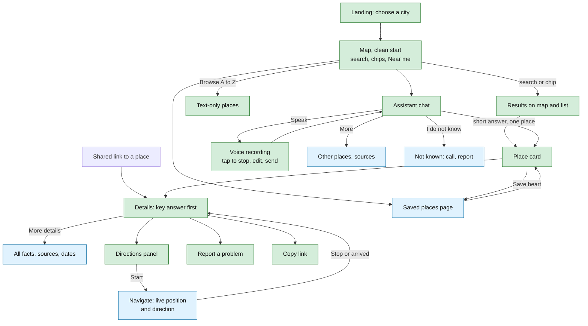

> **Archived 2026-11-27.** Historical record: this was built, answered or superseded. Current docs: [`../README.md`](../README.md), [`../decisions.md`](../decisions.md), [`../ui_handout.md`](../ui_handout.md).

# UX design brief (session 1 of the redesign)

**Status: v2, answers applied 2026-11-23.** The owner answered Q1, Q2 and Q4 and said to use the recommended default for all other questions (section 11). Rebuilt around the owner's list of 8 changes (section 3c) and the research (section 4). Section 11 records every question with its answer. No code, page or data was changed to produce it. Prototype sessions: read this whole file first, then only the screen they are assigned (section 10).

**How to read evidence tags.** *Verified* = I measured, reproduced or read it myself on 2026-11-23 (command, screenshot, calculation or fetched page named). *Reported* = written in `docs/improvement_plan.md` or by the owner, not reproduced. *Excerpt* = seen only in a search-result summary. *Assumed* = my inference. Screenshots are in `docs/figures/ux_audit/` (files named `live_*` are from the deployed site).

**Where the UI code lives:** the assistant, routing panel, saved places and voice are on branches `feature/assistant`, `feature/browser-routing` and `deploy/routing-pages` (worktree `accessibility-map-integration`), not on `main`. See 3c and Q1.

---

## 1. Purpose and users

**Purpose.** Help a person decide *whether and how they can get to and into a place* in a wheelchair or with another mobility device, using facts that show their source, date and how far to trust them, and say "unknown" when nothing believable exists. The map is a visualization; the product is the sourced dataset plus the assistant (README, `system_overview.md` section 1).

| User | Need | Priority | Basis |
|---|---|---|---|
| Wheelchair user (manual or power), often on a phone, often outdoors, often one-handed | Is there a step-free entrance and restroom? Is the route there passable? Is it still true? Little typing, big targets | **Primary** | `assistant_plan.md` section 2 (recorded) |
| Blind or low-vision user with a screen reader or zoom | Everything as real text; no map-only information; safer crossings | **Primary** (the repo treats them as co-primary) | `assistant_plan.md`, skill style rule (recorded) |
| Companion or caregiver | Fast answer, copy and share a link, no account | Secondary | `assistant_plan.md` (recorded) |
| Person reporting a problem (any of the above, at the place) | Report in under a minute, optional photo, no account, privacy | Secondary, but safety-relevant | `problem_reports.md` (recorded) |
| Researcher or the other lab team consuming the data | Understand source, rating method and freshness; get files, not a UI | Secondary | `system_overview.md` section 1 (recorded) |
| Deaf or hard of hearing; cognitive or reading differences | Text-first, plain language, consistent layout | Secondary (design for, not target of features) | `assistant_plan.md` (recorded) |
| Accessibility team reading reports | Supabase dashboard and export gallery, not a public screen | Out of scope for this redesign | `problem_reports.md` |

**Assumed, to confirm:** most use is phone-first and on the move (nothing in the repo measures device mix; there are no analytics and no user research in the repo, only a planned 5 to 8 person study, `assistant_plan.md` Phase 9). Current coverage is Cincinnati and Oxford (479 and about 177 places); DC, Dayton, Baltimore have data but no map page.

---

## 2. Top tasks (ranked)

| # | Task | Success test |
|---|---|---|
| 1 | Find out if a specific place is wheelchair accessible and how sure we are | From the list, map or a shared link, entrance and restroom answers (yes / partly / no / not known) with source and date are readable in **2 taps or fewer** and in order by a screen reader |
| 2 | Find places that meet my need (restroom, parking, food without steps, trail, event) by searching, not by scanning a crowded map | From a clean map, one search or one chip shows only matching places with a count in **2 taps or fewer**; places with no information never rank above confirmed ones |
| 3 | Get a step-free route and **follow it while moving** (live position, direction, next step) | "Route here" then "Start" gives the next step in large text; the position dot moves within 5 s of real movement; stopping the trip stops location use; works one-handed |
| 4 | Ask in plain words and get a short, sourced answer or an honest "I don't know" | The first answer is **one sentence plus one place**, readable without scrolling on a 390x844 phone; "More" opens the rest; an unanswerable question names what we do have |
| 5 | Come back to my own places (saved) | Saved places are reachable in **1 tap** from the main screen, survive a browser restart, and can be restored from a link |
| 6 | Judge whether to trust what I am reading | For any fact, source, date and confidence are findable in **1 tap or 1 screen-reader heading** without a legend lookup |
| 7 | Report a problem at a place, with optional photo | A report on a phone in **under 60 seconds** with 3 inputs; a failed send loses nothing |
| 8 | Share a place or rate it from my visit | "Copy link" in 1 tap opens the same place; one tap saves a rating (both exist) |

Researcher tasks (download data, read the method) are handled by one static page, see S15. The owner's 8 changes map to tasks 2, 3, 4, 5 and the panel in task 1 (section 8).

---

## 3. Audit of the current UI

Scope reviewed: `data/map/cincinnati.html` at 1280, 800 and 390 px wide, the report form on a phone, the landing page (`data/map/index.html`), the text-only place pages, and the code in `src/atlas/map_viewer.py` and `src/atlas/report_ui.py`. **Not tested:** screen readers (VoiceOver, TalkBack, NVDA), real phones, slow networks, Oxford page, and automated axe scan (a CDN download of the scanner was blocked by the tool's safety check, so run it from the project venv later). Everything below about screen reader behaviour is therefore from code, not from listening.

### 3a. What works (keep)

| Finding | Evidence | Tag |
|---|---|---|
| List-first structure: the list is the main interface, map markers are out of the tab order and the list holds the same content | `map_viewer.py:3-8`, `:302-303` | verified (code) |
| Rating is never colour alone: coloured disc + symbol (✓ ~ ✕ ?) + word; Okabe-Ito palette | `map_viewer.py:20-25`, `phone_list_open.png` | verified |
| Honest unknown state: "No information yet … does not mean it is inaccessible" in the legend | `map_viewer.py:30`, `tablet_legend.jpg` | verified |
| Skip link, one `<h1>`, `lang="en"`, visible focus ring (5.17:1 on white) | `phone_home.png`; Playwright: lang `en`, h1 count 1 | verified |
| Zoom to 200 percent: no horizontal scroll at 640x400 (= 1280 at 200%) | Playwright `scrollWidth <= innerWidth` | verified |
| Reduced motion honoured; report form is a native `<dialog>` with focus return, error summary, field errors, draft saving, 16 px inputs | `map_viewer.py:196`, `report_ui.py:23-67`, `phone_report_form.png` | verified (code and screenshot) |
| Phone layout: full-screen map with a bottom sheet; report form is a bottom sheet fitting one screen | `phone_home.png`, `phone_report_form.png` | verified |
| Text-only page for every place, plus an A–Z index (no-JS fallback for the data) | `data/map/places/cincinnati/*.html` (483 files) | verified |
| Source age warning ("Source from 2016, may be out of date") and "Computed from map data, not checked on site" notes | `phone_list_open.png`; `map_viewer.py:523` | verified |

### 3b. What fails

Severity: **H** blocks a primary task or fails WCAG 2.2 AA; **M** hurts task success; **L** polish.

| # | Finding | Evidence | Sev | Tag |
|---|---|---|---|---|
| A1 | **Trust is invisible.** The trust engine rates every source and fact (tiers A–D, fact confidence), but the exported map data holds no confidence or tier field (`facts` keys: attribute, value, detail, quote, source, date) and the UI shows none. "Confirmed / reported / unknown", promised in `system_overview.md` 4.2, does not exist on screen. | GeoJSON keys; `grep` of `map_viewer.py` and `export_map.py` for confidence or tier finds nothing | H | verified |
| A2 | **A single weak tag reads as "Accessible" and sorts first.** "Area History", rated Accessible only because OpenStreetMap carries `wheelchair=yes`, is the first card in "Most accessible first", with the same badge as the Aronoff Center, which has five quoted facts. Restroom shows "not known" beside a blue check. | `desktop_details.jpg`, `phone_list_open.png` | H | verified |
| A3 | **57% of places say "No information yet"** (271 of 479 Cincinnati places) and these are the default list tail with no way to act (no "ask the venue", no "help us fill this in" shortcut beyond Report). | GeoJSON counts: unknown 271, accessible 125, partial 73, not accessible 10 | M | verified |
| A4 | **Control borders fail 3:1.** Search, selects and the text borders use `--line #eceef1` = **1.16:1** on white; ghost button border `#cfd4da` = **1.35:1** on its own fill; report radio options `#d1d5db` = **1.47:1**; unselected rating stars `#c4c8cf` = **1.68:1**; text-field and floating Report button borders `#9ca3af` = **2.54:1**. Matches improvement_plan 3.1. | contrast calculation from CSS values (`map_viewer.py:88,98,135,201`, `report_ui.py:22,34,41`) | H | verified |
| A5 | **Tiny targets.** Header links "Switch to the Oxford map", "All places A–Z", "Accessible shows by date" are 15 px tall (WCAG 2.2 AA minimum is 24 px); the "Only places with accessibility information" checkbox is 13x13; Leaflet attribution link 12 px. Buttons are 32 px tall (card actions), 37 to 38 px (Near me, selects), below the repo's own 44 px rule. 99 controls on desktop are under 44 px. | Playwright `getBoundingClientRect` at 1280, 800, 390 | H (the 15, 13 and 12 px ones), M (the rest) | verified |
| A6 | **Legend and floating Report button collide on tablets**, hiding the last legend rows ("Trail", "Group of nearby places") at 800 px. | `tablet_legend.jpg` | M | verified (improvement_plan 3.2) |
| A7 | **A malformed link such as `#place=%` breaks start-up** with "The map could not be initialized". | Playwright: `URIError: URI malformed` in `decodeURIComponent`, status text shown | H | verified (improvement_plan 3.3) |
| A8 | **Too many tab stops.** Four header links come before search; each card has four equal-weight buttons, so the 20 cards per page create about 80 stops before the pager. No primary action per card. | Playwright tab sequence (4 stops per card) | M | verified |
| A9 | **Phone header uses about 15% of the screen** (130 of 844 px: title, three links wrapping to two lines, search, Near me), and the list is hidden behind a 64 px "Show list" strip; seeing results takes 1 tap, seeing details 2 more. | `phone_home.png`, `phone_list_open.png` | M | verified |
| A10 | **No loading, offline or empty-result design.** Whole map data (1.09 MB for Cincinnati, 1.71 MB landing page) is embedded in the HTML; the first load transfers about 1.7 MB including tiles and Leaflet from unpkg. No `<noscript>` message (0 occurrences). If the CDN is blocked the only message is a status line "The map could not be initialized". | file sizes; Playwright byte count; `grep -c noscript` = 0 | M | verified |
| A11 | **Body text is 15 px and secondary text 12.5 to 13.5 px**, below the 16 px rule the report form already follows; many labels use `--muted #6b7280` (4.83:1, passes but little headroom at 12.5 px). | `map_viewer.py:91,122,126` | M | verified (code) |
| A12 | **Inconsistent control styles.** Two button families (`ghost` with grey fill, `primary` dark), the floating Report button with a third style, chips, pager buttons; four different radii (10, 12, 14, 24 px). | `map_viewer.py:97-101,135,201,206`, `report_ui.py:22,29` | L | verified (code) |
| A13 | **Duplicate and confusing actions.** "Directions" opens Google Maps in a new tab (leaves the site, sends the place location to Google); the in-site step-free route sits inside Details; both exist at once. | `map_viewer.py:493-494,581-582,526-531` | M | verified (code) |
| A14 | **Errors not tied to fields for screen readers; error summary announced twice**; honeypot can discard a real report; "Anonymous" wording while user agent and page address are stored; closing while sending can create a duplicate; close button scrolls away; iOS bottom safe area; websites without `https://` become broken links. | improvement_plan 3.6, 3.7 | M | reported |
| A15 | **Libraries load without integrity hashes or a content security policy.** | improvement_plan 3.5; no `integrity=` in the template | M | reported |
| A16 | **Distances are straight line**, stated only in the status line after "Near me", while the card shows "750 feet southwest". A wheelchair user may read it as walking distance. | `map_viewer.py:753`, `desktop_details.jpg` | M | verified (code, text) |
| A17 | **Two page templates** (map page and text-only pages) with different CSS (text pages use `--ink #1b1f24`, link blue `#0a58ca`, 16 px) so the look differs between the two. | `places/cincinnati/*.html` head | L | verified |
| A18 | **No keyboard or screen-reader testing record** for the map page (the report form has automated tests, `tests/test_report_ui.py`; the main map has none for accessibility). | `tests/` listing | M | verified (absence) |

### 3c. Your 8 requested changes: what the code and the live site show

Checked 2026-11-23 on the **live** pages (`zenaism.github.io/.../cincinnati.html`, Playwright, Chromium, 390x844 and 1280x800) and in the worktree `accessibility-map-integration` (branch `deploy/routing-pages`, which is what is deployed). **Important:** the assistant, routing panel, saved places and voice code are **not on `main`**; they live on `feature/assistant`, `feature/browser-routing` and `deploy/routing-pages`, and that worktree has uncommitted edits. Prototypes and builds must target that branch (Q1).

| # | Your item | What I found | Evidence | Tag |
|---|---|---|---|---|
| 1 | Live location and heading | Location is read **once** (`getCurrentPosition`, high accuracy, 10 s timeout, 60 s cache). No `watchPosition`, no device orientation anywhere. The "you are here" dot never moves. Direction exists only as route words ("Head southeast on...") | `panel.js:626-633`, `map_viewer.py:842`; grep for `watchPosition` and `deviceorientation` finds 0 hits in source and in the live HTML | verified |
| 2 | Favourites page | Hearts exist (`atlas-favs` in localStorage), a "Saved places (n)" filter in the list, saved places first in the route picker. **No dedicated page, no way to move them to another device, no warning if the browser clears storage** | `map_viewer.py:481-510`, `panel.js:481`; live HTML contains `atlas-favs` | verified (page absence), assumed (storage loss, see research) |
| 3 | Left panel too full | Opening Details on "Area History" shows **1,598 characters** at once: rating, facts, quote, a facts table, a "Getting there" block with 3 notes, a full route (5 steps), star rating, text-page and copy-link. The top answer (entrance yes, restroom not known) is in the first 3 lines, then 10 more blocks follow | `live_desktop_details.jpg`; DOM text length measured | verified |
| 4 | Gear emoji in chat settings | The Settings button is a custom SVG (a circle with 8 rays) that reads as a **sun or brightness symbol**, not a gear; 50x44 px, text label "Settings". Same on desktop Chrome (13-inch Mac, owner's setup) and phone. `⚙` is not in the page. So the owner's complaint stands: it is not a proper settings icon | `live_mac13_1440x780_map_chat.jpg`; `chat.js:28,77` | verified |
| 5 | Chat answers are a wall of text | One answer to "nearest accessible restroom" is **1,465 characters**: a 4-line headline plus source sentence, then 3 full place cards (each with up to 3 fact lines, a source line and 3 buttons), then 5 more buttons (Read aloud, More detail, Sources, Show all on map, Report). A "More detail" toggle exists but only hides extras; the cards stay fully open | `live_phone_chat_answer.png`; button list measured | verified |
| 6 | Chat bottom cut off | **Reproduced on the owner's setup** (Chrome, 13-inch Mac, viewport 1440x780 and 1280x680): in the map's chat panel the input area ends **60 px below the window** (bottom 840 in a 780 px window; 740 in 680), so the Speak and Photo buttons are cut off. 60 px = the page header height. The standalone Ask page is fine (last button 38 px above the edge). Cause is in CSS (`.ow` sets `height:100%`, which beats top/bottom). **A fix already exists** (committed on `feature/assistant` as 69cfc08, and uncommitted in the integration worktree) but is not deployed. That uncommitted change also shrinks panel buttons to 38 px, below the 44 px rule. iPhone Safari remains untested | `live_mac13_1440x780_map_chat.jpg`; `assistant.css` diff; web.dev for the toolbar case | verified |
| 7 | Map shows every building on open | On first load on a phone: **26 icons plus about 20 cluster discs plus blue trail lines and a Report button** over the map; "479 places" in the sheet. Already clustered, but the opening view is busy and none of it answers a question yet | `live_phone_home.jpg`; DOM count of `.leaflet-marker-icon` | verified |
| 8 | Voice recording too short | The recogniser is started with `continuous = false`, with no timer of our own (`voice.js:13`, `chat.js:429`). So it ends when the browser decides the speech has ended: a short pause in a long sentence stops it. There is no visible stop button state, no counter, no way to continue. The real device behaviour is what you reported; the cause here is from code and MDN | `voice.js:13`; MDN `continuous` page | cause verified in code; device behaviour reported by you |

**New findings while checking (verified, live page, 390 px):**

| # | Finding | Sev |
|---|---|---|
| N1 | Phone header buttons "Near me" and "Ask" are 32 px tall (below the repo's own 44 px rule); the header info "!" button is 13x13 px (below the WCAG 2.2 minimum of 24 px) | H |
| N2 | Place-card buttons on the phone list are 32 to 34 px tall and 64 to 107 px wide, five per card; many have no visible text in the measured list (icon-only, name only for screen readers) | M |
| N3 | "Report a problem" floating button sits on top of the map at the top left, covering map content; "Legend" bottom right competes with the sheet strip | L |
| N4 | The page is 1.32 MB (HTML) with all place data embedded; on a slow connection nothing shows until it is parsed | M |
| N5 | Three versions of the UI exist (main, assistant branch, deployed integration branch), so audit results differ by branch | H (process) |

---

## 4. Research findings and what they imply

Done 2026-11-23 with web search, then opened the key pages. **Status key:** *verified* = I read the page text; *excerpt* = I saw only a search-result summary, not the page; *assumed* = my inference. Where a fetch failed I say so. No user research was done or invented; none of this replaces testing with wheelchair and blind or low-vision users (Q9).

### 4.1 Comparable tools

| Finding | Source | Status | Changes which decision |
|---|---|---|---|
| Google Maps shows a wheelchair icon for an accessible entrance, and summarises seating, restrooms and parking; it is **off until the user turns on "Accessible Places"** in settings (2020 post); it also shows when a place is confirmed *not* accessible; data comes from Local Guides and business owners; the post does not say how facts are checked | [Google blog, May 2020](https://blog.google/products/maps/wheelchair-accessible-places-google-maps/) | verified (2020 post, may be out of date) | We show source, date and confidence per fact, which Google's post does not describe. Show "no" explicitly, not only "yes" |
| AccessMap ships three preset profiles (manual wheelchair, power wheelchair, cane), lets users change settings such as maximum incline, works with screen readers, and **stores each profile on the phone** | [UW Allen School, Dec 2021](https://news.cs.washington.edu/2021/12/03/taskar-center-launches-first-mobile-version-of-accessmap-pedestrian-trip-planning-tool-for-android-and-ios) (archived page) | verified | On-device storage without accounts has a precedent; keep route profiles and favourites local (items 1, 2) |
| AccessMap's OSM wiki page lists a web platform and routing profiles `foot` and `wheelchair`, for "a limited number of cities" | [OSM wiki](https://wiki.openstreetmap.org/wiki/AccessMap) | verified | Coverage honesty: say where we have data |
| Wheelmap uses three states from the OSM `wheelchair` tag: yes, limited, no | [OSM wiki, Wheelmap](https://wiki.openstreetmap.org/wiki/Wheelmap) | verified | Same three states as ours; matches our rating words |
| Wheelmap shows unrated places in grey as a "call to action" to rate them (traffic-light colours green, yellow, red) | search excerpts from [Wikipedia](https://en.wikipedia.org/wiki/Wheelmap.org) and [EIB](https://www.eib.org/en/stories/wheelchair-map-app); the OSM wiki page does **not** mention colours | excerpt | "Not known" should invite action (report, call), not look like an error (item 3, principle 2). Do not copy red/green; we use Okabe-Ito and symbols |
| Apple Maps: no official source about wheelchair labels turned up | search only | not found | No claim made; compare by hand later |

### 4.2 Location, heading, battery

| Finding | Source | Status | Decision |
|---|---|---|---|
| `watchPosition()` registers a handler called when the position changes, returns an ID, and `clearWatch(id)` stops it; it needs the user's explicit permission | [MDN watchPosition](https://developer.mozilla.org/en-US/docs/Web/API/Geolocation/watchPosition) | verified (the page does not discuss battery or list options) | Start the watch only inside an explicit "Start navigation" state; clear it on stop, on route end and when the page is hidden |
| High accuracy asks for the best position at the cost of power; `maximumAge` allows cached positions | legacy [Microsoft docs](https://msdn.microsoft.com/en-us/library/windows/apps/gg593022.aspx) excerpt, [W3C Geolocation](https://www.w3.org/TR/2022/WD-geolocation-20220210/) | excerpt | High accuracy only while navigating; use the normal setting for "Near me" |
| Errors: permission denied (1), position unavailable (2), timeout (3); location needs HTTPS | [MDN GeolocationPositionError](https://developer.mozilla.org/en-US/docs/Web/API/GeolocationPositionError) | excerpt | Each of the three gets its own plain message and a manual way to set the start point |
| `DeviceOrientationEvent.requestPermission()` must be triggered by a UI event such as a button tap | [MDN](https://developer.mozilla.org/en-US/docs/Web/API/DeviceOrientationEvent/requestPermission_static) | verified (the fetched text names no browsers) | Compass is behind a visible "Show my direction" button, never automatic |
| On iOS Safari the compass heading comes as `webkitCompassHeading` after the permission call; on Android Chrome use `deviceorientationabsolute` (heading = 360 minus alpha); results differ by device | developer posts and a [W3C geolocation list thread](https://lists.w3.org/Archives/Public/public-geolocation/2024Jan/0035.html), [DEV article](https://dev.to/toolswebs1/building-a-compass-in-the-browser-how-the-deviceorientation-api-actually-works-3f37) | excerpt, assumed to be current | Two code paths plus a fallback: while walking use the movement direction when available, else no arrow and no claim. Test on one real iPhone and one Android phone before shipping |
| Poor GPS: the API gives no guarantee of the real location | [W3C Geolocation](https://www.w3.org/TR/2022/WD-geolocation-20220210/) | excerpt | Show an accuracy ring; above a limit (proposed 50 m) say "Location is rough" and stop saying "you are off the route" |

### 4.3 Many points on a map

| Finding | Source | Status | Decision |
|---|---|---|---|
| Leaflet.markercluster has `disableClusteringAtZoom`; plugins exist to draw markers only inside the viewport | [commit note](https://lists.alioth.debian.org/pipermail/pkg-javascript-commits/2014-October/013374.html), [Leaflet group thread](https://groups.google.com/g/leaflet-js/c/fiuubelyKzI) | excerpt (old) | Tools exist for zoom thresholds, but we can do search-first without them: draw only result markers |
| "Search-first, then fit the map to results" is a common pattern | no source found | assumed | Item 7: empty map plus search and category chips; the text list stays complete (principle 4) |

### 4.4 Chat answers, voice, favourites

| Finding | Source | Status | Decision |
|---|---|---|---|
| NN/g (April 2026): "give only the essential answer first, then offer relevant followup prompts so users can pull additional detail on demand"; keep sentences short and paragraphs to 2 to 3 sentences; the first answer holds what was asked plus caveats needed to keep it accurate; "Being concise does not mean omitting useful information. It means removing everything else." | [NN/g](https://www.nngroup.com/articles/less-chat-more-answer/) | verified | Item 5: one-sentence answer plus one place first; "More" for the rest. The "not checked on site" caveat stays in the short answer when the claim is computed |
| `continuous` defaults to false, meaning "at most one final result"; the page does not say when recognition ends | [MDN](https://developer.mozilla.org/en-US/docs/Web/API/SpeechRecognition/continuous) | verified | Item 8: use `continuous = true` |
| Chrome ends sessions itself after silence and periodically; restart in `onend`. Safari/iOS: different engine, stricter gesture rules, reports of stopping after the first phrase or about 10 s, `interimResults` unreliable | [AssemblyAI guide](https://www.assemblyai.com/blog/speech-recognition-javascript-web-speech-api), [Apple forum](https://developer.apple.com/forums/thread/775699), [Chromium group](https://groups.google.com/a/chromium.org/g/chromium-html5/c/s2XhT-Y5qAc) | excerpt (forum and vendor posts, some old) | Tap to start, tap to stop; auto-restart in `onend` while the user has not stopped; own cap and a visible counter; editable transcript, never auto-send; on iOS also point to the keyboard dictation key |
| Safari can delete script-written storage (localStorage, IndexedDB) after 7 days of browser use without visiting the site; whether Home Screen apps are exempt is unclear | [Ionic](https://ionic.io/blog/is-apple-trying-to-kill-pwas), [WebKit bug 211775](https://bugs.webkit.org/show_bug.cgi?id=211775), [Apple forum](https://developer.apple.com/forums/thread/710157) | excerpt (2020 to 2022) | Item 2: favourites need a way out: a copyable link or file that restores them; tell the user when storage seems empty |

### 4.5 Accessibility guidance

| Finding | Source | Status | Decision |
|---|---|---|---|
| WCAG 2.2 AA minimum target is **24 by 24 CSS px**, with exceptions (spacing, equivalent control, inline text, browser default, essential). **44 by 44 is the AAA criterion 2.5.5**. (A search summary wrongly called 44 the 2.2 minimum.) | [Understanding 2.5.8](https://www.w3.org/WAI/WCAG22/Understanding/target-size-minimum) | verified | Our 44 px is a **project rule**, justified by one-handed use and tremor, not by AA. Fix the checklist wording |
| Non-text contrast: UI components and the information needed to identify them need 3:1 against adjacent colours; a visible border is only required when it is the only way the control is identified | [Understanding 1.4.11](https://www.w3.org/WAI/WCAG22/Understanding/non-text-contrast) | verified (first 40k of 61k characters read, rest summarised) | Borders we rely on get `#6b7280` (4.83:1) |
| People with motor impairments produce many spurious touches; a CHI 2017 study of 32 people argues for larger targets (an 18 mm figure appears in the excerpt); spacing between targets matters | search excerpts for [CHI 2017](https://faculty.washington.edu/leahkf/pubs/CHI2017-TouchscreenAccess.pdf) (**the link returned 404, not read**) and [Axess Lab](https://axesslab.com/hand-tremors/) | excerpt, the 18 mm number is **not verified** | Large, spaced targets; no action on touch-down; confirm or undo for destructive actions; tap-to-toggle not hold |
| About half of people hold a phone one-handed, thumb reach is limited at the corners and for big phones; later commentary says do not over-rely on the "thumb zone" | [Smashing](https://smashingmagazine.com/2016/09/the-thumb-zone-designing-for-mobile-users), [Osmani](https://addyosmani.com/blog/touch-friendly-design/) excerpts; figures second-hand | excerpt | Primary action in the lower half of the screen; never hide the other actions behind reach |
| Outdoors, colour differences between light colours get harder as surrounding light rises (about 60 percent in one study); screen protectors and brightness help only partly | [Waterloo paper](https://cs.uwaterloo.ca/~dvogel/gi2026/papers/1075b.pdf) (**too large to fetch**, excerpt only) | excerpt | No light grey text, no pale-on-pale states; selected and error states use dark borders plus symbols; ink `#111827`, muted `#4b5563` |
| `100vh` is sized for hidden toolbars, so content "bleeds out of the viewport" while toolbars show; `dvh` adapts; an iOS 26 forum post reports a gap with `dvh` | [web.dev](https://web.dev/blog/viewport-units) (verified), [Apple forum](https://developer.apple.com/forums/thread/803987) (excerpt) | verified and excerpt | Item 6: `svh` or `dvh` with a `vh` fallback, and 16 px bottom padding on top of the safe-area inset; test on a real iPhone |

### 4.6 What each of your 8 changes becomes (proposals, to prototype)

| # | Proposal | Key rule | Question |
|---|---|---|---|
| 1 | A **Navigate** state started by an explicit button in the route panel: live dot with accuracy ring, next step in large text, "Show my direction" button for the compass, Stop button. Heading from movement when walking, compass only after the tap, else no arrow. **Owner wants spoken turns, off-route alerts and re-routing too** (4.7) | Location stays on the device; no tracking while not navigating; no "off route" claims when accuracy is poor | Q4 (answered) |
| 2 | A **Saved** page (list view, 3 sections: saved, recently opened if wanted, empty state), reached from the header; heart on cards and details; "Copy link to my saved places" to restore on another device or after storage loss | No account; undo after removing; the link carries place ids only | Q5 |
| 3 | Details panel in **two layers**: first layer = name, rating word and symbol, confidence line, entrance, restroom, one parking/step line, source and age in one line, then two buttons (Route here, Save). Second layer ("More details", closed): all facts with quotes, Getting there, contact, rate, report, links | The first layer answers "can I get in, and how sure are we" | Q6 |
| 4 | Replace with a standard gear icon (inline SVG from an MIT-licensed set such as Lucide or Feather, checked), 44x44, with the word "Settings" on desktop and the accessible name on phones | Never an emoji; text name always present | Q2 |
| 5 | Answer = **one sentence** (about 25 words) + **one** compact place card (name, rating, one key fact, source and date) + "More" (other places, all facts, sources) + max 2 visible actions (Route here, Show on map) | Every claim still traceable to a record (verifier stays); computed facts keep "not checked on site" | Q7 |
| 6 | **First, deploy the existing fix** (panel 60 px too tall on desktop). Then chat layout: height from `svh`/`dvh` with fallback; Speak and Photo become 44 px icon buttons **inside** the input row (saves one row, about 60 px); 16 px bottom padding plus safe area; chips scroll in one row | Last control at least 16 px above the bottom edge on a real iPhone | Q1 (device) |
| 7 | Opening view: basemap, search, category chips (Restroom, Parking, Food, Trails, Events), Near me. **No place markers and no trail lines until a search or chip**; results draw as markers with a count; "Show all places" is a switch, off by default; "Browse all places A to Z" stays as the text route | Text list remains complete (principle 4); empty map says what to do | Q8 |
| 8 | Voice: tap to start, tap to stop; continuous with auto-restart on `onend`; hard cap 60 s with a visible counter and a one-sentence warning at 50 s; transcript appears in the input and is editable; **no auto-send**; clear message when the engine stops itself | The limit is mostly the browser's, so we cannot promise a length, only continue after pauses | Q9 |

### 4.7 Spoken guidance, off-route alerts and re-routing (owner request, 2026-11-23)

These are in scope. Design consequences, mostly **assumed** (not yet researched; the web page can only do this while it is open and the screen is on):

| Feature | How it would work | Limit to design around | Status |
|---|---|---|---|
| Spoken steps | Browser speech synthesis (`speechSynthesis`, already used for "Read aloud") says the next step when it becomes due ("In 100 feet, turn left onto Carrel Street, caution: steep section") | The page must stay open; iOS may stop speech when the screen locks; must also show the same text; a Mute button always visible | assumed |
| Off-route alert | Compare each position fix with the route line; if farther than a threshold (proposed 25 m) for 3 fixes in a row **and** accuracy is better than 30 m, say "You may be off the route" and show a Re-route button | GPS noise near buildings gives false alarms; with poor accuracy say "Location is rough" instead; no alarming sounds, calm words | assumed |
| Re-routing | Run the existing in-browser router from the current position to the same place | Needs the routing data loaded; takes time on a phone; show "Finding a new route" and keep the old steps until the new one is ready; ask before replacing it the first time | assumed |
| Keeping the screen on | The Screen Wake Lock API can stop the phone dimming while navigating | Not researched here; must be released on Stop; falls back to a note "keep the screen on" | assumed, to research |

All of it stays on the device (no location sent). Suggested build order, each testable alone: live dot and text, then spoken steps, then off-route alert, then re-routing.

---

## 5. Design principles

1. **Say how sure we are, quietly.** Three states only: *Confirmed* (high), *Reported* (medium, says who and when), *Not known* (nothing believable), matching `system_overview.md` 4.2. Show nothing extra when a fact is confirmed and fresh; label it when it is weaker or old; one tap reveals source, quote, date. Never invent a fourth state, a percentage or a score on screen.
2. **Unknown is an answer, not an error.** "Not known" gets its own words, its own symbol, and a next step (call the venue, report, see nearby places that are known). It never looks like "no" and never ranks above a confirmed "yes".
3. **Source and freshness travel with the fact** in text, not tooltips: "Venue website, March 2026", and an age warning when a source passes the freshness limit for that kind of fact (physical feature: years; notice or event: days, `D-27`).
4. **Words first, map second.** Every result is complete without the map or a mouse or sound (`assistant_plan.md` rule). The map is a companion.
5. **Low effort on a phone, one hand.** The main thing is reachable in the lower half of the screen; one primary action per card; no typing needed for common needs (tiles and filters); drafts survive accidents.
6. **Do not send what people do to third parties.** No free address geocoding, location stays on the device, "Directions" to Google is labelled as leaving the site (`routing_in_browser_plan.md` 4.4).
7. **Low bandwidth and unreliable networks.** Show text before tiles; tell the truth when something fails and keep working offline for what is already loaded; no required web fonts; keep per-page weight in budget (section 7.8 targets).
8. **Calm and minimal.** Plain words at about reading age 12, no exclamation marks, no celebratory animation, no alarm colours for ordinary uncertainty. Reserve strong colour and the word "Caution" for hazards (steep, closure, no sidewalk).
9. **Safe by default.** Stairs are never suggested; safety-relevant questions with only "Reported" evidence say so and suggest calling ahead (`system_overview.md` 4.4).
10. **One system.** Map page, text-only pages, report form and assistant share tokens, components and wording (fixes A12 and A17).

---

## 6. Accessibility requirements (checklist, each item testable)

Target: **WCAG 2.2 AA**, plus the stricter project rules marked (P). "How" says the test; run each on every prototype and every built screen.

| # | Requirement | How to test |
|---|---|---|
| 1 | Text contrast ≥ 4.5:1 (≥ 3:1 for text of 24 px or 18.66 px bold) in all states, including hover, disabled-looking and on map overlays | Contrast calculator on each token pair; list of pairs in the style guide table |
| 2 | Control borders, icons that carry meaning, focus rings and the chart or route line ≥ 3:1 against adjacent colours (1.4.11) | Same calculator; every `input`, `select`, `textarea`, radio and checkbox border and every button without a filled background |
| 3 | No information by colour alone: rating, confidence, hazard, selected, error each have a symbol and a word | View in greyscale; read with colour filter off |
| 4 | Keyboard only: every action reachable, no traps, visible focus on every control, logical order (header, filters, results, pager, report), Escape closes dialogs and sheets and returns focus to the opener | Tab through each screen; record the order in the prototype notes |
| 5 | Screen reader names: every control has an accessible name that includes the place name when repeated ("Details: Area History"); icons have text labels; state is exposed (`aria-expanded`, `aria-pressed`, `aria-current`) | VoiceOver (macOS and iOS) at minimum; TalkBack and NVDA when available |
| 6 | Errors: summary at top with links to fields, message next to each field tied by `aria-describedby`, announced once (no `role=alert` plus live region together), invalid state not by colour alone | Submit empty and invalid; listen once |
| 7 | Focus order and focus management: opening a panel moves focus to its heading; closing returns focus to the trigger; a new result or route moves focus only when the user asked | Keyboard walkthrough |
| 8 | Touch targets: ≥ 24x24 CSS px with spacing is the AA minimum (2.5.8); **project rule (P): ≥ 44x44 px for primary controls on touch** (44 px is the AAA criterion 2.5.5, chosen for one-handed use and tremor); ≥ 8 px between neighbouring targets; no action fires on touch-down, destructive actions have undo or confirm | Measure with `getBoundingClientRect` (script in section 3 audit) |
| 9 | Reduced motion: no animation under `prefers-reduced-motion`; no auto-playing motion or sound | Toggle OS setting; check |
| 10 | Zoom and reflow: usable at 200% text zoom and at 320 CSS px wide, no horizontal scroll, no content lost (1.4.4, 1.4.10); landscape works | Playwright at 320x568 and 640x400 |
| 11 | Text sizing: body ≥ 16 px (P); nothing under 13 px except map attribution; user text-size increase does not break layout | Inspect computed sizes |
| 12 | Forced colours (Windows high contrast) and light theme only for v1: controls remain visible; borders use `ButtonText` or system colours when forced | Chrome rendering emulation `forced-colors: active` |
| 13 | Language and structure: `lang`, one `h1`, headings in order, landmarks (header, nav, main), lists are real lists, tables have captions and header cells | Outline view |
| 14 | Links open in a new tab only when labelled "(opens in a new tab)" (exists) | Read link text |
| 15 | Map content has a text equivalent for every marker and the route; the map is not required for any task (P) | Complete each top task with the map hidden |
| 16 | Time: nothing times out; "saved" and "sent" messages stay until read (≥ 8 s) or are a polite live region | Read the status flow |
| 17 | Drag and gesture alternatives: nothing needs a drag or multi-finger gesture except map pan and zoom, which also have +/- buttons and keyboard (2.5.7) | Try with single taps |
| 18 | Consistent help and navigation: report button and help in the same place on every screen (3.2.6) | Compare screens |
| 19 | Automated scan clean (axe) on every state, then manual checks above; record both | Run axe from a locally installed copy (not fetched at run time) |
| 20 | Plain-language check: main answer in the first two sentences; sentences of about 15 words (P, from `assistant_plan.md` 3.8) | Read-through |
| 21 | Live location: position updates are not announced on every fix; a polite announcement only for step changes and arrival; the compass and the position can be turned off; works with location denied (manual start point) | Walk-through with VoiceOver and with location denied |
| 22 | Voice input: a visible Start/Stop with state in text, a counter, a cap warning, editable transcript, nothing sent automatically; text input always available | Test with speech available, unavailable and denied |
| 23 | Sunlight and glare: no text lighter than `#4b5563` on white, no pale-on-pale selected states, key controls have dark borders and a symbol | Check on a phone at full brightness outdoors, and with a 3:1 contrast pass on every state |
| 24 | Bottom of the screen: last control at least 16 px above the bottom edge plus safe-area inset, on a real iPhone with Safari toolbars shown and hidden | Real device |

---

## 7. Style guide

Principle: keep today's minimal, grey-and-ink look, USGS basemap and Okabe-Ito rating colours (`map_viewer.py:20`). Change only what the audit shows fails. Values marked **new** are proposals.

### 7.1 Colour tokens

| Token | Value | Use | Contrast |
|---|---|---|---|
| `--ink` | `#111827` | Text, primary button fill | 17.7:1 on white |
| `--muted` | `#4b5563` **new** (was `#6b7280`) | Secondary text (meta, notes) | 7.6:1 on white; the old value 4.83:1 leaves no margin at 13 px |
| `--bg` | `#ffffff` | Page | |
| `--soft` | `#f6f7f9` | Sunken areas, search fill, detail panel | |
| `--line-soft` | `#e5e7eb` | Decorative dividers between cards (not controls) | decorative, exempt |
| `--line-control` | `#6b7280` **new** | Border of every input, select, textarea, secondary button, radio, checkbox | 4.83:1 on white, 4.51:1 on `--soft` (passes the 3:1 rule) |
| `--focus` | `#2563eb` | Focus ring, 2.5 px with 2 px offset | 5.17:1 |
| `--link` | `#0a58ca` | Links (one value for map and text pages) | 6.44:1 |
| `--r-accessible` | `#0072B2` | Accessible | 5.19:1 on white |
| `--r-partial` | `#E69F00` | Partly accessible (always with dark glyph `#1a1a1a`) | 2.25:1 as fill on white: acceptable only because the symbol and word carry the meaning and the glyph is dark; do not use as text |
| `--r-not` | `#D55E00` | Not accessible | white glyph 3.87:1 |
| `--r-unknown` | `#6b7280` **new** (was `#767676`) | No information yet | 4.83:1 |
| `--conf-reported` / `--conf-unknown` | neutral grey plus symbol | Confidence labels (see 7.6); no new hue, to avoid clashing with ratings | |
| `--hazard` | `#92400e` text on `#fff7ed` | Caution, old source | 6.68:1 (7.09:1 on white) |
| `--error` | `#991b1b` text on `#fef2f2`, 2 px border `#b91c1c` | Errors | ≥ 7:1 |
| `--route` | `#1d4ed8` with white casing | Route line | 5.87:1 on the grey basemap |

All pairs above were calculated on 2026-11-23 with the WCAG relative-luminance formula; re-check any pair you change.

### 7.2 Type scale

System font stack as today (no web fonts: low bandwidth). Line height 1.5.

| Role | Size | Weight | Use |
|---|---|---|---|
| Page title | 18 px | 650 | Header `h1` |
| Section / dialog title | 20 px | 650 | `h2` |
| Card title | 17 px | 620 | place name |
| Body and inputs | **16 px** (new; was 15) | 400 | everything readable; inputs must be 16 px to stop iOS zoom |
| Secondary | 14 px | 400 | meta, notes, hints (min 14; was 12.5 to 13.5) |
| Attribution only | 12 px | 400 | map credit |

### 7.3 Spacing and shape

4 px base grid: 4, 8, 12, 16, 24, 32. Card padding 12 px vertical, 16 px sides. Gap between tap targets ≥ 8 px. One corner radius for controls (**10 px**), one for containers (**14 px**), pill (999 px) only for chips. Shadows only on floating layers (sheet, popup, floating buttons).

### 7.4 Buttons and fields

| Component | Spec |
|---|---|
| Primary | `--ink` fill, white text, height ≥ 44 px, one per view or card |
| Secondary | white fill, 1.5 px `--line-control` border, `--ink` text, height ≥ 44 px |
| Quiet (text button) | no border, underlined or with an icon and visible label; only for low-risk actions; height ≥ 44 px |
| Destructive (delete my report) | secondary style with `--error` text and a confirm step |
| Icon button | ≥ 44x44 px, has a text label (visible on desktop, `.vh` name on phone), 3:1 icon contrast |
| Input, select, textarea | 16 px text, height ≥ 44 px, 1.5 px `--line-control` border, label above (never placeholder only), hint under label, error under field with symbol and words |
| Checkbox and radio | 24 px box minimum, whole row clickable (≥ 44 px), 2 px `--line-control` border |
| Chips (filters) | 44 px high touch area, selected state has check mark plus dark border, not colour alone |
| Focus | `outline: 2.5px solid var(--focus); outline-offset: 2px` everywhere; never removed |

### 7.5 Cards, popups, sheets, dialogs

- **Place card (list):** name (card title), rating line (disc+symbol+word, place type), up to three key facts (✓/~/✕/? chips with words), one line of summary, **one primary action ("Details")** and a quiet overflow for Show on map, Directions, Report, Copy link. Source and age line shown only when the confidence rule in 7.6 says so.
- **Map popup:** name, rating, one line, "Details" primary; no rating form inside the popup (keeps it short; the rating moves to the detail view).
- **Bottom sheet (phone):** three heights (peek 96 px showing count and the top result name, half, full); drag handle plus a visible button (no gesture-only); `aria-expanded` on the handle; safe-area inset respected.
- **Dialog:** native `<dialog>`, bottom sheet on phones, centred up to 560 px on larger screens, close button always visible (sticky), Escape closes, focus returns to the opener.
- **Detail panel:** sections as real headings: *Access facts*, *Getting there*, *Contact and hours*, *What visitors say*, *Report or rate*; each fact row = attribute, value in words, source link, date, quote on demand.

### 7.6 Trust and uncertainty components (the new part)

| State | Words | Symbol | When shown | Rule |
|---|---|---|---|---|
| Confirmed | "Confirmed" | ✓ in a ring (distinct from the rating ✓ disc) | Only in the detail view and on request (one tap on "Source") | Not repeated on every card; absence of a label means confirmed and fresh |
| Reported | "Reported by *source*, *month year*" | ◐ | On the card and in details | Always visible; plain sentence, never just an icon |
| Not known | "Not known" plus next step ("Call to ask", Report) | ? | Everywhere it applies | Never styled like "No" |
| Old source | "Source from 2016, may be out of date" | clock | On the card when past the freshness limit for that kind of fact | Exists; keep the wording |
| Conflict | "Sources disagree: *A* says yes (2026), *B* says no (2023)" | ≠ | Details, and a one-word flag on the card | Show both, newer first |
| Computed | "Computed from map data, not checked on site" | calculator | Getting there, routes | Exists; keep |

Overall rating rule to prototype (see Q3): a place whose only evidence is one low-tier or single crowd tag shows **"Reported accessible"** (hollow ring) rather than "Accessible", and sorts below places with confirmed facts.

### 7.7 Map symbols and legend

- Keep the 30 px disc with a pictogram for type and a small white badge with the rating symbol (`markerIcon`), and clusters as white discs with a count.
- Make the legend a labelled disclosure, closed by default on phones, placed so it never overlaps a floating button (A6): one anchored position per breakpoint, tested at 390, 800, 1280.
- Legend rows: rating (disc, symbol, word, one-line meaning), confidence words, place types, trail line, cluster, route line, "You are here". Each row has text.
- Route: dark blue 6 px line with 2 px white casing, large start and end markers with text labels, caution icons with the word "Caution".
- "You are here": magenta disc with white ring (5.14:1); keep.

### 7.7b Basemap

USGS The National Map tiles only (repo rule), greyscale filter as today. Tiles never carry meaning; failure to load tiles must not hide markers or the list.

### 7.8 Loading, empty, error, offline

| State | Pattern |
|---|---|
| Loading list or panel | Skeleton text lines plus a polite status "Loading places…"; the page header and filters appear immediately |
| Map tiles slow | List and markers usable; a quiet line "Map background is loading" |
| Empty filter result | "No places match. Try *removing* ‘Only places with information’." with a button that does it |
| Empty because unknown | "We have no information yet about this. Call *number*, or report what you know." |
| Offline | "You are offline. What you already opened still works. Reports and ratings will wait." (reports keep drafts today) |
| Error | What happened, what to do next, a retry button; never only a status line; focus to the message |
| Location denied | "Location not shared. Distances are from the centre of the map." (exists, keep words) |
| No JavaScript or library blocked | `<noscript>` message with link to the text-only A–Z pages |

Performance targets (measure each built screen): first meaningful content under 3 s on a mid-range phone on 3G-class speed; page weight under 1 MB before tiles for the main screen; no web fonts. Today: 1.09 MB HTML for Cincinnati, 1.71 MB landing (verified).

---

## 8. Screen and flow inventory

Priority 1 = foundation or blocks others, 2 = main tasks, 3 = supporting, 4 = later. "Item" = the owner's change number (section 3c). Tasks refer to section 2.

| ID | Screen or state | Pri | Item | Tasks |
|---|---|---|---|---|
| S0 | Style tokens and component sheet (colour, type, buttons, fields, chips, cards, trust labels, icons incl. gear) | 1 | 4 | all |
| S1 | Map and list, desktop and tablet, **clean opening state, search and chips, results on map** | 1 | 7 | 1, 2 |
| S2 | Map and list, phone: header, bottom sheet, clean opening state, 44 px controls | 1 | 7 | 2 |
| S3 | Place card (list item), all rating and confidence states | 1 | 3 | 1, 6 |
| S4 | **Place details, two layers** (key answer first, "More details" closed) | 1 | 3 | 1, 6 |
| S5 | Trust and uncertainty components in context | 1 | 3, 5 | 6 |
| S6 | Search, category chips, Near me, location permission states | 2 | 7, 1 | 2 |
| S7 | Directions panel: empty, loading, route found, no route, errors, profiles | 2 | 1 | 3 |
| S17 | **Navigate (live): position dot and accuracy, direction, next step, Stop; states: waiting for GPS, rough location, denied, compass off, speech on or muted, off route, finding a new route, arrived** | 2 | 1 | 3 |
| S18 | **Saved places page**: list, empty state, remove with undo, copy restore link, storage-cleared notice | 2 | 2 | 5 |
| S10 | Assistant chat (Ask page and map panel): short answer, one card, "More", chips, input row with voice and photo, settings, small-screen layout | 1 | 4, 5, 6, 8 | 4 |
| S10v | **Voice recording states**: idle, listening with counter, cap warning, stopped by browser, no permission, unsupported | 2 | 8 | 4 |
| S8 | Report a problem: form, photo, errors, sending, success | 2 | none (Phase 3.6, 3.7) | 7 |
| S9 | Visitor rating | 3 | none | 8 |
| S11 | Landing page, region switch | 3 | none | 1, 2 |
| S12 | Text-only place page and A to Z index on shared tokens | 3 | 7 (the text route to everything) | 1 |
| S13 | Legend, map symbols, route and position styling | 2 | 7, 1 | 2, 3 |
| S14 | Global states: loading, offline, error, noscript, empty, malformed link | 1 | none (Phase 3.3) | all |
| S15 | "Data and method" page for researchers | 4 | none | 6 |
| S16 | Crawler info and opt-out page, restyled | 4 | none | n/a |

**Your 8 changes to screens:** 1 to S17, S7, S13; 2 to S18, S3; 3 to S4, S3; 4 to S0, S10; 5 to S10; 6 to S10; 7 to S1, S2, S6, S13; 8 to S10v.

Green = exists today on the deployed pages (the saved filter exists, but not the page; the chat exists but with long answers), blue = new or changed.

---

## 9. Constraints

| Constraint | Consequence for design |
|---|---|
| **Location stays on the device** (`compliance.md`) | Live position, heading and routes are computed in the browser; nothing about movement is sent, logged or stored; location is read only while navigating or on a "Near me" tap; saved places hold place ids only, never positions |
| $0: free tools, no paid APIs (`decisions.md` D-15) | No paid fonts, icons, maps, geocoding, analytics or hosted models; icons are inline SVG from MIT-licensed sets (licence checked); fonts are system fonts |
| Static hosting on GitHub Pages | No server rendering; everything is generated files plus browser JavaScript; pages are rebuilt by `make map`; prototypes must be static HTML |
| Free Supabase tier | Only reports and ratings are live; each report is capped (global hourly cap, 250 KB photos); no new live feature without a quota check; photos live in the database so volume is limited |
| No manual review steps in the data (memory: no manual data checking) | Confidence comes only from the trust engine; the UI cannot rely on a person verifying facts or moderating text |
| Basemap is USGS The National Map only | Light grey basemap, no dark map; tiles are never needed to use the list |
| Privacy (`docs/compliance.md`) | No names, accounts or IP addresses stored; device id random and local; report photos re-encoded in the browser without location; contact optional, shown only to the team; retention 24 months; assistant questions not collected; "Anonymous" wording must match what is stored (A14); no sending typed addresses to outside services; the repo is public so prototypes contain no real reports |
| Data stability for the other team | The page must not require schema changes unless flagged: **A1 needs a `confidence` field in the exported facts**, which is a data-export change to coordinate with `docs/data_dictionary.md` |
| Licences | Google Places live lookups are display-only, never stored; OSM attribution stays visible; do not redistribute vendor text |
| No build chain (today) | The map page is one Python string template (`map_viewer.py`); prototypes are plain HTML, CSS, JS; do not assume React |

---

## 10. Prototype session plan

Each prototype is a static HTML file under `docs/prototypes/<ID>/` (no framework), at 390, 800 and 1280 px, with the states listed, reviewed by the owner before any build. Every session starts by reading this file, `docs/system_overview.md` and its screen's source file **on branch `deploy/routing-pages`** (Q1).

| Order | ID | Scope | Question the owner decides | Parallel? |
|---|---|---|---|---|
| 1 | S0 + S14 | Tokens, components, icon set (gear), global states, contrast table | Accept stronger borders and 16 px body (Q11) | Alone first |
| 2 | S5 + S3 + S4 | Trust labels, place card, two-layer details with Aronoff Center (rich) and Area History (weak) | What is in the first layer (Q6); how loud is confidence (Q12) | Together; before S10 |
| 3 | S1, S2, S6, S13 | Clean opening map on three widths, search and chips, results, legend and position styling | Is the list empty too on open (Q8) | With 3b, 3c |
| 3b | S10 + S10v | Chat: short answer, one card, "More", input row, bottom layout, settings icon, voice states | Short answer shape (Q7), voice rules (Q9) | Parallel with 3, after 2 |
| 3c | S7 + S17 | Directions and live navigation, all states, compass button, rough-GPS state | Navigation scope (Q4) | Parallel with 3 |
| 4 | S18 | Saved page, empty state, restore link | Where saved places live (Q5) | Parallel, after 2 |
| 5 | S8, S9, S11, S12 | Report, rating, landing, text pages on shared tokens | none | Parallel, after 1 |
| 6 | S15, S16 | Data and method, crawler page | none (default: yes, last) | Last |

After S0 is approved, S1/S2/S6/S13, S10/S10v, S7/S17 and S18 are independent. S5+S3+S4 finish before S10 and S18 (shared card). Real-device checks (iPhone Safari, Android Chrome) are needed for items 1, 6 and 8 before building; no prototype can settle them.

---

## 11. Questions and answers

Answered by the owner on 2026-11-23: Q1, Q2, Q4. For all other questions the owner said "use the default", so the recommended default is the decision (marked **default**). Any of these can be reopened.

| # | Question | Decision |
|---|---|---|
| Q1 | Source of truth for the UI | Yes: `deploy/routing-pages` (live). Owner uses Chrome on a 13-inch Mac, so items 4 and 6 are desktop issues, both reproduced. Merge it to `main`, then work there |
| Q2 | Item 4 icon | Owner: use the **standard gear icon that phones and computers use** (a cogwheel), replacing the sun-like icon. Inline SVG from an open icon set (Feather is MIT, Lucide is ISC; check the licence file when adding), 44x44, visible text name "Settings" on desktop |
| Q3 | "Reported accessible" for places with one weak tag | **Default: yes**, sorts below confirmed places (needs an export note in `data_dictionary.md`) |
| Q4 | Navigation scope | Owner: spoken turns, re-routing and off-route alerts are wanted. Built in stages: live dot and text, then speech, then off-route alert, then re-routing (4.7) |
| Q5 | Saved places storage | **Default:** on the device plus a copyable restore link of place ids; no Supabase sync |
| Q6 | First layer of details panel | **Default:** rating word, entrance, restroom, one step or parking line, source and age, Route here, Save |
| Q7 | Chat first answer | **Default:** one sentence plus one place card; the rest under "More" |
| Q8 | Opening view | **Default:** map empty (no markers, no trails) until a search or chip; list shows only Saved and a prompt; "Browse A to Z" stays |
| Q9 | Voice | **Default:** tap to start and stop, continuous with restart, 60 s cap with counter, editable transcript, never auto-send |
| Q10 | Testers | **Default:** run the study after the first built screens; self-check with VoiceOver meanwhile. Claims stay "assumed" until then |
| Q11 | Heavier borders (`#6b7280`) and 16 px body | **Default: yes** |
| Q12 | Confidence on cards | **Default:** quiet unless weaker or old; always shown in details |
| Q13 | Dark mode | **Default:** no for v1 |

Decided without asking (change if you disagree): the in-site route is the primary directions action and Google Maps the labelled secondary (the route panel already exists); a researcher "Data and method" page is built last.

---

## Decisions recorded

`decisions.md` entries D-31 to D-39 are written (2026-11-23): (a) three-state confidence display, quiet by default; (b) control border `#6b7280` and 16 px body; (c) 44 px target rule versus the 24 px WCAG 2.2 minimum (44 is AAA); (d) "Reported accessible" labelling; (e) prototypes as static HTML; (f) location stays on the device and is read only during navigation; (g) saved places local with a restore link; (h) search-first map with no markers on open; (i) short-answer-first chat; (j) voice: tap-to-toggle, continuous, no auto-send. The UX flow diagram is in `docs/architecture.md` section 13.
