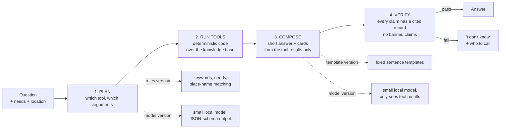
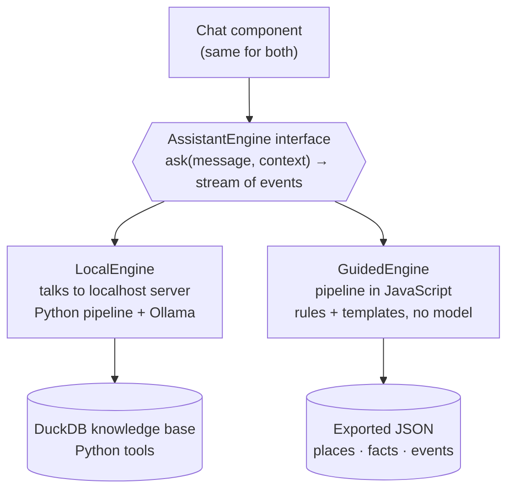

# Openway Assistant: build specification (what we will use and how)

Status: **built** (routing and the assistant are live on `main`). Written 2026-11-20 as a plan; kept as the technical reference, and the code points at section 4. Product plan: [`archive/assistant_plan.md`](archive/assistant_plan.md). Tool list and answer rules: [`assistant_design.md`](assistant_design.md). Decisions: [`decisions.md`](decisions.md).

Items marked **(spike)** were assumptions to test before relying on them; what was settled is recorded in `decisions.md`.

## 1. Constraints that shape every choice

- **No funding** (D-15, confirmed 2026-11-20): no paid or hosted model, no paid hosting.
- **Hardware for development:** an 8 GB M1 Mac. Ollama 0.14.1 is installed. Models present: `qwen2.5:3b` (1.9 GB), `llava-phi3` (2.9 GB), `qwen2.5vl:3b` (does not load on this Ollama version, D-26).
- **Users:** wheelchair users and blind or low-vision users; the interface must work without the map, a mouse or sound.
- **The data is the product:** facts with quotes and sources, trust scores, routes. The model must not be where facts come from.
- **Existing code to reuse:** DuckDB knowledge base and Python tools in `src/atlas/assistant/`, the question bank in `eval/`, the routing engine.

## 2. The key design: plan, run tools, compose, verify

A small local model is bad at open-ended "decide what to do next" loops, but acceptable at narrow, structured jobs. So we do not give it a free loop. We run a **fixed pipeline** and let a model help only in two places, each with a strict output format:



Why this shape:

- **Tools and the verifier, not the model, keep answers sourced.** Even a bad model cannot add a fact that the verifier cannot trace to a record.
- **No-model mode is the same pipeline** with the rules planner and the template composer. It is not a second product.
- **It gives us a research result:** run four variants and compare them honestly (section 8).

## 3. What we will use

| Need | Choice | Why | Cost |
|---|---|---|---|
| Language and data | Python 3.11, DuckDB (already used) | Existing tools and tests | $0 |
| Local model runtime | **Ollama** HTTP API (`/api/chat`), called with `requests` (already a dependency) | Already installed; no extra SDK | $0 |
| Text model | `qwen2.5:3b` first **(spike)**. Candidates only after Mariam agrees to downloads or an Ollama upgrade: a 7B model of the same family (about 4.7 GB at 4-bit; may not fit alongside other work in 8 GB), `llama3.2:3b` | Installed now; fits memory | $0 |
| Structured output | Ollama's JSON-schema `format` option **(spike)**, validated again in our code | Forces the model to return the plan or answer in a fixed shape | $0 |
| Tool schemas | The existing `TOOL_SPECS` (they use the `name` / `description` / `input_schema` shape). A small adapter converts them to Ollama's function format | No rewrite | $0 |
| Schemas for answers | `pydantic` v2 (new optional dependency, extra `assistant`) | Validates model output, same schema for tests and UI | $0 |
| Place-name matching | `rapidfuzz` (already used in `atlas/extract/match.py`; declare it in `pyproject.toml`) | Handles "Findlay market", "the art museum" | $0 |
| Document search | DuckDB full-text search **(spike)**; vectors only if keyword search proves too weak | Avoids a vector database and an embedding model for v0 | $0 |
| Local web server (research demo) | `fastapi` + `uvicorn`, extra `assistant` | Streaming answers to the chat page on `localhost` | $0 |
| Photo reading | `llava-phi3` through Ollama on the local server; in the public static version, on-device text recognition in the browser (Tesseract.js or similar) **(spike on size and accuracy)** | A vision model is not possible without a server; reading text from a sign or flyer is | $0 |
| Chat interface | Hand-written web component (plain JavaScript, no build step) in `src/atlas/web/assistant/` | Full control of focus and announcements; fits the static site | $0 |
| Speech | Browser speech recognition and speech synthesis **(spike: support and privacy differ by browser; some send audio to the browser vendor)** | No cost; text always works as the fallback | $0 |
| Agent framework | **None** (no LangChain or similar) | A 4-step pipeline and 6 tools is about 400 lines of our own code; frameworks add dependencies and hide the behaviour we need to test | $0 |
| Public hosting | GitHub Pages (static) | Already used | $0 |

## 4. Two ways to run it, one interface



| | LocalEngine (research) | GuidedEngine (public) |
|---|---|---|
| Runs on | A laptop with Ollama and the Python code | Any browser; static files only |
| Free-text understanding | Model-assisted planner and composer | Rules and the matcher; quick-ask tiles cover the common questions |
| Photo | llava-phi3 | On-device text reading only |
| Privacy | All local | All on the device; nothing is sent |
| Reach | The people at the lab, demos, the evaluation | Everyone, for free |

The JavaScript pipeline is a **port** of the Python rules planner, tools and templates. To keep them from drifting we use the same method as routing: golden test cases generated by Python (question, expected tool call, expected answer text) that the JavaScript must reproduce exactly. Only the places, facts and events are exported (about 650 places and a few hundred facts per region; size to be measured), never private data.

The interface contract (events the chat component receives):

```
text      {delta}                       a piece of the answer
card      {place, facts[], sources[]}   a place card
action    {type: route_to|show_on_map|call|report, ...}
unknown   {about[], call?}              what we could not find, and who to call
done      {verified: true|false}
error     {message}                     always in plain words
```

## 5. The pieces in detail

### 5.1 Plan

Input: the question text, the user's "My needs", an optional location. Output (validated): `{intent, tool, args, needs_clarification?}`.

- **Rules planner:** finds the *intent* (restroom, parking, food, getting there, events, trails, place details, services) from keywords and the question bank phrasing; the *need* (accessible restroom, step-free entrance, adult changing table, audio description...) from the vocabulary in `config/categories.yaml`; the *place* by fuzzy name match against the knowledge base; the *region* and *location* from context. It returns a tool call, or "unclear", which becomes one short clarifying question.
- **Model planner:** the small model is shown the question, the tool list and the allowed vocabularies, and must return the same JSON shape (constrained output). Anything outside the allowed values is rejected and falls back to the rules planner.
- Both are tested against the same question bank: given the question, is the tool call the one in `eval/questions.yaml`?

### 5.2 Run tools

Plain Python calls to the existing tools (`search_places`, `nearest`, `get_place`, `find_events`, `area_conditions`, `accessible_route`), plus two new ones: `search_documents` (full-text search over crawled text) and `trust_note` (turns a source's rating and age into plain words). No model is involved. Results are records with ids, quotes, URLs and dates.

### 5.3 Compose

- **Template composer:** fixed sentence templates per intent ("The closest one I know is {name}, about {distance} {direction}. It {facts}. {source_sentence}."), filled from records, in plain language (short sentences, the main answer first). Always includes the "not checked on site" wording for computed facts and the phone number when something is unknown.
- **Model composer:** the small model gets only the tool results and must return the answer in the answer schema (text, cards, unknown list). It cannot call tools. Its text is then checked by the verifier like any other.

### 5.4 Verify (the part that matters most)

Deterministic checks, no model needed:

1. every card and every fact in the text refers to a record id that exists in the tool results;
2. every quote shown appears word for word in its record;
3. every number, name and date in the text appears in the tool results;
4. none of the banned phrases appear ("ADA compliant", "safe", "guaranteed"; "accessible" is allowed only next to a cited fact);
5. hours and dates appear only if the record has them;
6. old or conflicting data carries its age or both sources.

On failure the bad sentence is removed; if nothing is left, the answer becomes "I don't know" with who to call. Failures are logged with the cause (planner, tool, composer) for the evaluation.

### 5.5 Needs, location and privacy

"My needs" (stored on the device) changes the plan: for example *cannot use steps* filters to step-free places and uses the step-free route; *blind or low vision* uses the safer-crossings route and spoken-friendly wording. Location is used only by the tools. The local server does not log message text or coordinates.

### 5.6 Safety rules

Emergency words trigger "call 911" and stop. Crawled text is quoted data only, never instructions: tool results are passed as structured fields, the composer's instructions cannot be changed by them, and the only side effect any tool can have is opening the report form.

### 5.7 Events, changing information, and everything else people will ask

People ask about more than places. `config/categories.yaml` lists 25 question categories (see [`categories.md`](categories.md)); the planner's vocabulary comes from that file, so it is not limited to the six quick-ask tiles. Three kinds of information need special handling.

**Events** (the `find_events` tool, category `events`, refreshed every 7 days, expires):
- The planner must understand dates in words: "tonight", "this weekend", "next Saturday", "this month". The rules planner converts them using the device's clock (the browser's date in guided mode); the tests fix the date so results do not change from day to day.
- Past events are never shown. Each answer says when the events data was last updated ("events as of 18 Nov").
- Access details are part of the answer when the data has them (audio description, ASL, sensory-friendly, disability-focused), and the card offers "Route here" to the venue.
- Dates, times, prices and registration are quoted from the record or left out; never guessed (existing answer rule).
- Events outside our two areas are labelled as out of area.

**Information that changes quickly** (transit, closures and construction, snow and outages, weather alerts; refresh 1 day or less):
- The public guided mode has only the last published copy, so it must say "as of <date>" and point to the source for live status. It must not present old data as current.
- The local version can read the hourly archive (`data/history`) but it is still an archive, not a live feed, unless we add one.
- Weather and alerts are not in the quick tiles; add them only if the data is reliably fresh.

**Categories with no data yet** (housing, civic and voting, emergencies and shelters, places of worship, comfort such as shade and noise, "what people report"):
- The assistant says plainly "I don't have information about that yet" and what we do have nearby, and records the question (locally, never sent anywhere) so we can see which gaps matter. A help page lists what it can and cannot answer today, generated from the `status` column in `categories.md`.
- Emergencies: only "call 911"; we do not answer safety questions from our data.

**Freshness in the public version:** the exported data is a snapshot, rebuilt by `make refresh` (currently run by hand weekly). For events to stay useful the refresh should run on a schedule (for example a scheduled GitHub Action), and the chat shows the snapshot date. Whether to automate this is a decision for Mariam.

**Tests:** add events and "changing information" questions to the question bank with a fixed "today", including relative dates, an empty result ("nothing found this weekend; the next one is ..."), a past event that must not appear, and a category with no data.

## 6. Planned files

```
src/atlas/assistant/
  schema.py        Answer, Card, Fact, Source, Plan (pydantic)
  needs.py         "My needs" profile and what it changes
  planner.py       rules planner + model planner
  executor.py      runs tools, collects records
  composer.py      template composer + model composer
  verify.py        the checks in 5.4
  llm.py           small Ollama client (chat, structured output, timeouts)
  engine.py        the four-step pipeline
  server.py        localhost API for the chat page
  chat_cli.py      terminal chat for development
src/atlas/export_assistant_data.py   exports places, facts, events → data/map/assistant/<region>.json
src/atlas/web/assistant/
  engine.js        AssistantEngine interface, LocalEngine, GuidedEngine
  planner.js  executor.js  composer.js  verify.js     JavaScript port (golden-tested)
  chat.js  cards.js  voice.js  photo.js               the interface
eval/
  questions.yaml   (existing) grown to about 100 questions
  traps.yaml       trust, refusal and injection tests
  run_agent.py     runs the variants, writes eval/results/
tests/             unit tests per module; golden planner and composer cases
```

New dependencies go in an optional extra: `assistant = ["pydantic", "fastapi", "uvicorn", "rapidfuzz"]`. Nothing changes for people who only build the map.

## 7. Build order (matches phases 1 to 3 of the plan)

1. **Spikes (half a day):** can `qwen2.5:3b` return valid JSON plans with Ollama's schema option? how fast is it on this machine? does DuckDB full-text search work in our environment? Write the results down, including failures.
2. **Schemas and verifier first** (they define "correct"), with tests.
3. **Rules planner and executor** against the existing question bank until the tool choice matches for every answerable question.
4. **Template composer**, then a terminal chat.
5. **Model planner and composer**, behind the same interfaces and the verifier.
6. **Evaluation harness** with the four variants and the trap tests.
7. Stop. Mockups and the interface need Mariam's approval (plan phase 4).

## 8. How we measure it (ablation)

| Variant | Planner | Composer | What it tells us |
|---|---|---|---|
| A | rules | templates | The floor: what the data and tools alone can do, with no model |
| B | model | templates | Does a small model understand questions better than rules? |
| C | rules | model | Does a small model write better answers, and does it add errors? |
| D | model | model | The "full" local assistant |

Scores for each, on the same questions: tool-choice accuracy, retrieval (top 5), groundedness (the verifier plus a human check of a sample), honesty ("unknown" when the data has no answer), trap-question pass rate, and time per answer on this laptop. The existing tools-only baseline (35 of 35 answerable questions, written after looking at our data) is a regression check, not a quality score; new questions should be written without looking at the data, ideally by people who know these places.

Limits to state with the results: a 3B model, one machine, a small question set, an answer key not checked independently.

## 9. Risks specific to this build

| Risk | Plan |
|---|---|
| The 3B model is too weak or too slow to help | Variant A still works and ships; B to D are reported as research findings, including negative ones |
| Python and JavaScript versions of the pipeline drift | Golden tests generated from Python, exact match required |
| The public guided mode feels limited | Quick-ask tiles for the common questions, clear "I can answer these" help, honest "I did not understand, try one of these" |
| Browser speech and on-device OCR are inconsistent | Text always works; these are extras, tested on real devices |
| Memory pressure (8 GB) while running a model and the crawler | Run them one at a time; the evaluation records memory and time |
| Verifier too strict, removing good answers | Track "removed sentences" as a metric and tune with the question bank |
| Planner takes planted text in a page as an instruction | Tool results are data fields only; injection tests in `traps.yaml` |

## 10. Open items

- **Spikes** in section 7 (they decide whether B to D are worth building).
- **Upgrades or downloads** (a larger model, a newer Ollama for better vision models): need Mariam's OK, per D-26.
- **Name check:** a quick web search found two small projects called Openway; a trademark search is still needed.
- **People for testing** the interface (see `archive/assistant_plan.md` section 9).
