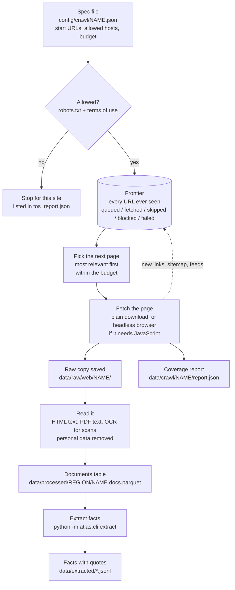

# Crawler guide: how to run it and what you get

A practical guide, in plain words. For *why* the crawler is built this way (requirements, tool comparison, tests), see [`crawler_plan.md`](crawler_plan.md).

## What the crawler does

You give it a website. It visits the pages that are most likely to talk about accessibility (ramps, restrooms, wheelchair entrances, ADA), saves exactly what it received, and turns the pages into text. A second command then pulls out **facts**, each with a word-for-word quote and a link to the page.

It is deliberately polite: it obeys `robots.txt`, checks a site's terms of use, visits one page at a time per site, and waits between requests.

## How it works



The two commands are separate on purpose: **crawl** collects and reads pages, **extract** turns them into facts. You can re-run extract as often as you like without touching the website again.

## Before you start (once)

```bash
cd ~/code/research/accessibility-map
make setup        # Python environment, packages, headless Chromium
```

Use `.venv/bin/python` in the commands below, or activate the environment first (`source .venv/bin/activate`) and use `python`.

## Step 1: write a spec file

One small JSON file per site, saved in `config/crawl/`. Example for the City of Oxford, `config/crawl/oxford_city.json`:

```json
{
  "regions": ["oxford"],
  "author_type": "official",
  "seeds": ["https://cityofoxford.org/"],
  "scope": {"hosts": ["cityofoxford.org", "www.cityofoxford.org"], "depth": 4},
  "budget": {"pages": 200, "images": 20, "megabytes": 400, "per_pattern": 30, "ocr_images": 15},
  "assets": "all",
  "discover": {"sitemaps": true, "feeds": true, "probe_paths": true},
  "render": "auto",
  "explore_share": 0.1
}
```

| Field | Meaning |
|---|---|
| `regions` | Which region the pages belong to (`oxford`, `cincinnati`, `dc`...) |
| `author_type` | Who wrote the pages: `official`, `business`, ... Used later for trust ratings |
| `seeds` | Where to start |
| `scope.hosts` | The only websites the crawler may visit. Links to other sites are skipped |
| `scope.depth` | How many link-clicks away from the seeds it may go |
| `budget.pages` | Stop after this many pages (`--max-pages` on the command line overrides it) |
| `budget.megabytes` | Stop after this much data |
| `budget.per_pattern` | Max pages of one URL shape, so one calendar cannot eat the whole budget |
| `budget.ocr_images` | How many images to run text recognition on |
| `assets` | `"all"` also downloads PDFs, Office files and images |
| `discover` | Where to look for URLs besides links: sitemap, feeds, common paths |
| `render` | `"auto"`: use the headless browser only for pages that need JavaScript |
| `explore_share` | Share of the budget spent on pages that do not look relevant, so we do not miss surprises |
| `tos_allow` | (optional) sites whose owners gave us permission although their terms say no bots |

## Step 2: run the crawl

Try a small run first:

```bash
.venv/bin/python -m atlas.crawler.run oxford_city \
    --spec-file config/crawl/oxford_city.json --region oxford --max-pages 20
```

Then the full run (same command without `--max-pages`).

| Option | What it does |
|---|---|
| `--spec-file F` | Use this spec file (otherwise it looks for the name in `config/sources.yaml`) |
| `--region R` | Region name |
| `--max-pages N` | Page limit for this run |
| `--delay S` | Seconds between requests to one site (default 2) |
| `--fresh` | Forget the waiting queue and crawl again. The list of URLs already seen (the frontier) is kept |
| `--docs-only` | Do not crawl. Rebuild the documents table from what is already saved |

The first argument (`oxford_city`) is the **source name**. It names the output folders. A crawl that stops partway can be started again with the same command and it carries on.

## Step 3: look at what happened

```bash
cat data/crawl/oxford_city/report.json
ls data/raw/web/oxford_city/
```

A real report, from our DC Office on Disability Rights crawl:

```json
{
  "total_urls": 572,
  "by_state": {"failed": 10, "fetched": 184, "queued": 126, "skipped": 252},
  "skipped_reasons": {"off-site": 198, "pattern budget": 23, "translation (es)": 10, "low relevance": 5},
  "failed_reasons": {"HTTP 403": 1, "HTTP 404": 9},
  "html_pages": 110,
  "rendered_in_browser": 26,
  "ended": "page budget reached",
  "complete": false
}
```

How to read it:

- **`by_state`**: every URL the crawler ever saw, and what became of it. `queued` means found but not yet visited.
- **`skipped_reasons`**: why pages were not fetched (other websites, translations, too many of one kind, low relevance).
- **`ended`**: why it stopped. `page budget reached` means there was more to crawl; raise the budget or run again.
- **`complete`**: `true` only when nothing relevant was left in the queue.
- **`tos_report.json`** (only if present, in the same folder): a site whose terms forbid bots. The crawl of that site stopped. Ask the site for permission.

## Step 4: turn pages into facts

```bash
.venv/bin/python -m atlas.cli extract oxford_city --region oxford          # rules only
.venv/bin/python -m atlas.cli extract oxford_city --region oxford --llm    # plus the small local model (Ollama must be running)
```

Each fact keeps its quote, and the quote is re-checked against the saved page text every run. A fact looks like this:

```json
{"place": "BLINK 2026 festival", "attribute": "accessible_parking", "value": "limited",
 "detail": "placard-only street parking areas 4 pm-midnight; no dedicated lots",
 "evidence_quote": "There is no dedicated standard or accessible parking for Blink as it happens across many neighborhoods and street blocks.",
 "url": "https://www.blinkcincinnati.com/resources/accessibility"}
```

## Where everything is saved

| What | Where | In git? |
|---|---|---|
| Raw pages, PDFs, images exactly as received (plus `manifest.jsonl`) | `data/raw/web/<source>/` | No (ignored; stays on your machine) |
| Frontier (URL list with states), job state, `report.json` | `data/crawl/<source>/` | No (ignored) |
| Documents table (cleaned text, tables, phones, hours, OCR) | `data/processed/<region>/<source>.docs.parquet` | Not ignored; check before committing |
| Facts with quotes | `data/extracted/` | Yes |

The raw files are not published. Before text is stored in the documents table, personal data is removed: personal-looking email addresses and phone numbers marked cell, mobile or home. Role addresses (`info@`, `accessibility@`) and business phone numbers are kept.

## Other ways to start a crawl

**Crawl the websites of places already on the map** (this builds the spec for you):

```bash
.venv/bin/python scripts/place_crawl.py --region oxford --categories restaurant,cafe --limit 40
```

**Fetch a fixed list of URLs** (listed in `config/sources.yaml`, no link-following):

```bash
.venv/bin/python -m atlas.cli fetch web_venues_cincinnati --region cincinnati
```

## When something looks wrong

| Symptom | Likely cause and fix |
|---|---|
| Report says `ended: page budget reached`, `complete: false` | Normal for a first run. Raise `budget.pages` or run the same command again |
| Many pages `skipped: off-site` | Links go to other websites. Add a host to `scope.hosts` only if that site is part of the same organization |
| Page 404s that you can open in a browser | Check how the page writes its links. Some sites set a `<base href>` so relative links resolve from the site root (this caused the Blink map PDFs to fail until corrected) |
| `tos_report.json` exists | The site's terms forbid bots. Ask for permission, then add the host to `tos_allow` |
| A JavaScript site returns almost no text | Set `"render": "auto"` (or `true`) so the headless browser is used |
| You stopped a run and want a clean start | Add `--fresh` (keeps the URL list, clears the queue) |

## Related docs

- [`crawler_plan.md`](crawler_plan.md): requirements, research, design choices, test plan
- [`compliance.md`](compliance.md): robots, terms of use, personal data
- [`architecture.md`](architecture.md): how the whole system fits together
