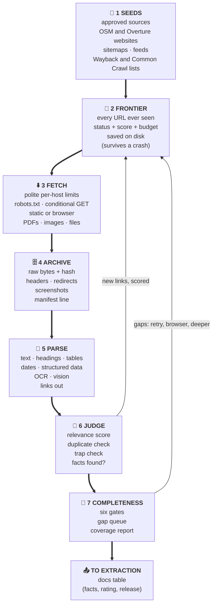
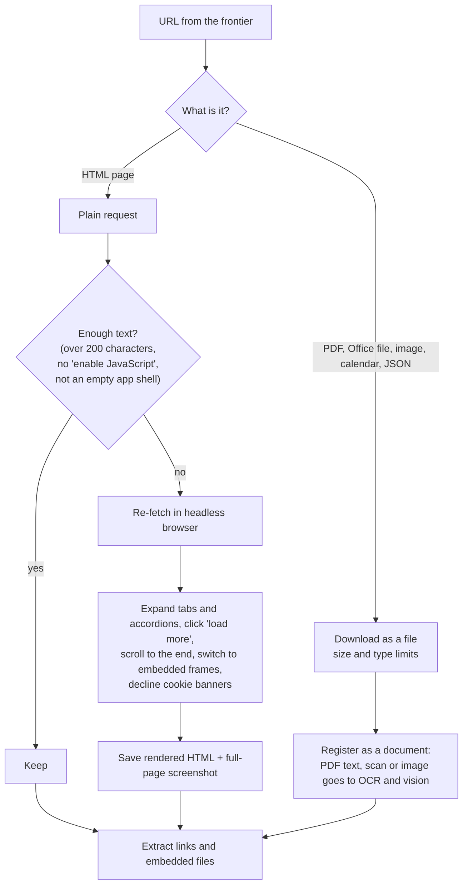
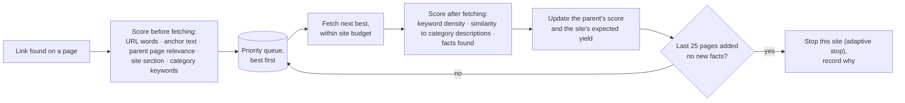
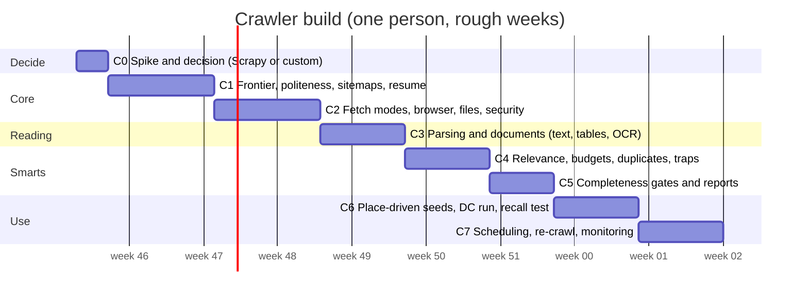

# Web crawler: research and implementation plan

**Goal:** a crawler that finds and keeps every page, PDF and image we might need now or later, from any website, politely, for $0, and can prove how complete it was. Status: **phases C1 to C3 built and tested (2026-11-15)**: core crawler (real-site recall 91.1% against a 90% target), the browser fallback with hidden-content expansion, Office files and safety checks, and the reading layer (text with heading paths, tables, dates, structured data, PDF text, OCR for scans and posters). 132 tests pass. Not built yet: a vision model for maps and posters, Docling for complex PDF tables, and phases C4 to C7 beyond what C1 already has (scheduling, change-driven re-crawl, monitoring). Written 2026-11-15. Part of [`national_data_plan.md`](national_data_plan.md) section 3.4 (fetching) and the completeness gates in [`architecture.md`](architecture.md) 9 and 10. Reasons are logged in [`decisions.md`](decisions.md) (D-20).

**Confidence labels.** *Checked* = confirmed in a web search on 2026-11-15, with a link in section 14. *Unchecked* = general knowledge or vendor claims; verify before relying on them. Most tool comparisons online come from vendors, so treat their numbers as directional.

## 0. The recommendation in six lines

1. **Do not buy or adopt a black box. Build a thin crawler of our own on proven parts,** because our needs are unusual: seeds come from maps (place-driven), crawling is steered by what wheelchair users ask, every page must carry provenance, and a crawl must prove its own completeness.
2. **Use Scrapy as the crawl engine** (queues, politeness, retries, resume, sitemap support are solved there) **and Playwright for JavaScript pages.** Run a 2 to 3 day spike first; fall back to a small custom async crawler if the spike fails (section 4).
3. **Crawl wide, extract deep.** Save everything in scope (cheap), read only what looks relevant (costly), so future questions can be answered from the archive without re-crawling.
4. **Find pages five ways, not just by following links:** seeds from OSM and Overture, sitemaps, feeds, link following, and archive URL lists (Wayback and Common Crawl).
5. **Steer by relevance** (best-first, budgets per site, stop when new pages stop adding facts) so a country-wide crawl stays affordable.
6. **Measure ourselves:** the 22 hand-picked website sources we already have are the answer key. Given only each site's homepage, the new crawler must rediscover at least 90% of the pages we picked by hand.

## 1. What "excellent" means (requirements with numbers)

| # | Requirement | How we know (measurable) |
|---|---|---|
| R1 | **Complete discovery:** finds pages that links alone do not reveal | at least 90% recall against the hand-picked set; sitemap coverage at least 95%; six completeness gates pass or gaps are listed |
| R2 | **Polite and legal:** never harms small sites, never evades blocks | 0 robots violations; at most 1 request per second per host; stops on 429 and 503; no login, CAPTCHA or paywall circumvention |
| R3 | **Reads modern sites:** JavaScript, tabs, accordions, iframes, PDFs, images, calendars | pages where plain download returns less than 200 characters of text are re-fetched with a browser; 100% of linked PDFs and images in scope are saved |
| R4 | **Efficient:** spends effort where answers are | at least 60% of pages fetched are relevant after the first tuning round (measured by the relevance score and by facts found) |
| R5 | **Reproducible and auditable:** any fact traces to saved bytes | every URL has a final status; raw files hashed; manifest line per fetch |
| R6 | **Fresh:** keeps up with change | re-crawl interval by page type; conditional requests; removed pages retire their facts |
| R7 | **Resumable and robust:** survives crashes and bad sites | a killed crawl resumes with no repeated fetches; one bad host never stops others |
| R8 | **Future-proof:** answers questions we have not thought of yet | raw bytes, rendered text, screenshots, headers and link graph kept; schema versioned |
| R9 | **Costs $0:** laptop and lab machines only | no paid APIs or services |
| R10 | **Safe:** crawled content is untrusted | no execution of downloads; size and type limits; text treated as data, never as instructions |

## 2. What we have today (gap analysis)

The existing `src/atlas/connectors/web.py` (about 280 lines) works for hand-picked sites. Compared with the requirements:

| Capability | Today | Gap |
|---|---|---|
| Finding pages | seed URLs you list, plus links one hop deep that start with a prefix you list | no sitemaps, feeds, archive lists, deeper crawling, pagination, or discovery of the seeds themselves |
| Queue | in memory, lost if the run stops | no persistent frontier, no priority, no resume |
| Politeness | one thread, 1 s sleep, robots.txt read once per run | no per-host limits, no Crawl-delay or Retry-After handling, no backoff on 429 |
| Freshness | whole-run age setting (`ATLAS_MAX_AGE_DAYS`) | no conditional requests, no change detection, no per-page schedule |
| JavaScript | optional headless Chromium per source, with screenshot | not automatic; no expanding of tabs, accordions or "load more"; iframes ignored |
| Documents | linked PDFs saved and read with pypdf; images only if the filename looks like a map | no OCR, no table extraction, no Office files, weak image choice |
| Text | BeautifulSoup text of the main block | loses headings and tables; no date or structured-data extraction |
| Duplicates | exact hash only | no URL canonicalization, no near-duplicate detection, no trap protection |
| Relevance | none: the person decides what to list | no scoring, no budgets |
| Completeness | failures and robots skips are counted | no sitemap or archive comparison, no keyword audit |
| Raw archive | hash-named files plus `manifest.jsonl` | good base; no response headers, no redirect chain |

**What to keep:** the raw-store layout and manifest idea, `docs.parquet` columns, `archived_doc()` (facts quote a specific saved version), and the 22 configured web sources as test data.

## 3. Research findings

### 3.1 Crawling frameworks (checked, vendor-influenced)
- **Scrapy** is the mature Python crawler: static HTML by design, JavaScript through add-ons such as scrapy-playwright; built-in scheduling, deduplication, retries and middleware. One source (Apify) calls it better than raw Playwright for scale, a vendor claim.
- **Playwright** is a browser automation library, not a crawler; teams wrap it in a framework for queues, retries and concurrency.
- **Crawlee** adds browser crawling, autoscaling and sessions; it is mainly Node/TypeScript with a Python port. No independent benchmarks found; claims of a universal speed gap are not well supported.
- **Crawl4AI** (open source, self-hosted) produces LLM-ready Markdown and has an "adaptive" mode that stops when enough information is gathered. Licence reported as Apache-2.0 by most sources, MIT or AGPL by others: check the repository. One vendor-adjacent benchmark reported 89.7% success, 11.3% noise: unverified.
- **Firecrawl:** hosted product; the server code is AGPL-3.0 (checked); not free to rely on.
- **Browsertrix Crawler** (Webrecorder, AGPL-3.0) drives a real browser in Docker and writes WARC web archives with built-in behaviours such as autoscroll. A reviewer found it archives what the browser actually loaded, not every URL in the page source.

### 3.2 Finding pages (checked)
- **Sitemaps:** a sitemap file holds at most 50,000 URLs and 50 MB; an index can list up to 50,000 sitemaps (sitemaps.org FAQ). `Sitemap:` lines in robots.txt are a widely supported extension, not part of RFC 9309.
- **Wayback Machine CDX API** lists every captured URL of a domain. No official rate limit is published; reported limits range from about 15 to 30 requests per minute per IP, and the maintained Python client defaults to about 24 per minute. Blocking is per IP. Be conservative.
- **Common Crawl index** (served by pywb) lists captured URLs per monthly crawl; each crawl has its own index (no index spans all crawls); query syntax is `example.com/*` for a whole domain; `cdx_toolkit` wraps both Common Crawl and Wayback.
- **Best-first (focused) crawling** with a relevance or quality score as the queue priority is an active research area; two 2025 papers propagate a page's estimated quality to the pages it links to; CRAW4LLM uses a document score as crawl priority. No paper combining a classifier, a best-first queue and topic focus was found, so we design our own from these ideas.

### 3.3 Politeness and legality (checked)
- **RFC 9309** (September 2022) is the robots.txt standard. `Crawl-delay` is not in it: Google ignores it, Bing and Yandex honour it; a polite crawler sets its own limits and treats the directive as a hint.
- **Legal summary (law-firm and vendor blogs, not legal advice):** scraping public, logged-out pages is comparatively low-risk under the US computer-misuse law after *hiQ v. LinkedIn* (settled 2023, no Supreme Court ruling) and *Van Buren* (2021); *Meta v. Bright Data* (2024) turned on contract terms and public pages. Breaching site terms can still create contract risk, and circumventing technical barriers (logins, CAPTCHAs, IP blocks) is a different and riskier matter. Copyright and privacy law are separate questions that these sources did not cover. **We follow robots.txt, avoid anything behind a login or paywall, and ask the university library or counsel before redistributing page content.**

### 3.4 Reading what we fetched (checked, mixed sources)
- **Main text:** trafilatura scores about 0.90 to 0.91 F-score in its own benchmarks, ahead of readability-lxml (about 0.80) and newspaper (about 0.72); an independent 2,008-page benchmark gives about 0.93 for trafilatura on articles, but all extractors do well on articles and less well on other page types. The maintainers wrote the first benchmark, so expect bias.
- **Dates and structured data:** `htmldate` finds publication and update dates; `extruct` reads JSON-LD, Microdata, Open Graph (a newer library, `turbohtml`, claims to combine these). Schema.org accessibility properties exist but were designed for digital content (see `source_types.md` H).
- **PDFs:** Docling is generally rated best for tables and layout, runs locally and has OCR (Tesseract, EasyOCR, RapidOCR); Marker is faster with a GPU and uses Surya OCR; PyMuPDF4LLM is the lightest and best for clean text PDFs but has no OCR. Benchmarks conflict and come from vendors, so we test on our own PDFs.
- **Images, posters, maps:** small local document models are strong: dedicated OCR models around 1 billion parameters (PaddleOCR-VL, GLM-OCR) top one 2026 guide's document benchmark; general vision models (Qwen2.5-VL 7B, Qwen3-VL 8B) suit layout questions on maps and posters and run in roughly 6 GB at 4-bit. These figures come from aggregator blogs and are unverified for our content.

## 4. Options compared and the choice

| Option | JS pages | Politeness, retries, resume | Custom priority and relevance | WARC archive | Effort | Fit |
|---|---|---|---|---|---|---|
| **A. Extend current `web.py`** | yes (Playwright, manual) | we write it all | we write it | no | medium, but every hard part is ours to get right | poor at scale |
| **B. Scrapy + scrapy-playwright (recommended)** | via add-on | built in (concurrency per domain, auto-throttle, retry middleware, persistent job directory, duplicate filter, sitemap spider) | request priority plus our own scoring middleware | add-on or our own | low to medium | good |
| **C. Crawlee for Python** | built in | built in | possible | no | medium; younger Python port | fair |
| **D. Crawl4AI** | built in | partial | its adaptive mode, but opinionated | no | low to start, less control | fair as a helper, not a core |
| **E. Browsertrix Crawler** | real browser | built in | limited | **yes** | needs Docker; AGPL; weaker custom logic | good as an optional archiver, not the brain |
| **F. Fully custom async crawler** | Playwright | we write it | full control | we write it | highest | fallback |

**Choice (proposed, D-20): B**, with our own modules for the parts that matter to us (relevance scoring, budgets, completeness gates, provenance, extraction hand-off), plus the free libraries named in section 6. **A 2 to 3 day spike decides:** crawl three known sites end to end with Scrapy and with a small custom loop; keep Scrapy unless it cannot (a) keep its queue priority under our scoring, (b) resume after a kill, (c) run Playwright pages through the same politeness limits. Browsertrix stays an optional later add-on for WARC export of key sites.

## 5. Architecture



Each box is a separate module with one job and a tested interface, so a part can be replaced (for example the fetcher) without touching the rest.

## 6. Components in detail

### 6.1 Seeds and URL discovery (R1)
| Route | What it adds | Notes |
|---|---|---|
| Approved source URLs (`sources.yaml`, candidates table) | the starting points | already exist |
| **OSM `website` / Overture `websites` tags** | one seed per known place | main route for venues; also `contact:website` and `url` tags |
| **Sitemaps** | the site's own list of pages | read `Sitemap:` lines in robots.txt, try `/sitemap.xml`, `/sitemap_index.xml`, `/wp-sitemap.xml`; handle gzip and indexes; honour the 50,000 URL / 50 MB limits; use `lastmod` to schedule re-crawls |
| **Feeds** | new pages and events | RSS, Atom, iCal (`/feed`, `/events.ics`, `<link rel=alternate>`) |
| **Link following** | what is linked | all links, not only prefixes; also `rel=next` and numbered pagination; iframes, embedded viewers, `<object>` and `<embed>` sources |
| **Archive URL lists** | pages the site no longer links or lists | Wayback CDX and Common Crawl index per domain, at most 1 request per 3 seconds (conservative); used only to *discover* URLs, then we fetch live |
| **On-site search probe** | pages the nav hides | for sites with a search form, try a few query URLs (for example `?s=wheelchair`) as a gate check (6.9), never as the main route |
| **Homepage and nav probing** | the "Accessibility" page nobody linked well | always try common paths per site: `/accessibility`, `/ada`, `/visit`, `/plan-your-visit`, `/parking`, `/directions`, `/events`, `/faq` (list generated from `categories.yaml` `page_words`) |

### 6.2 Scope and politeness (R2)
- **Scope rules per site:** same registered domain plus an allow-list of related hosts (CDNs, PDF hosts) named in the spec; schemes http/https only; depth limit (default 4, raised for trusted sites); page and byte budgets per site.
- **robots.txt per RFC 9309:** fetch and cache per host (refresh daily), obey Allow/Disallow for our user agent; keep a record of every robots decision. `Crawl-delay` is honoured when present (as a floor), otherwise our own delay applies.
- **Rate:** one request at a time per host, at least 1 s (2 s default, adaptive: slow down when response time rises), a global cap on parallel hosts (start 8), exponential backoff on 429, 500, 502, 503, 504 and honour `Retry-After`; a circuit breaker pauses a host after repeated failures.
- **Identity:** honest user agent with a project contact page, never an individual's email (privacy), never pretend to be a browser from a search engine.
- **Conditional requests:** send `If-None-Match` and `If-Modified-Since`; a 304 costs almost nothing.
- **Never:** log in, solve CAPTCHAs, evade IP blocks, fetch pages whose terms forbid automated access (the site is marked `tos: restricted` and handled by asking permission), or hit paths that look like actions (`/cart`, `/login`, `/delete`).

### 6.3 Fetch modes and rendering (R3)

- **Browser budget:** the browser is slow, so it is used only when the plain fetch is thin or the site is flagged as an app; at most one page per host at a time; recycle the browser every 100 pages; a time limit per page.
- **Hidden content:** open `details` elements, tabs, accordions (ARIA roles), "show more" buttons, and read shadow DOM and iframes; save the rendered DOM, not only the page source.
- **Cookie banners:** choose the most privacy-preserving option (decline non-essential), as our general rule.
- **Files:** PDF, DOC/DOCX, XLS/XLSX, PPT/PPTX, CSV, ICS, JSON, KML/GeoJSON, ZIP (listed, not auto-opened), images (all non-trivial images on relevant pages; skip logos and icons by size and name).

### 6.4 Archive (R5, R8)
- Keep exactly what we received: bytes (hash-named), response headers, final URL and redirect chain, status, timing, the rendered DOM and a screenshot for browser pages, and a manifest line (extends today's `manifest.jsonl`, plus `data/raw/manifest.jsonl` from Phase 0).
- **History:** a changed page is a new file; old versions stay so a fact can quote the version it came from (`archived_doc()` already does this).
- **Compression:** gzip or zstd for HTML and text; images and PDFs as they are; deduplicate identical files by hash.
- **WARC (optional, later):** export key sites as WARC through Browsertrix or `warcio` for standard replay and for sharing, if the lab wants it.

### 6.5 Parsing: text, tables, documents and pictures (R3, R8)

_Built in C3 (`src/atlas/crawler/read.py`): trafilatura for main text with a fallback; sections with heading paths; HTML tables as rows; htmldate and extruct (JSON-LD, Microdata, Open Graph); phone and opening-hours patterns; accessibility sentences by section; PyMuPDF text by page with tables; RapidOCR (a pip-only OCR, no system install) for scanned pages and images; PDFs read in a separate process. Chosen instead of the options below: Docling and a local vision model are heavier and are left for later._
| Input | Method (free) | Output kept |
|---|---|---|
| HTML text | trafilatura for the main content, with a fallback to our current extractor when it returns too little | text with heading hierarchy (so chunks keep "section path"), plus the full-page text as a second copy so nothing is lost |
| HTML tables | parse into rows and columns | table records (hours, prices, access tables) |
| Dates, structured data | htmldate; extruct (JSON-LD, Microdata, Open Graph) | publication and update dates; addresses, phone numbers, opening hours, geo coordinates when present |
| Contact and address patterns | rules (phone, email domains, street addresses, hours) | candidate contacts and hours |
| Text PDF | PyMuPDF for text with page numbers; Docling for tables and layout when the page has tables | text per page, tables, page and box positions for quotes |
| Scanned PDF, poster, flyer | OCR (Tesseract or PaddleOCR) first; a local vision model only when OCR is poor or the page is a map or poster | text with confidence; short description of the picture |
| Images on relevant pages | size, name and alt-text filter, then OCR; vision model for signs, maps and floor plans | text, description, image kept as evidence |
| Office files | convert to text and tables (python-docx, openpyxl) | text, tables |
| Calendars | iCal parser | events |
Every output keeps where it came from (file hash, page, region) so the quote check can verify claims later.

### 6.6 Relevance, priority and budgets (R4)

- **Score before fetch (cheap):** keyword hits from `config/categories.yaml` `page_words` in the URL and anchor text; page depth; whether the parent page was relevant; path patterns (`/accessibility`, `/ada`, `/visit`); file type (a PDF named "accessibility guide" outranks a blog post); negative signals (`/tag/`, `/author/`, `/cart`, calendars far in the past).
- **Score after fetch (still cheap):** keyword density and heading matches; cosine similarity of a small local embedding of the page to each category's description; facts found by the extractor, which feeds back to raise the score of similar links.
- **Budgets:** a total page and byte budget per site, a per-section budget (so one big blog cannot starve the visit pages), and an **exploration share** (about 10%) for low-score pages so we do not miss unexpected places.
- **Adaptive stop:** when many recent pages added no new facts, stop the site and record "stopped by yield". Sites with high yield get more budget.
- **Learning from results:** after each crawl, count which URL patterns produced facts and update the weights (a plain table, no heavy model).

### 6.7 Duplicates, canonical URLs and traps (R4, R7)
- **Normalize URLs:** lowercase host, drop fragments, remove tracking parameters (`utm_*`, `fbclid`, `gclid`), sort parameters, drop `index.html`, respect `<link rel=canonical>`, resolve redirects, treat `http` and `https`, `www` and bare as one when the site does.
- **Exact duplicates:** same content hash. **Near-duplicates:** SimHash or MinHash on the text (for example with `datasketch`), to skip print pages, language copies without new facts, and template-only differences.
- **Trap guards:** cap calendar and date-archive paths, cap repeated parameter patterns (`?page=` beyond the last non-empty page), maximum path depth, maximum URLs per path pattern; stop on "soft 404" pages that return 200 with an error text.

### 6.8 Change detection and re-crawl (R6)
| Page type | Re-crawl |
|---|---|
| events, alerts, closures | daily to hourly (feeds first) |
| transit and parking pages | weekly |
| venue accessibility pages | every 90 to 180 days |
| ADA plans, PDFs | every 180 to 365 days |
| anything with a sitemap `lastmod` | when `lastmod` changes |
- Use conditional requests; compare content hash; record `change_count` and a simple change-rate estimate per page, and revisit pages that change often sooner.
- A page that disappears (404, 410) or moves marks its facts `valid_to` rather than deleting them (D-17), and its redirect target becomes a new candidate.
- A redesigned site (extraction yield drops sharply while pages still load) raises a drift alert and a re-extraction job.

### 6.9 Completeness gates (R1)
The six gates in `architecture.md` 10 become code:
1. **Status audit:** no URL left without a final status.
2. **Sitemap coverage:** share of sitemap URLs fetched, target 95% or the reasons listed.
3. **Count check:** for API or GIS sources the server's total equals rows saved.
4. **Archive check:** URLs found in Wayback and Common Crawl that we never saw; those under in-scope paths are queued.
5. **Keyword audit:** run the site's own search (when it has a form we can read) for wheelchair, accessible, ADA, ramp, elevator, parking and compare with fetched pages; also a web search for `site:` is **not** used (no paid search); the audit uses on-site search and the archive lists.
6. **Sample audit:** pick random in-scope URLs we did not fetch (from archive lists and sitemaps with low score) and test relevance with the local model; if more than 5% are relevant the score weights are wrong and the budget is raised.
Output: a per-site and per-region **coverage report** (fetched, failed, skipped with reason, blocked, rendered, stopped by yield, gaps), saved next to the dataset card and fed to the trust engine's completeness component.

### 6.10 Observability (R5, R7)
- **Crawl report per run:** pages by status and reason, bytes, time per host, browser use, duplicates, near-duplicates, relevance histogram, facts per 100 pages, slowest hosts, and the top reasons for failure.
- **Fetch ledger:** extends `data/ledger/fetch_log.jsonl` (already written on every fetch) with crawl id and host.
- **Alerts in the report (no dashboard server):** a host whose failure rate exceeds 20%, a crawl that stopped on budget, a robots rule that changed, a site whose yield dropped.

### 6.11 Reliability (R7)
- **Frontier on disk** (SQLite or DuckDB file) with one row per URL; every state change is committed, so a crash loses at most the page in flight.
- **Idempotent steps:** re-running a crawl only does what is missing; the manifest and hashes make repeats free.
- **Timeouts and limits:** connect, read and total timeouts; maximum response size (for example 50 MB for HTML and PDFs, a separate larger limit for known big documents); maximum redirects (5).
- **Isolation:** a failing host never blocks others; the browser runs in a separate process with a memory cap and a restart policy.
- **Disk guard:** stop and report when free space falls below a threshold.

### 6.12 Security (R10)
- Treat every download as hostile: never execute, open Office macros, or unpack archives automatically; check the real file type from the bytes, not the extension; run parsers in a subprocess with limits; reject zip bombs and oversize files.
- **Safe networking:** resolve names and refuse private or loopback addresses (stops a malicious page from pointing us at the local network); follow only http and https.
- **Prompt-injection hygiene:** page text may contain instructions aimed at an AI. The extraction step passes it to the model as quoted data, never as instructions; claims need a verbatim quote that is checked against the saved bytes; the model has no tools while reading pages.
- **Secrets:** never put API keys in fetched URLs or logs (the manifest already stores parameter names only).

### 6.13 Legal and ethics (R2)
- Public pages only; honour robots.txt; record each site's terms status; if the terms forbid automated access, mark `tos: restricted`, do not crawl, and request permission or use another route.
- Store facts, short quotes and links for sharing; keep full page copies private for evidence (copyright); minimise personal data (no staff emails or personal social profiles unless the page is the official contact for the service).
- Provide a contact page and a quick way for a site to ask us to stop; honour it.
- Ask Miami's library or counsel about redistributing page-derived data before the first release; the legal sources we found are blog summaries, not advice.

## 7. Data model and configuration

### 7.1 Crawl spec (extends a source in `config/sources.yaml`)
```yaml
web_example_museum:
  type: crawl               # new connector type; `web` keeps working for hand-picked pages
  regions: [dc]
  author_type: official
  seeds: [https://example.org/]          # or taken from OSM/Overture websites
  scope: {hosts: [example.org, cdn.example.org], depth: 4}
  budget: {pages: 300, megabytes: 500, per_section: 60}
  discover: {sitemaps: true, feeds: true, archives: true, probe_paths: true}
  render: auto              # auto | always | never
  assets: all               # all | maps | none
  refresh_days: 90
  tos: ok                   # ok | restricted
```

### 7.2 Frontier table (one row per URL)
| Field | Meaning |
|---|---|
| `url_id`, `url`, `canonical_url`, `host` | identity after normalization |
| `state` | queued, fetching, fetched, failed, skipped, blocked, duplicate, retired |
| `reason` | why it is skipped, blocked or failed (robots, off-scope, budget, timeout, 404, ...) |
| `depth`, `discovered_from`, `discovered_via` | where it came from: seed, sitemap, feed, link, archive, probe |
| `score`, `priority` | relevance estimate and queue priority |
| `attempts`, `last_attempt`, `next_retry` | retry control |
| `etag`, `last_modified`, `content_sha`, `status_code`, `content_type`, `bytes`, `render_used`, `final_url` | what we got |
| `first_seen`, `last_fetched`, `change_count` | history for re-crawl |
| `facts_found` | feedback for scoring |

### 7.3 Documents table (extends today's `docs.parquet`)
Keep all current columns and add: `canonical_url`, `depth`, `discovered_via`, `content_sha`, `status`, `headers` (selected), `rendered`, `language`, `published_at`, `updated_at`, `section_path`, `relevance`, `tables` (reference), `structured_data` (reference), `crawl_id`. Schema v2 history rules apply (changed pages become new rows).

## 8. Future-proofing: what to capture now so we do not have to re-crawl

- **All in-scope pages and files, not only relevant ones,** within budget (text is small; relevance only decides what we read deeply now).
- **Raw bytes, headers, redirect chains, rendered DOM and screenshots** (re-extract later with a better model).
- **The link graph** (who links to whom, with anchor text): enables new scoring and "what is reachable from the accessibility page" questions.
- **Per-page history** (versions, change dates, removed pages).
- **Structured data and contact details** found on any page.
- **Images and documents** for relevant pages (vision models will keep improving).
- **Crawl reports and gap lists** (so we know what we do not know).
- **Versioned schemas** and the crawl configuration used, so results are reproducible.

## 9. Scale and capacity at $0 (rough, unchecked)

- **Per region:** a city or county region has on the order of thousands of sites; at about 20 to 300 pages per site that is 50,000 to a few hundred thousand pages, roughly 5 to 50 GB raw (before compression). One laptop at one request per second per host and 8 hosts in parallel can fetch around 5 to 8 pages per second overall, so a region takes hours to a day, plus browser and OCR time for the minority of pages that need it.
- **Country:** millions of sites make a full live crawl impractical on a laptop. The plan is therefore **region by region, on demand,** with a global budget, priority by what users ask about, and reuse of the Common Crawl index to find (and, where its copies are fresh enough, to read) pages without hitting small servers. Whether Common Crawl's stored pages are fresh and complete enough for our needs is unchecked.
- **Storage:** compress text; keep raw files only for relevant sites at full depth and for the rest keep text, hashes and headers; ask where lab or university storage exists.
- **Compute:** crawling is network-bound (laptop is fine); parsing is cheap; OCR and vision models are the slow part, so they run in batches on a lab GPU if available.

## 10. Testing and evaluation plan

| Test | What it proves | Pass mark |
|---|---|---|
| **Local trap server** (a small test website we run that has robots.txt, sitemaps, redirects, a calendar trap, infinite parameters, a JavaScript-only page, a 429 response, an oversized file, a fake `Retry-After`) | politeness, traps, JavaScript detection, backoff, resume | all behaviours as specified; a killed crawl resumes with no repeats |
| **Recall against our hand-picked set:** for each of the 22 current web sources give only the homepage and compare discovered pages with the pages we listed by hand | discovery quality (R1) | at least 90% of hand-picked pages found; list the misses and fix |
| **Precision of relevance:** sample 100 fetched pages per run and label them relevant or not using the local model plus the facts found | efficiency (R4) | at least 60% relevant after the first tuning |
| **Completeness gates on two sites with a known sitemap** | gates work | gaps found and reported |
| **Politeness audit** from the ledger | R2 | 0 violations (rate, robots, Retry-After) |
| **Extraction regression:** re-read the 25 Cincinnati and 79 Oxford documents already extracted | new parser is not worse | facts with verified quotes do not drop |
| **Cost per useful fact** (pages fetched and compute time per verified fact) | efficiency over time | falls from the first run to the third |
| **Resume and failure injection** (kill the process, cut the network, fill the disk) | reliability (R7) | clean recovery |
| **Security tests** (malformed PDFs, zip bomb, redirect to a private address, page with injected instructions) | R10 | rejected or contained |

## 11. Implementation plan



| Phase | Tasks | Exit criterion |
|---|---|---|
| **C0 Spike (2 to 3 days)** | crawl 3 known sites with Scrapy (+ scrapy-playwright) and with a small custom async loop; compare how each handles priority, resume, per-host limits, Playwright pages, and how much code each needs | decision recorded in D-20; if Scrapy cannot do all three listed conditions, go custom |
| **C1 Core** | persistent frontier (SQLite or DuckDB); URL normalization; robots.txt (RFC 9309) with decision log; per-host rate limiting, backoff, Retry-After, circuit breaker; sitemap and feed discovery; conditional requests; manifest and ledger integration; crawl spec in `sources.yaml`; local trap server | trap-server tests pass; kill and resume works; 0 politeness violations |
| **C2 Fetch** | static and browser modes with the "thin page" rule; hidden-content expansion; iframes; file downloads with type and size checks; screenshots; security guards (private IPs, file sniffing, subprocess parsers) | JavaScript, tab and accordion test pages fully captured; security tests pass |
| **C3 Reading** | trafilatura with heading structure; tables; htmldate and extruct; PDF cascade (PyMuPDF, Docling for tables, OCR for scans); image handling with OCR then vision; documents table v2 | extraction regression passes; 100% of linked PDFs and images in scope saved |
| **C4 Smarts** | relevance scoring (keywords from `categories.yaml`, small local embedding); priority queue; budgets and exploration share; adaptive stop; near-duplicate detection; trap guards; weight updates from facts found | at least 60% relevant on a tuning sample; trap server shows no runaway |
| **C5 Completeness** | the six gates as code; Wayback and Common Crawl list lookups with conservative limits; coverage report; hook into the trust engine's completeness component and the dataset card | gates run on two sites with sitemaps; gap lists produced |
| **C6 Use** | seeds from OSM and Overture website tags; candidate table integration; run DC end to end; recall test on the 22 hand-picked sources | at least 90% recall; DC coverage report |
| **C7 Operate** | scheduler for re-crawl by page type; change detection and retirement of removed pages; drift alerts; optional WARC export; Common Crawl backfill experiment | a second crawl of a region only fetches what changed |

(Times assume one person and are rough; C0's outcome may change C1 and C2.)

## 12. Risks

| Risk | Mitigation |
|---|---|
| Sites block or slow us | strict politeness, honest identity, backoff; never evade blocks; mark as blocked and ask the owner |
| Scrapy cannot keep our relevance priority or resume as hoped | C0 spike with a custom fallback ready |
| JavaScript-heavy or app-like sites defeat extraction | browser mode, rendered DOM and screenshots, vision model fallback |
| Storage grows beyond the laptop | compress, keep raw only for relevant sites, ask for lab or university storage |
| OCR and vision are slow | cheap rules first, batch jobs, only on relevant images |
| Legal or terms issues | record terms status per site, public pages only, ask counsel before redistribution |
| Relevance scoring misses unusual places | exploration share, sample audit, archive and keyword audits |
| Crawling hits small organisations' servers | low rates, caching, conditional requests, off-peak runs |
| Prompt injection in crawled text | text as data, quote check, no tools while reading |
| Scope creep | phases with numeric exit criteria; C1 to C3 already give a better crawler than today's |

## 13. Open questions (answered 2026-11-15)

Answered by you on 2026-11-15 (see `questions_for_you.md`); the effects are in decision D-21.

**Still open:** who is the crawler's contact person (B4); whether the lab's wheelchair recordings can be joined to the map by place and time (E1, ask your professor); whether to ask Miami's library or counsel about redistributing page-derived data (E3); the Maryland counties and deadline beyond "whole city" coverage (A1); WARC files (B2, not needed now); the rule for sites whose terms forbid bots (C2, using my default until you decide: skip and ask permission).


From your answers: Scrapy first with a custom fallback; everything runs on your laptop for now; relevant pages only at first; Zenodo may host archives.

## 14. Sources (searched 2026-11-15)
- Frameworks: [Scrapy vs Crawlee (Crawlee)](https://crawlee.dev/blog/scrapy-vs-crawlee), [Scrapy vs Playwright vs Crawlee 2026](https://dev.to/0012303/scrapy-vs-playwright-vs-crawlee-which-web-scraping-tool-should-you-use-in-2026-1eik), [Scrapy alternatives (Apify)](https://blog.apify.com/alternatives-scrapy-web-scraping)
- Archiving: [Browsertrix Crawler review](https://thunderbit.com/blog/browsertrix-crawler-review), [Browsertrix behaviours](https://webrecorder.net/blog/2025-05-28-create-use-and-automate-actions-with-custom-behaviors-in-browsertrix), [Autopilot behaviours](https://webrecorder.net/blog/2021-04-21-autopilot-testable-automated-behaviors)
- Text extraction: [trafilatura evaluation](https://trafilatura.readthedocs.io/en/latest/evaluation.html), [WCXB extraction benchmark](https://murrough-foley.pages.dev/web-content-extraction-benchmark/), [extruct](https://pypi.org/project/extruct/), [htmldate evaluation](https://htmldate.readthedocs.io/en/stable/evaluation.html)
- Archive indexes: [cdx_toolkit](https://github.com/commoncrawl/cdx_toolkit), [Common Crawl CDXJ index](https://blog.commoncrawl.org/cdxj-index), [CDX Server API (pywb)](https://pywb.readthedocs.io/en/latest/manual/cdxserver_api.html), [Wayback rate limit notes](https://cirosantilli.com/wayback-machine-rate-limit)
- Standards: [RFC 9309](https://datatracker.ietf.org/doc/html/rfc9309), [How Google reads robots.txt](https://developers.google.com/search/reference/robots_txt?nav=true), [sitemaps.org FAQ](https://sitemaps.org/faq.html)
- Focused crawling: [CRAW4LLM](https://liner.com/review/craw4llm-efficient-web-crawling-for-llm-pretraining), [quality-scoring crawler paper](https://arxiv.org/pdf/2504.11011v1), [Crawl4AI vs Firecrawl](https://blog.apify.com/crawl4ai-vs-firecrawl/)
- PDFs and OCR: [Docling vs PyMuPDF4LLM](https://www.file2markdown.ai/blog/pymupdf4llm-vs-docling), [OCR to Markdown evaluation](https://www.llamaindex.ai/insights/ocr-to-markdown-evaluation), [open-source OCR models](https://blog.roboflow.com/best-open-source-ocr-models/), [local vision models 2026](https://tinyweights.dev/posts/best-local-vision-language-models-2026/)
- Legal (not legal advice): [hiQ v. LinkedIn and other rulings](https://www.fbm.com/data-analytics/publications/what-recent-rulings-in-hiq-v-linkedin-and-other-cases-say-about-the-legality-of-data-scraping/), [Is web scraping legal in the US](https://thunderbit.com/blog/is-web-scraping-legal-us)
