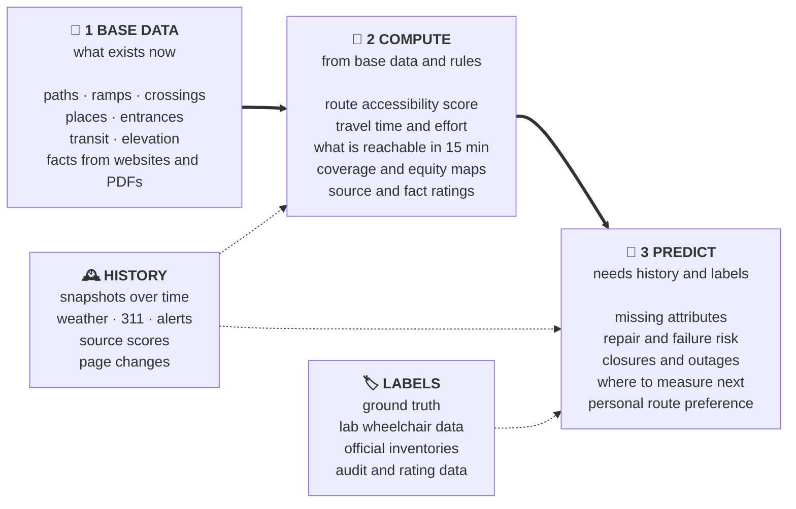

# Data we will need: now, for computing, and for prediction

The attribute list for the assistant's questions is in [`data_landscape.md`](data_landscape.md) section 1. This file goes further: it lists **what else to collect now so we can compute and predict things later**, and what that means for how we store data. Written 2026-11-15. Source availability and licences are *unchecked* unless marked; verify before relying on them. Everything is chosen to be free ($0 budget).

## 1. The idea in one picture

Three rules follow from it:
1. **Base data** answers questions today.
2. **Computed values** need the base data plus *rules* (ADA limits, user profile).
3. **Predictions** additionally need **history** (what changed and when) and **labels** (what was really true). Both are cheap to keep now and impossible to recreate later, so they are collected from day one.

## 2. What we need, by purpose

Priority: **P0** needed for the first regions · **P1** next · **P2** later. **Keep history?** = store dated snapshots now, because it cannot be recovered afterwards.

### 2.1 Base data (answers questions today)

Already covered by the attribute list; summary only. Street layer (sidewalks, ramps, crossings, steps, signals, slope), places (entrance, restroom, parking, elevators), transit (stops, wheelchair boarding, schedules, alerts), events, and quoted facts from websites, PDFs and posters. See `data_landscape.md` and `source_types.md`.

Additions the first plan did not stress:

| Data | Why | Free source (unchecked unless noted) | P | Keep history? |
|---|---|---|---|---|
| Opening hours and closures | "open now" answers | OSM `opening_hours`, venue pages | P0 | yes |
| Building footprints and addresses | match facts to the right building; entrance location | Overture buildings and addresses, OSM, Microsoft footprints | P0 | no |
| Indoor data (elevators, floors, restrooms) | inside-a-place questions | OSM indoor tags, venue floor plans and PDFs | P1 | yes |
| Parking: accessible stalls, van access, drop-off | arrival questions | OSM, city parking layers, venue pages | P0 | yes |
| Door and entrance details (width, automatic, threshold height) | can I get in | OSM, venue text, photos (vision model) | P1 | no |
| Surface and condition (cracks, bumps, width) | comfort and safety | OSM, city audits, street imagery, lab sensors | P1 | yes |
| Obstructions (poles, bins, scooters, parked cars) | route blocking | 311, Mapillary detections, Project Sidewalk | P2 | yes |
| Lighting, shade, rest benches | comfort, safety, energy | OSM, city GIS | P2 | no |
| Paratransit service areas and rules | getting around | agency PDFs and pages | P1 | yes |

### 2.2 For computing (derived numbers)

| Computation | Inputs needed | Free source | P |
|---|---|---|---|
| **Route accessibility score** for a person | slope (running and cross), surface, width, kerb height, ramps, crossing type, steps, plus the person's limits | 3DEP and LiDAR, city GIS, OSM, user profile | P0 |
| **Rules library** (ADA and PROWAG limits: ramp 1:12, route width 36 in, cross slope 2%, and so on) as data, not code | the legal thresholds with citations | ADA standards (public), US Access Board | P0 |
| **Travel time and effort** | speed by surface and grade, energy per grade, battery range, detours | published wheelchair speed and energy studies; lab recordings (IMU) | P1 |
| **Reachability ("what can I reach in 15 minutes")** | connected pedestrian graph with barriers, transit timetables, transfer times | OSM and city graph, GTFS | P1 |
| **Accessibility islands and critical barriers** (which single fix reconnects the most) | the same graph, barrier locations | derived | P2 |
| **Service access** (distance to accessible stops, restrooms, clinics, groceries) | POI list with accessibility, stops | Overture, OSM, GTFS | P1 |
| **Equity** (who lacks access, who waits longest) | disability prevalence, income, race, vehicle access, redlining maps, population, 311 per capita, response time | Census ACS (S1810 and others), HOLC maps, 311 portals | P0 for the two cities |
| **Coverage and completeness per region** | dataset cards, counts, crawl status | generated | P0 |
| **Source and fact ratings** | reference data, agreement stats | generated, `system_overview.md` section 4 | P0 |

### 2.3 For predicting (needs history and labels)

| Prediction | Why it matters | Inputs and history to keep | Labels needed | P |
|---|---|---|---|---|
| **Fill missing attributes** (does this venue have a step-free entrance, is this crossing signalised?) | most places are unknown; a model can guess with a stated probability | place category, building age, neighbourhood, nearby tags, aerial or street imagery, similar places | places whose answer is known (official data, quoted facts, lab data) | P1 |
| **Ramp and sidewalk deterioration and repair need** | tells cities where to inspect | age, material, tree cover, freeze-thaw and rain history, traffic, 311 history | inspection results, 311 outcomes | P2 |
| **Temporary barriers** (elevator outages, closures, construction, snow and ice) | "is it passable today" | GTFS-RT alert history, permits, weather forecasts, event calendars | past alerts and closures with start and end | P1 (collect now) |
| **311 response time and who gets slower service** (RQ1) | the equity paper | request dates, categories, statuses, neighbourhood, income | recorded close times | P0 |
| **Where to measure next** (uncertainty sampling) | spend limited lab time well | source scores, disagreements, missingness (RQ3) | new measurements | P1 |
| **Source reliability** (truth discovery) | rates sources better over time | each source's claims over time, reference data | reference values | P1 |
| **Personal route preference** | personalised routes | rider choices, ratings, feedback (opt-in) | which route was chosen or rated | P2 |
| **Demand** (where wheelchair users go, paratransit trips) | plan services | aggregated trip data if available | counts | P2 |
| **Surface type and comfort from motion** | cross slope and surface from a moving chair (RQ2) | IMU, radar, camera, depth from the lab | surveyed surfaces | P1 (lab) |

### 2.4 Context and time data (feeds both computing and prediction)

| Data | Use | Free source | P | Keep history? |
|---|---|---|---|---|
| **Weather**: snow, ice, rain, temperature | passability, deterioration, forecasts | NOAA and National Weather Service | P1 | yes |
| Transit real-time and alerts | outages and detours | GTFS-Realtime feeds | P1 | yes (archive every poll) |
| Construction and right-of-way permits | closures | city permit portals | P1 | yes |
| Events and crowds | access notes, closures | iCal feeds, event pages | P1 | yes |
| Building permits and renovation dates | ADA upgrades are triggered by renovations | city permit data | P2 | yes |
| DOJ ADA settlements, complaints | documented problems | ADA.gov | P2 | yes |
| Land use, zoning, parcels | context for predictions | county GIS | P2 | no |

### 2.5 Labels and ground truth

| Data | Use | Source |
|---|---|---|
| **Lab wheelchair recordings** (mmRAMP radar, camera, depth, IMU; SurfaceEncoder surfaces) | highest-quality truth for slope, surface, cross slope | the lab |
| Official inventories (CAGIS, DC ADA curb ramp, Maryland highway pedestrian facilities, ODOT) | silver truth for ramps and sidewalks | government |
| Project Sidewalk and other labelled imagery | training and testing vision models | open (CC0 for Project Sidewalk, checked) |
| The 44-question bank, and more | evaluate the assistant | our repo |
| Our own visitor ratings | crowd signal and personalisation labels | Supabase |
| Audit and rating data from users (opt-in) | calibration | future |

### 2.6 People data (handle with care)

To personalise, we need a **user profile**: chair type (manual, power, scooter), width and length, turning radius, maximum slope and cross slope, stamina and battery range, preferences (avoid cobblestones, prefer shade), and sensory needs. Rules: store as **parameters on the device by default**, never require identifying data, make any sharing opt-in, aggregate before research use, and check with IRB before collecting. Questions the assistant receives are also sensitive: keep them only anonymised and only if the user allows it.

## 3. What this changes in how we store data

These are the design implications, and they are what makes future computing and prediction possible.

1. **Never overwrite: keep history.** Every observation has `observed_at`, `valid_from`, `valid_to` and the source snapshot it came from. Changing a value adds a row. Archive GTFS-Realtime, weather, 311 and key web pages on a schedule. (Decision D-17 in `decisions.md`.)
2. **Store uncertainty with values:** confidence, method and source rating, so models can weigh data.
3. **Units, coordinate system and geometry always explicit.** Slope in percent, widths in metres, one coordinate reference system, geometry for every entity that has a place.
4. **Stable IDs across releases** for places, segments and ramps, so a prediction can be matched with what later happened.
5. **Keep the raw files** so a better model can re-read them later (already in the plan).
6. **A rules table** for legal thresholds (value, unit, citation, date), so computed scores can be explained and updated.
7. **A feature view:** a periodic table that joins an entity with its latest and historical features (age of data, count of reports, weather exposure), ready for machine learning. Build it from the release files; do not store a second copy.
8. **Label table:** separate rows marking which values are ground truth, from which method, so models never train on their own guesses.
9. **Privacy by design:** user profile and query data are separate from place data, off by default, and removable.
10. **Dataset cards** state coverage, freshness and known bias (for example 311 reflects who reports, not where barriers are), so a model does not learn the bias unawares.

## 4. Collect now or lose it

These cost almost nothing today and cannot be reconstructed afterwards:
- Daily or hourly archive of GTFS-Realtime alerts and vehicle positions.
- Weather observations for each region.
- Snapshots of key web pages and PDFs (hash, date, text), so we can see change over time.
- 311 requests with status and close times (the portal can change).
- Our source scores and fact confidence over time.
- Every extraction run: model, prompt version, output (to measure model quality and drift).
- Ratings and feedback from the map, with consent.

### History archive: running now
`scripts/archive_loop.sh` saves weather, active weather alerts and transit alerts for every region once an hour into
`data/history/<kind>/<region>/<YYYY-MM>.jsonl` (not committed to git: it grows; plan to publish it through a data release).
Start it with `nohup scripts/archive_loop.sh > /dev/null 2>&1 &`; it pauses while the computer sleeps. For a permanent
schedule add a cron line (see the script header). Web page history is kept by the crawler (every fetched version is saved).

## 5. Priorities

| Phase | Data focus |
|---|---|
| Now (P0) | base street layer for the new regions, places and entrances, parking, opening hours, ADA rules table, Census equity data, coverage metrics, source ratings, start the history archives |
| Next (P1) | indoor and entrance details, paratransit, weather, transit real-time, permits, travel time and reachability, fill-missing-attribute model, source reliability, lab sensor data |
| Later (P2) | deterioration prediction, personalisation from opt-in feedback, demand, obstruction detection from imagery, legal and settlement data |

## 6. Open questions (answered 2026-11-15)

Most important predictions: **outages and personal routes** (the rest chosen by me: filling missing attributes and source reliability follow because they support both). Raw history: keep everything for the two target regions and thin old snapshots later. User profile or feedback only after ethics (IRB) review. Still open: whether the lab recordings can be joined to the map (ask your professor).

