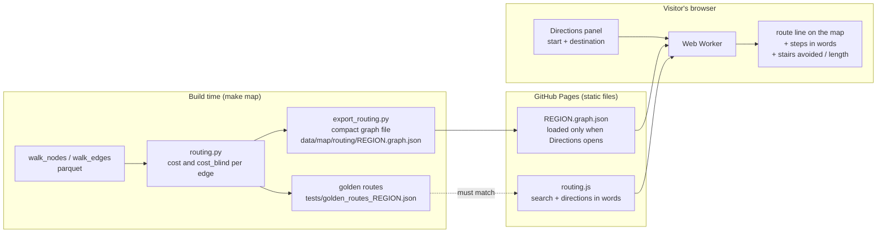

# Implementation guide: route from any place to any place, in the browser

Status: **plan only, not started.** Written 2026-11-20. Nothing in this guide has been built or measured yet; sizes and timings are estimates until Phase 1 and Phase 5.

## 1. Goal

On the map, a visitor picks a **start** and a **destination** and gets a step-free walking route drawn on the map, with directions in words, like a walking route in Google Maps. It must keep what makes our routing different:

- no stairs, ever;
- steep sections, rough surfaces, raised kerbs and streets with no sidewalk cost extra;
- a **blind / low-vision** option that prefers signalled, audible crossings;
- the honest note: "Computed from OpenStreetMap paths and USGS elevation; not checked on site."

## 2. What exists today

| Piece | Where | Note |
|---|---|---|
| Route search and directions | `src/atlas/routing.py` (`route()`, `penalty()`, `blind_penalty()`, `_legs()`, `_describe()`) | Python, networkx. Runs only at build time |
| Walking network | `data/processed/<region>/walk_nodes.parquet`, `walk_edges.parquet` | Oxford: 21,637 nodes, 25,436 edges. Cincinnati: 190,174 nodes, 216,680 edges |
| One route per place | `src/atlas/export_map.py` (`_route`, around line 1386) | Bus stop to the place's accessible entrance, saved in the place's `getting_there.route` |
| Route drawing | `showRoute()` in `src/atlas/map_viewer.py` | Draws a saved route line with Leaflet |
| "Near me" | `setHere()`, `locate()` in `map_viewer.py` | Gives the visitor's position |
| Map build | `make map` (`python -m atlas.cli map`) | Writes `data/map/*.html`, served by GitHub Pages |
| Existing tests | `tests/test_routing.py`, `tests/test_report_ui.py` (Playwright) | |

**The gap:** the maps are static pages, so nothing can run Python when a visitor clicks. Today's "Directions" link opens Google Maps instead.

## 3. The approach

Do the search **in the visitor's browser**. At build time, Python exports the walking network with the costs already worked out. The browser loads it, finds the cheapest path, and writes the directions.

Python keeps all the *rules* (the penalties). JavaScript only does the *search and wording*. This is deliberate: if the penalty rules lived in two languages they would drift apart.



## 4. Experience design (the quality bar)

Goal: **simple to use, and it works very well.** Simple means few choices and plain words. Works well means it is fast, it never fails silently, and it is usable with a keyboard, a screen reader, a phone, and one hand. Our visitors include wheelchair users and blind or low-vision users, so accessibility is the main requirement, not a polish step.

### 4.1 Principles

1. **Two taps to a route.** From any place card, "Route here" gives a route with the start already filled in. Everything else is optional.
2. **The words are the product.** The list of steps is the main result. The map line is a companion. Everything on the map is also in the text.
3. **Safe by default.** Stairs are never offered. The shortest way is only shown as information ("The shortest way uses 2 stairways, so it is not shown").
4. **Say how sure we are.** Every route carries "Suggested from map data, not checked on site", and a Report a problem button sits next to the result.
5. **Never a dead end.** Every error says what happened and what to do next.
6. **Fast and quiet.** No page jumps, no surprise permission prompts, nothing downloaded until the visitor asks for directions.

### 4.2 The main flow

```
 Place card ──[Route here]──▶ Directions panel opens
                               From: My location  (asks permission only now)
                               To:   King Library (filled in)
                                      │
                    location allowed? ├─ yes ─▶ route found in about a second
                                      └─ no  ─▶ "Pick a start": choose a place,
                                                 tap the map, or type a place name
                                      │
                                      ▼
                            Result: summary + steps + map line
                            [Wheelchair | Blind or low vision]  [Swap]  [Copy link]
```

Other entry points: the **Directions** button in the header (empty panel), and a shared link such as `#route=<from>,<to>&profile=wheelchair` (matches the existing `#place=` links).

### 4.3 Layout

Desktop (the panel replaces the place list while open; a Back link returns to the list):

```
┌───────────────────────────┬──────────────────────────────────────────┐
│ ← Back to places          │                                          │
│ Directions                │                                          │
│ ┌───────────────────────┐ │             MAP                          │
│ │ ● From  My location ▾ │ │      ●━━━━━┓                            │
│ │ ⇅                     │ │            ┃  (route: white outline,     │
│ │ ◼ To    King Library  │ │            ┗━━◼   blue line, big dots)   │
│ └───────────────────────┘ │                                          │
│ (•) Wheelchair            │       ▲ steep   ⚠ unmarked crossing      │
│ ( ) Blind or low vision   │         (icons sit on the route)         │
│                           │                                          │
│ 6 min · 0.2 mi           │                                          │
│ ✓ No stairs              │                                          │
│ 1 crossing, with signal  │                                          │
│ Suggested from map data, │                                          │
│ not checked on site.     │                                          │
│                           │                                          │
│ 1. Head northeast on the  │                                          │
│    sidewalk, 60 feet      │                                          │
│ 2. ⚠ Cross at the signal  │                                          │
│    50 feet (no audible)   │                                          │
│ 3. ...                    │                                          │
│ [Copy] [Google Maps]      │                                          │
│ [Report a problem]        │                                          │
└───────────────────────────┴──────────────────────────────────────────┘
```

Phone (bottom sheet with three heights: **summary**, **steps**, **full**; the map stays visible above it):

```
┌───────────────────────┐        ┌───────────────────────┐
│        MAP            │        │        MAP            │
│    ●━━━┓              │        │    ●━━━┓              │
│        ┗━━◼           │        │        ┗━━◼           │
├───────────────────────┤        ├───────────────────────┤
│ ───                   │        │ ───                   │
│ 6 min · 0.2 mi        │        │ 6 min · 0.2 mi  ✓ No  │
│ ✓ No stairs · 1 cross.│        │ stairs                │
│ [Steps ▲]  [Change]   │        │ 1. Head northeast...  │
└───────────────────────┘        │ 2. ⚠ Cross at signal  │
        summary                  │ 3. ...                │
                                 └───────────────────────┘
                                          steps
```

### 4.4 Details that make it feel good

- **Start and destination fields:** one search box each, a proper combobox (type to filter the map's places, arrow keys, Enter). Options also include "My location" and "Pick on map". Free address search is **not** included by default, because it would send what people type to an outside service (see Phase 0).
- **Swap button** between the fields, and a clear (x) button in each.
- **Route summary first:** time, distance, "No stairs", crossings in plain words ("1 crossing, with a traffic signal"). Time is an **estimate at a stated pace**, shown as "about 6 min at a typical wheelchair pace", never as a promise.
- **Steps, not paragraphs:** each step is one short line with a small icon for the action (straight, left, right, cross). Warnings (steep section, no sidewalk, unmarked or non-audible crossing) get a warning icon **and** the word "Caution", so colour is never the only signal.
- **Tap a step, see it:** selecting a step zooms the map to that part of the route. Previous and Next buttons step through them.
- **The map line:** white casing under a dark blue line so it reads on the grey basemap; large start and end markers with labels; small icons on the route for steep sections and crossings; the map fits the route with padding for the panel, so the route is never hidden under it.
- **Honest comparison line:** "About 120 feet longer than the shortest way, to avoid 2 stairways."
- **Blind or low vision option:** prefers signalled, audible crossings; steps say whether each crossing has a signal, an audible signal, and tactile paving; steps are written to be read aloud.
- **Remembers the choice** of Wheelchair or Blind or low vision (local only, optional, never required).
- **Copy directions** as plain text, **Copy link**, and **Open in Google Maps** as a second opinion.
- **Report a problem** is one tap from the result and pre-fills the route.
- **Loading:** the walking-network file starts downloading when the visitor focuses or hovers the Directions button, and the panel says "Loading walking map…" if it is not ready. It is cached by the browser after the first time.
- **Calm motion:** no animation for people who ask for reduced motion.

### 4.5 States to design and test

| State | What the visitor sees |
|---|---|
| Empty | Both fields empty, with one-line help: "Choose where you are starting and where you are going." |
| Loading map data | "Loading walking map…" with a progress hint; fields still usable |
| Location asked | Short explanation first, then the browser prompt; "Not now" keeps going |
| Location denied or unavailable | "We could not find your location. Choose a start instead." Focus moves to the From field |
| Searching | "Finding the easiest step-free route…" (live region) |
| Route found | Summary, steps, map line; focus moves to the summary heading |
| Start or end far from a mapped path | "That point is more than 500 feet from a mapped path. Try a point on a sidewalk or street." |
| No step-free route | "We found no step-free route between these points in the map data. Stairs or a missing sidewalk may be in the way. Try a different start, or call ahead." Report button offered |
| Same start and end | "You are already there." |
| Graph file failed to load | "We could not load the walking map. Try again, or open this in Google Maps." Retry button |
| Place has no mapped accessible door | Route ends at the map point, with the existing "no accessible door is mapped" note shown in the steps |

### 4.6 Accessibility requirements (must pass, not nice to have)

- Full keyboard use, with a visible focus ring and no keyboard traps. Escape closes the panel and returns focus to the button that opened it.
- Screen readers: the combobox follows the standard pattern; results are announced through a live region; the steps are a real ordered list; focus goes to the summary heading when a route appears.
- Targets at least 44 by 44 px; body text at least 16 px; works at 200% zoom and in landscape; no horizontal scrolling at 320 px wide.
- Contrast at least 4.5 to 1 for text and 3 to 1 for the route line and icons, in light mode and in forced-colours mode.
- Nothing depends on colour alone; every icon has a text label.
- Respects `prefers-reduced-motion`.
- Does not need a mouse or the map: a person can get a full route using only the fields and the list.

### 4.7 Performance targets (measured, not assumed)

| Measure | Target (Oxford) |
|---|---|
| Directions panel opens | under 100 ms |
| Walking map downloaded (first time, compressed) | under 2 MB |
| First route after download | under 1 second on a laptop, under 2 seconds on a mid-range phone |
| Page stays responsive while searching | yes (Web Worker) |

## 5. Step-by-step plan

Work on a branch named `feature/browser-routing`. Do the phases in order; each ends with something you can check.

### Phase 0: decisions (before any code)

Confirm these with Mariam:

1. **Oxford first, Cincinnati after** measuring size and speed. Default: yes.
2. **Place of the code:** a new file `src/atlas/web/routing.js` embedded into the map page by a placeholder in the template, the same way `__REPORT_JS__` is embedded. Default: yes.
3. **Start choices** for the panel: a place from the list, a tap on the map, "my location". Default: all three.
4. **Destination point:** use the place's accessible entrance when one is mapped (same rule as `export_map.py`), otherwise the place's map point with the existing "no accessible door is mapped" note. Default: yes.
5. **Address search:** a free-text address box needs an outside geocoding service (for example OpenStreetMap's Nominatim or Photon), which would receive what people type. Default: **no**; start and destination are places from the map, a tap on the map, or "My location". Revisit after the first usability test.
6. **Time estimate:** show "about N min" at a stated pace (default 2.5 mph, written on screen). Default: yes, labelled as an estimate. The pace is a guess until we find a source or ask users.
7. **Mockup approval:** I produce clickable mockups of the panel (desktop and phone, all states in section 4.5) and Mariam approves them before Phase 4 starts. Default: yes.

### Phase 1: export the graph (Python)

New file `src/atlas/export_routing.py`, plus a `routing` step in `atlas.cli` and in `make map`.

1. Load the network with `routing.network(region)` (it already applies kerb flags and drops duplicate edges).
2. For each edge write what the browser needs, and **nothing else**:
   - endpoints `u`, `v` (as array indexes, not OSM ids);
   - `len` (metres, 1 decimal);
   - `cost` and `cost_blind` (already include every penalty; stairs are `null` = "never use");
   - class code for wording: footway, sidewalk, crossing, path, pedestrian, service, cycleway, road, other;
   - a street-name index into a shared `names` list (this includes the "the X sidewalk" names from `_name_sidewalks`);
   - flags: `steep` (grade above 8.33%), `maxgrade`, `roadNoSidewalk`, `stairs`, `raisedKerb`;
   - crossing info (only for crossing edges): kind, signals, audible, tactile.
3. Write nodes as integer coordinates (degrees times 1e6), delta-encoded.
4. Keep stair edges in the file with `cost = null`. They are needed for the "avoids N stairways" comparison against the shortest route.
5. Write `data/map/routing/<region>.graph.json`, gzip-friendly (GitHub Pages compresses it on the wire).
6. **Print the file size** (raw and gzipped). Budget for Oxford: under 2 MB gzipped. If Cincinnati is far larger, see Phase 8.
7. Also write `tests/golden_routes_<region>.json`: 20 start/destination pairs run through the Python `routing.route()`, with the full output (path, `length_feet`, `directions`, `compared_with_shortest`, `crossings_text`) for both profiles. Include at least one pair that avoids stairs, one with crossings, one that fails (too far from the network), and one where the destination is only reachable by stairs.

**Done when:** the Oxford file exists, its size is printed, and the golden file has 20 pairs.

### Phase 2: the search (JavaScript)

New file `src/atlas/web/routing.js`. Pure functions, no map code, so it can be tested alone.

1. `loadGraph(json)`: build typed arrays and an adjacency list.
2. `snap(lat, lon)`: nearest node using a simple grid index. Refuse if the nearest node is more than **150 m** away (same rule as Python).
3. `findPath(a, b, profile)`: A* with a binary heap. Use `cost` for the wheelchair profile and `cost_blind` for the blind profile. Skip edges whose cost is `null`.
4. `shortestPath(a, b)`: the same search on `len`, stairs allowed, for the comparison sentence.
5. Return `null` when there is no step-free path.

**Done when:** `node --test` (Node 22 is installed) passes a test that loads the Oxford graph and reproduces the **node path** of every golden route.

### Phase 3: directions in words (JavaScript)

Port, line for line, from `routing.py`: `_legs`, `_turn`, `_bearing`, `_feet`, `_crossing_words`, `_describe`, `_summary`, `_crossing_counts`, `crossing_sentence`, and the "compared with the shortest" sentence.

Rules for the port:

- Same constants: 8.33% ramp limit, 8 m leg-folding threshold, 30/60/150 degree turn thresholds, compass names.
- Match the Python rounding exactly (`_feet` rounds to 10 feet under 1000 feet).
- Do not "improve" the wording here. Any wording change is made in Python first, then the golden file is regenerated.

**Done when:** the Node test compares `directions`, `length_feet`, `compared_with_shortest` and `crossings_text` to the golden file with exact string equality for all 20 pairs and both profiles.

### Phase 3b: mockups, approved before building the UI

Make a static, clickable HTML mockup (no routing, fake data) of the panel on desktop and on a phone, covering every state in section 4.5. It follows the existing map's colours and fonts. Show it to Mariam. **Do not start Phase 4 until she approves or changes it.** The mockup is also the first thing to try with a screen reader.

### Phase 4: the Directions panel (map UI)

Build exactly what section 4 and the approved mockup describe. Edit `src/atlas/map_viewer.py` (template and a new CSS block). Reuse `showRoute()` drawing and `setHere()`.

1. Add a **Directions** button and panel: *From* and *To* fields (searchable lists of the map's places), a "Use my location" button, a "Pick on map" button, a swap button, and a **Wheelchair / Blind or low vision** choice.
2. Load the graph file **only when the panel first opens**, with a status message ("Loading walking map…"). If loading fails, say so in words and keep the old Google Maps link as a fallback.
3. Run the search in a **Web Worker** so the page never freezes. Build the worker from the embedded `routing.js` text (a Blob), so there is still no extra file to host except the graph.
4. Show the result: route line on the map, a one-line summary (length, stairs avoided, crossings), numbered steps in a list, and the "not checked on site" note.
5. Keep the existing "Directions" link on each place card, now labelled "Route here" and prefilled with the destination, and keep a "Google Maps" link as a second option.
6. Update the live status region (`#status`) so screen readers hear the route summary.

Accessibility requirements (the list is the main interface for many users; do not regress it):

- every control has a real label; keyboard-only use works end to end; focus moves to the steps list after a route is found;
- the steps are plain text in an ordered list, not only drawn on the map;
- errors are in words: "No step-free route found", "That point is more than 500 feet from a mapped path", "Could not load the walking map";
- buttons at least 44 px tall, 16 px text, nothing relies on colour alone;
- works at phone width.

**Done when:** the panel works in a browser on the Oxford map for all three ways of picking a start.

### Phase 5: tests

1. **Python:** a test that `export_routing` output is deterministic, has no `NaN`, and every edge's endpoints exist.
2. **Node parity test** (`node --test`): the golden comparison from Phases 2 and 3. Add this to `make test`.
3. **Browser test** with Playwright, in the style of `tests/test_report_ui.py`: open the Oxford map, open Directions, choose two places, assert a route layer exists and the steps list has items; test the failure messages; test keyboard-only use; test a phone-sized viewport.
4. **Timing and size**, recorded in the progress log and compared with section 4.7: graph size (raw and gzipped), parse time, and search time for a short and a long route, on a normal laptop and with CPU throttled 4 times.
5. **Automated accessibility checks:** run axe-core inside the Playwright tests on every state in section 4.5, in light mode and forced-colours mode; check focus order and that focus returns where it should; check 320 px width and 200% zoom.
6. **Real devices:** an iPhone with Safari and an Android phone with Chrome, plus VoiceOver on a Mac. I cannot do the real-device and screen-reader checks myself; they need Mariam or a tester.

**Done when:** all tests pass from a clean clone, the numbers are written down, and nothing in section 4.6 fails.

### Phase 5b: usability test with real people

Ask 3 to 5 people to try five tasks without help: (1) route from a place to another, (2) route from "my location", (3) switch to the blind or low-vision option and find the crossing details, (4) understand a "no step-free route" message, (5) report a wrong route. Ideally at least one wheelchair user and one screen-reader user (Miami's Student Disability Services or a campus group may help; ask the professor first). Record where they hesitate, what they misread, and how long each task takes. Fix the top problems before publishing. This is a small pilot, not a study, and its results are described that way.

### Phase 6: build and docs

1. Add the routing export to `make map` so the graph is rebuilt with the maps.
2. Update `data/map/README.md`, the root `README.md`, and `docs/architecture.md` (one new box in the diagram).
3. Add a short "Directions" section to the in-app Help text.
4. Add a line to `docs/progress_log.md` with what was built, what was measured, and what was **not** checked.

### Phase 7: review before publishing

1. Run `ruff check` and `ruff format`, the full test suite, and `/code-review`.
2. Try 10 real routes by hand in the browser and compare each to the Python output and to what you know of the streets. Write down any route that looks wrong (usually a missing sidewalk or curb ramp in OpenStreetMap, not a code bug).
3. Push the branch. **Do not merge or open a pull request until Mariam says so.**

### Phase 8: Cincinnati (only after Oxford works)

The Cincinnati network is about 9 times larger. Decide with the Oxford numbers:

- **Contract the graph:** merge chains of nodes that only continue straight (degree-2 nodes) and keep their shape as a short polyline. This usually cuts size by half or more.
- **Split into tiles:** for example 4 to 6 area tiles, loading only the tiles a route crosses. More work, only if needed.
- **Fallback:** if it is still too slow on phones, keep Cincinnati on the old per-place bus-stop routes and say so.

Set a limit before starting: Cincinnati graph under about 8 MB gzipped, route found in under 2 seconds on a mid-range phone. If it cannot meet that, the answer is a small routing server (a separate project with hosting cost), not a slower page.

## 6. Risks and how the plan handles them

| Risk | Handling |
|---|---|
| Python and JavaScript give different directions | Golden-file tests with exact string equality; wording changes only in Python first |
| Penalty rules drift | Penalties are computed only in Python and exported as `cost` / `cost_blind` |
| Graph file too large for Cincinnati | Measure first (Phase 1 step 6); contract or tile (Phase 8) |
| Page freezes during search | Web Worker; loading message |
| Visitor trusts a route that is wrong (missing sidewalk or curb ramp in OpenStreetMap) | The "not checked on site" note stays on every route; wording says "suggested"; the Report a problem button is next to the result |
| Visitor's location is private | Location is used only in the browser to pick a start; nothing is sent anywhere |
| Start or destination far from any mapped path | Refuse beyond 150 m with a clear message |
| Break existing map features | Panel is additive; keep the old Google Maps link; run the existing Playwright tests |

## 7. Out of scope for now

Live turn-by-turn navigation while walking; bus or transit routing; indoor routes; more than two stops; saving routes; any server.

## 8. Checklist

- [ ] Phase 0 decisions confirmed
- [ ] Phase 1 graph export + golden file (Oxford), size printed
- [ ] Phase 2 search passes Node test
- [ ] Phase 3 directions pass exact-match test
- [ ] Phase 3b mockups approved by Mariam
- [ ] Phase 4 Directions panel
- [ ] Phase 5 tests and measurements, accessibility checks
- [ ] Phase 5b usability test with real people, top problems fixed
- [ ] Phase 6 build, docs, progress log
- [ ] Phase 7 review; push branch (no merge)
- [ ] Phase 8 Cincinnati decision
