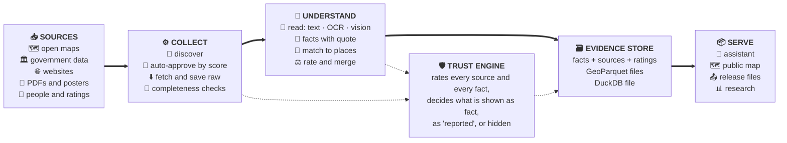
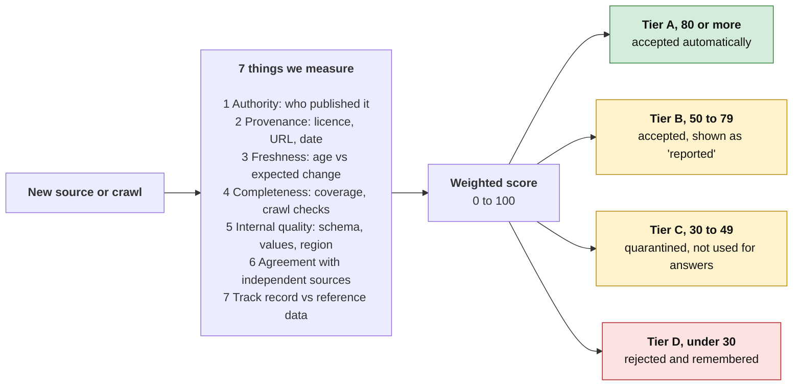
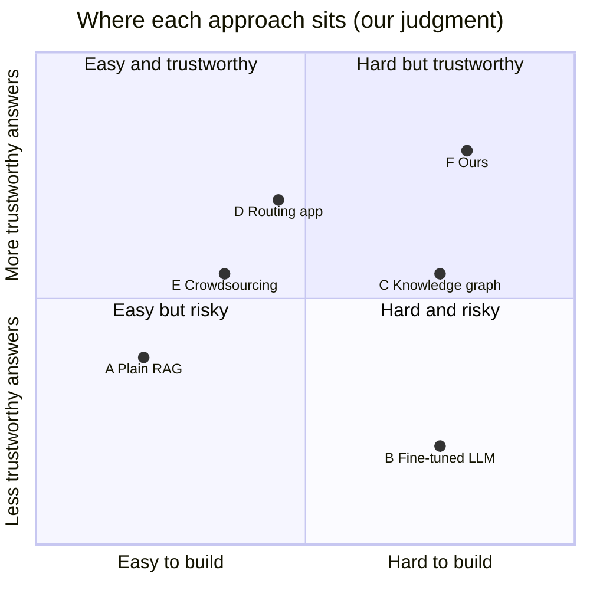

# System overview: how it works, how it is rated, and how it compares

**The one file to read first.** It explains the whole system in plain words, with diagrams, the automatic data-rating scheme, pros and cons, and a comparison with other architectures. Details live in the linked docs; this file does not copy them. Status: design (nothing here is approved until you say so). Updated 2026-11-15.

Contents: 1 What it is · 2 System diagram · 3 How it works, step by step · 4 Automatic rating (no hand checking) · 5 The assistant · 6 Pros and cons · 7 Comparison with other architectures · 8 Where we stand today · 9 Terms · 10 Open questions · 11 Where the details are

---

## 1. What it is

A **fact engine for wheelchair accessibility plus an assistant that answers from it**. It collects accessibility information about places and routes from many kinds of sources (maps, government data, websites, PDFs, posters, people), turns each piece into a **fact that keeps its source, quote and date**, rates how far each fact can be trusted, merges conflicting facts, and serves the result to the assistant, to a public map and to another lab team's app.

Constraints that shape every choice: **whole-country goal**, **no budget** (free tools, local models), **no one can hand-check the data**, and **other people consume the data**, so formats must be stable.

---

## 2. System diagram

The **trust engine** replaces human review. It runs at three points: before a source is accepted, while facts are extracted, and when facts are merged.

---

## 3. How it works, step by step

| Step | What happens | Free tool | Details |
|---|---|---|---|
| 1 Discover | find sources for a region automatically: open-data catalogs, government sites, venue websites from OSM and Overture, a few hand-run searches | catalog APIs, sitemaps, Wayback and Common Crawl indexes | `national_data_plan.md` 3.2 |
| 2 Approve | the trust engine scores each candidate source; high scores are accepted automatically, middle scores are accepted with limits, low ones are dropped | rules, local model | section 4 below |
| 3 Fetch | download everything exactly as received, with date and hash; pages needing JavaScript use a headless browser; every URL gets a final status | Playwright, requests | plan 3.4 |
| 4 Check completeness | six checks compare what we got with independent measures; gaps are queued and retried | scripts | `architecture.md` 9 and 10 |
| 5 Read | text, tables, PDFs, OCR for scans, a vision model for maps and posters, cheap rules first and local models only on relevant pages | PyMuPDF, Tesseract or PaddleOCR, local models | plan 3.5 |
| 6 Make facts | every claim becomes a fact with its quote (or image region), source, date, method; claims whose quote is not in the source are thrown away | scripts | `data_design.md` |
| 7 Match | link each fact to the right real place by name and location | DuckDB spatial, OSM and Overture backbone | plan 3.6 |
| 8 Rate and merge | combine facts about the same thing, weigh by trust, flag conflicts, record "unknown" honestly | scripts | section 4 |
| 9 Serve | release files, DuckDB knowledge base, map pages, assistant | GeoParquet, DuckDB | `architecture.md` 5 |

One fact's journey (zoo example) is in `architecture.md` section 1b.

### 3b. Where the data lives: database or files?

Both, in layers. Short answer to "are we not storing data in a database": **yes, DuckDB is our database**, built on top of files that are the permanent record.

| Layer | What it is | Role |
|---|---|---|
| Raw files (`data/raw`) | pages, PDFs, images, API responses exactly as received, with date and hash | permanent record; lets us re-read with a better model |
| Parquet and GeoParquet (`data/processed`) | cleaned entities, observations and documents, including every past value (history) | **the source of truth**; portable, so the other team can read it without our code |
| **DuckDB database** (`data/kb/atlas.duckdb`) | tables for places, facts and events that the assistant queries with SQL, including distance and filters | the working database; DuckDB reads Parquet directly, so history is queryable there |
| Supabase (hosted) | visitor ratings from the map | the only live, multi-user store |
| Release files | a versioned copy of the Parquet tables plus dataset cards | what we hand to the other team |

Today the DuckDB file is rebuilt from the published map data (`make kb`), rather than written to live. That is deliberate: DuckDB allows one writer at a time, and files can be shared and re-created. The earlier remark about disk use concerned the raw archives (hourly feeds, page snapshots), not the database. If you want the database to be the primary store (live writes, history inside it), we can switch, at the cost of portability and with a server database (PostGIS) once several people write at once. See D-05.

---

## 4. Automatic rating: no hand checking needed

You cannot check data by hand, so **the system rates everything itself**. This does not prove a fact is true; it measures how believable the evidence is, and it makes the assistant honest about the difference.

### 4.1 Rate the source (0 to 100)

Authority levels (highest first): official inventory or data layer, official website, venue's own statement, trusted open dataset, crowd data, lived-experience text, unknown. The starting weights are a judgment call and will be tuned from the "track record" part once we have reference data.

### 4.2 Rate each fact (0 to 1)

`fact confidence = source score × extraction reliability × freshness decay × corroboration − conflict penalty`

- **Extraction reliability** (for facts read from text or images) comes from checks the machine can do alone:
  1. **Quote check:** the quoted words must actually appear in the saved source. If not, the fact is dropped.
  2. **Double extraction:** run the extraction twice with different prompts or models; facts that disagree are lowered.
  3. **Entailment check:** a separate small model asks "does this quote really support this fact?" and gives a score.
  4. **Sanity rules:** plausible ranges (slope, width), consistent units, the place exists, the date is real.
- **Freshness decay:** older facts count less, with different speeds (a 2016 ramp survey decays slower than a closure notice).
- **Corroboration:** two independent sources that agree raise confidence. "Independent" matters: sources that copy each other count once.
- **Conflict penalty:** disagreeing sources are kept, the more reliable one is preferred, and the conflict is flagged.

Shown to the user as: **✅ confirmed** (high), **🟡 reported** (medium, says who said it and when), **❓ unknown** (nothing believable). Low-confidence facts are never stated as fact.

### 4.3 How the system checks itself without people

| Self-check | What it catches |
|---|---|
| **Reference data:** official inventories (for example DC's and Cincinnati's curb-ramp layers) and the lab's wheelchair-recorded data act as "silver" ground truth to measure each source's accuracy | sources that are systematically wrong |
| **Cross-source agreement** | a source that disagrees with everyone else |
| **Question-bank test:** the 44 questions with known answers run after every build | regressions after a change |
| **Planted tests:** insert known true and false facts and see whether the pipeline keeps or rejects them | a rating scheme that is too lenient or too strict |
| **Drift alerts:** a source's score drops sharply or its coverage shrinks | sites redesigned, data removed |
| **Honest coverage report** per region and attribute | hidden gaps |

### 4.4 Limits to accept

- Automatic rating measures *consistency and credibility*, not truth. A venue that wrongly says "accessible" on its own website will score well. Corroboration and reference data reduce this, they do not remove it.
- Weights start as educated guesses. They improve only as reference data accumulates.
- A tiny one-time labelled set (about 100 facts) would greatly improve calibration even if no one reviews data regularly. We can build it automatically from official datasets and the lab's recordings, and it counts as "silver", not perfect.
- The assistant must show uncertainty and sources. For a safety-relevant question with only "reported" evidence, it should say so and suggest calling ahead.

---

## 5. The assistant

A **tool-using agent**: it asks structured questions of DuckDB with tools (`locate`, `find_places`, facts about a place), searches text passages for open questions, and writes the answer only from what comes back, with source, date and confidence. At $0 the model is a local open model. Diagram: `architecture.md` section 6. Reasoning: decisions D-02 and D-05 in `decisions.md`.

---

## 6. Pros and cons of our design

**Pros**
- **Honest about uncertainty:** facts carry source, quote, date and a rating; "unknown" is a real answer. This directly serves safety.
- **Scales by configuration:** a new region is a config entry plus discovery, not new code.
- **No budget needed:** free data, free tools, local models, cheap-first processing.
- **Explainable and auditable:** any answer traces to a quote or a source row.
- **Reusable by others:** the evidence store is a documented file release, independent of the assistant.
- **Handles conflicting sources** instead of hiding them.
- **Multimodal:** posters, PDFs and maps count, not just text.
- **Research value:** the rating and fusion are themselves publishable (source trust, missing data, harm-weighted evaluation).

**Cons and risks**
- **Automatic rating is not truth.** Confidently wrong sources can pass; mitigated, not solved.
- **Local models are weaker** than frontier models: more extraction errors, slower, needs a GPU or patience.
- **Coverage is uneven.** Obscure venues without websites stay unknown; places without OSM or Overture records are not found by place-driven discovery.
- **Complex:** many moving parts (crawl, extraction, matching, fusion, rating) to build and maintain with a small team.
- **Legal gray zones:** scraping, licences (share-alike data), and restricted APIs need care.
- **Freshness is hard:** conditions change; we can only mark age, not know today's state.
- **Files, not a live service,** for the other team in v1.
- **Heavy first-time effort** before the assistant looks impressive.

---

## 7. Comparison with other architectures

The options are generic patterns, not products. Scores are **our judgment** (● strong, ◐ partial, ○ weak), not measurements.

| Criterion | A. Plain RAG over scraped text | B. Fine-tuned LLM (the NYC predecessor's plan) | C. Knowledge graph + GraphRAG | D. Routing or map app only | E. Crowdsourcing first | **F. Ours: evidence store + rated facts + agent** |
|---|---|---|---|---|---|---|
| Answers location questions ("nearest, within 500 m") | ○ | ○ | ◐ | ● | ◐ | ● |
| Shows source, quote and date | ◐ | ○ | ◐ | ◐ | ◐ | ● |
| Rates and handles conflicting sources | ○ | ○ | ◐ | ○ | ◐ | ● |
| Says "unknown" instead of guessing | ○ | ○ | ◐ | ◐ | ◐ | ● |
| Works at $0 | ● | ○ (training cost) | ◐ | ● | ● | ◐ (local models) |
| Scales to the whole country | ◐ | ◐ | ◐ | ◐ | ○ (needs many contributors) | ● (config-driven) |
| Uses PDFs, posters, images | ◐ | ◐ | ◐ | ○ | ○ | ● |
| Easy to maintain | ● | ○ | ○ | ◐ | ◐ | ○ |
| Reusable data for other teams | ○ | ○ | ◐ | ◐ | ◐ | ● |
| Risk of confident wrong answers | high | high | medium | low (narrow) | medium | lower, not zero |

How to read it:
- **A. Plain RAG** is simplest, but it cannot do distance or filters and cannot say how much to trust a passage. We keep retrieval as one tool inside the agent.
- **B. Fine-tuned LLM** bakes facts into model weights: no sources, stale as soon as data changes, costly. The NYC project aimed at this; we deliberately do not.
- **C. Knowledge graph** models relations well (place connects to entrance connects to path) and is a candidate for later. Our entity and observation tables are a light version of it; a graph database adds complexity we do not need yet.
- **D. Routing apps** (for example the OpenSidewalks and AccessMap family) are strong on paths but narrow: little on venues, interiors, events or text sources.
- **E. Crowdsourcing first** (Wheelmap, AXS Map style) gives fresh, lived detail but depends on volunteers and uneven coverage. We use crowd data as one rated source and keep our own ratings.
- **F. Ours** is the most work to build, and it is the only one that combines location queries, provenance, conflict handling and honesty about gaps.

Our position: we accept a harder build to get trustworthy, explainable answers. If time runs short, the fallback is "F-lite": the evidence store and tools for the two regions, with simple rules for ratings, which already beats A to E on honesty.

---

## 8. Where we stand today

| Part | Status |
|---|---|
| Cincinnati and Oxford data (maps, 311, transit, slope, venue facts with quotes, posters, events) | ✅ built |
| Map and text pages (GitHub Pages) | ✅ built |
| DuckDB knowledge base and four lookup tools; tools-only evaluation 29/29 | ✅ built |
| Visitor ratings (Supabase) | ✅ built |
| Region resolver (Census and OSM) for new regions | 🔵 planned |
| Automatic discovery (catalogs, gov crawl, place-driven) | 🔵 planned |
| Trust engine (source and fact rating): scores, tiers, caps, fact confidence | ✅ built, version 0 (`trust.py`, `config/trust.yaml`); agreement and track record not measurable yet |
| Completeness checks and gap queue | 🔵 planned |
| Multimodal extraction with local models | 🔵 planned (partly done by hand for posters) |
| Entity matching and fusion | 🔵 partly (place matching exists) |
| Dataset cards for every source and region; schema v2 with history; raw-fetch manifest; candidate-source table | ✅ built, version 0 (`make cards`, `make candidates`); release packaging still planned |
| Agent loop with a local model | 🔵 planned |
| Maryland, DC, Dayton data | 🔵 planned; first sources identified in `source_types.md` |

---

## 9. Terms

- **Entity:** a real thing: a place, path segment, curb ramp, bus stop, event.
- **Observation / fact:** one statement about an entity (attribute, value) with source, quote, date, method, confidence.
- **Provenance:** where a fact came from and how.
- **RAG:** the model looks up text passages before answering. **Agent:** the model chooses and calls tools (queries, search) in a loop, then answers.
- **GeoParquet:** a compact file format for tables with locations. **DuckDB:** a database in a single file with no server.
- **Tier A to D:** how much a source or fact is trusted (section 4).
- **Silver ground truth:** reference data that is good but not perfect (official inventories, lab recordings).
- **Quarantine:** kept but not used to answer questions.

---

## 10. Open questions

1. Are the starting weights and the 80 / 50 / 30 tier cut-offs acceptable, or do you want them stricter?
2. Do you want the one-time labelled set (about 100 facts) built from official data, for calibration?
3. Is there a lab or university GPU we can use for local models?
4. Which formats does the other team want, and how often do they need updates?
5. Maryland: whole state or which counties; which other cities and what deadline?

---

## 11. Where the details are

| Topic | File |
|---|---|
| Full plan, phases, free-tool table | `national_data_plan.md` |
| Every diagram | `architecture.md` |
| Why each choice was made | `decisions.md` |
| Which source kinds, licences, DC / MD / Dayton findings | `source_types.md` |
| Attribute list (what users need) | `data_landscape.md` |
| All data we need, now and for computing and prediction; what to keep from day one | `data_needs.md` |
| Assistant tools and the 44-question bank | `assistant_design.md` |
| Research questions and study design | `research_questions.md`, `study_design.md` |
| Progress and findings | `progress_log.md` |
| Index of all docs | `README.md` |
| Web crawler: research, options, architecture, tests, phases | `crawler_plan.md` |
| Question categories and how to fetch each | `categories.md` (generated from `../config/categories.yaml`) |
| Source tracker (auto-updated after each fetch) | `source_inventory.md`, `../data/source_inventory.csv`, `../data/ledger/fetch_log.jsonl` |
